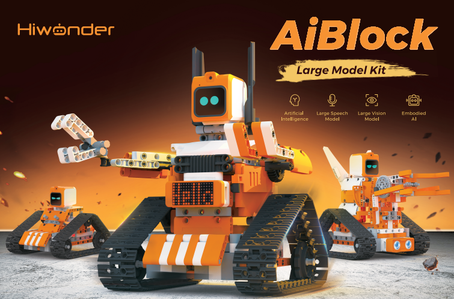
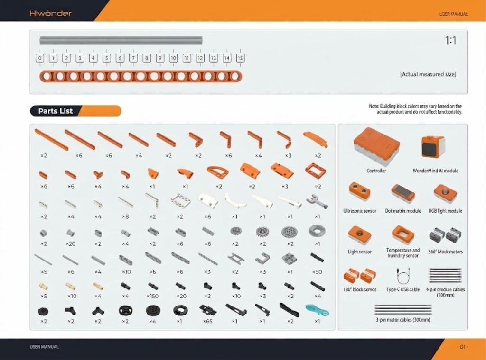

# 1. Kit Introduction

## 1.1 Kit Overview

The AiBlock Large Model Kit targets AI STEAM education for secondary students. This kit features the AiBlock controller at its core, with the WonderMind voice and vision large model module integrated alongside sensors, servo motors, and mechanical building block components. The kit includes WonderLab with both graphical and Python programming tools. The 16-lesson curriculum covers large model dialogue, voice interaction, image recognition, OCR text reading, and multi-robot model assembly. Students build and program projects that combine mechanical engineering with cutting-edge AI technology. This approach develops programming logic step by step, guiding learners from fundamentals to embodied AI practice for introductory STEAM literacy. The kit suits classroom instruction, after-school clubs, and home STEAM learning.

## 1.2 Kit Features

1. **Tiered Dual-Learning Approach**: The kit supports two distinct learning paths. Students build pure mechanical structures without a controller, or they program intelligent functions with the controller. Students with no prior experience start with hands-on building and progress gradually to coding, significantly lowering the threshold for STEAM entry. The system accommodates both classroom instruction and home-based practice.

2. **Integrated Controller**: Features the AiBlock Controller with dedicated ports for multiple servos, motors, and sensors, plus 2 programmable buttons and an onboard buzzer. Clearly marked port divisions and stable power output enable precise and simple hardware control.

3. **Complete Mechanical Building-Block Components**: Includes 500+ structural and transmission components covering more than ten mechanical systems, including gear drives, worm gears, crank linkages, rack-and-pinion mechanisms, fixed pulleys, and track drives. The variety of components supports free creative construction and develops hands-on skills and logical thinking.

4. **WonderMind Large Model AI Module**: Integrates voice and vision capabilities through a unified module, including speech recognition, voice synthesis, large language model conversation, image detection, and OCR text recognition. Abstract AI theory becomes tangible through physical robot applications, fully realizing multimodal human-robot interaction education.

   

5. **Dual Programming Tools**: Combines WonderCode drag-and-drop graphical programming with the Hiwonder Python editor. The graphical interface operates simply without complex code, supporting online real-time debugging and program upload. Advanced learners can switch to code mode, with programs synchronized to course cases at each level, developing computational thinking and code development skills in a tiered manner.

6. **Multi-Sensor Fusion Interaction**: The kit integrates ultrasonic, light-sensitive, temperature, and humidity sensors, supporting multiple interaction modes including distance measurement, light sensing, and environmental monitoring. Students progress from single-sensor control to multi-sensor coordinated decision-making, establishing a complete "sense, decide, act" intelligent system framework.

7. **Multi-Actuator Coordinated Control**: Integrates DC motors, 180° block servos, 360° block motors, RGB lights, dot matrix displays, buzzers, and more. It supports multi-dimensional feedback, such as speed control, angle positioning, color display, graphic animation, and sound effects, enabling synchronized linkage between mechanical movements and audio-visual effects to enhance the expressiveness and interactive experience of creations.

8. **Systematic Tiered AI Teaching Cases**: Includes a complete tiered AI teaching curriculum, progressing from AI foundational concepts, machine learning, and large model hands-on practice to integrated embodied intelligence projects. Aligned with elementary school Information Technology curriculum standards, theory combines with hands-on practice to reduce teacher preparation and teaching burden.

9. **Lightweight Portable Complete Kit**: Compact and lightweight with a moderate-size storage box. USB alone completes power supply and program upload, with Wi-Fi enabling AI module network connectivity. Suitable for classrooms, after-school clubs, home self-study, and robotics competitions.

## 1.3 Kit Specifications

|Name|Specifications|
| :--: | :--: |
|Brand|Hiwonder|
|Product model|AiBlock Large Model Kit|
|Programming software|WonderLab graphical programming, Hiwonder Python editor|
|Recommended age|8+|
|Electronic modules|WonderMind AI module, 180° block servo, 360° block motor, ultrasonic sensor, dot matrix module, RGB light module, light sensor, temperature and humidity sensor|
|Communication port|USB port|
|Number of building blocks|500+|
|Product materials|ABS|
|Product weight includes packaging|1.8 kg|
|Package dimensions|365 × 270 × 120 mm|

## 1.4 Packing List

