# 3. Teaching Case

## 3.1 Basic Concepts of Artificial Intelligence 

### 3.1.1 Lesson Introduction

Artificial intelligence stands at the core of today's technology landscape. It has already become deeply integrated into daily life, with applications visible everywhere: face-scan payments, voice assistants, smart recommendations, and Go-playing AI. Yet most people hold significant misconceptions about AI, often conflating it with robots or intelligent life forms.

This lesson serves as the foundational entry point. It deconstructs the essential nature of artificial intelligence from the ground up, compares traditional programs with AI, traces the origins and development of AI, and maps out its capability systems and hierarchical classifications. These elements build a complete foundational framework for understanding AI and prepare learners for subsequent topics, including AI recognition, AI training, and future developments in artificial intelligence. The lesson avoids complex technical terminology and relies on accessible explanations and concrete examples. Complete beginners can quickly grasp what artificial intelligence truly means.

### 3.1.2 Learning Objectives

1. **Cognitive Objectives**:  Clarify common misconceptions regarding artificial intelligence. Distinguish between AI, robotics, and intelligent life forms, and understand standard definitions and core capabilities.

2. **Knowledge Objectives**: Understand the development history, three major technical schools, and three core pillars of AI. Distinguish the operational logic of traditional programs from artificial intelligence.

3. **Skill Objectives**: Identify everyday AI applications and distinguish between the three AI tiers: weak AI, strong AI, and super AI.

4. **Literacy Objectives**: Build an objective perspective toward AI without overstatement or bias, fostering scientific and technological literacy.

### 3.1.3 Learning Practice

**(1) Core Definition of Artificial Intelligence**

Artificial intelligence, abbreviated as AI, carries this core meaning: through computers, sensors, and algorithmic programs, machines simulate and replicate human behavior patterns and thought processes.

&emsp;&emsp;In practical terms, this concept breaks down into two core capabilities:

&emsp;&emsp;**① Thinking like humans: Machines possess the ability to judge, analyze, and reason.**

&emsp;&emsp;**② Acting like humans: Machines perceive external environments and complete tasks autonomously.**

**(2) Five Core Simulation Capabilities of Artificial Intelligence**

The core logic of AI is replicating human intelligence. This corresponds to five core capabilities that cover the vast majority of AI application scenarios:

&emsp;&emsp;1. **Perception capability**: Corresponds to human visual and auditory senses. Core technologies include computer vision and speech recognition. Typical applications: face-scan payment, photo-based object identification, and speech-to-text conversion.

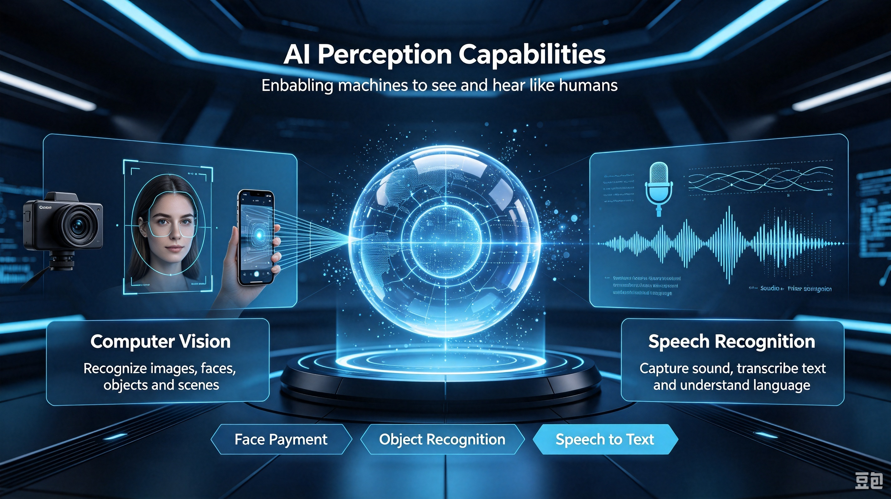

&emsp;&emsp;2. **Language comprehension capability**: Corresponds to human language communication abilities. Core technology is natural language processing. Typical applications: AI dialogue, machine translation, and intelligent copywriting.

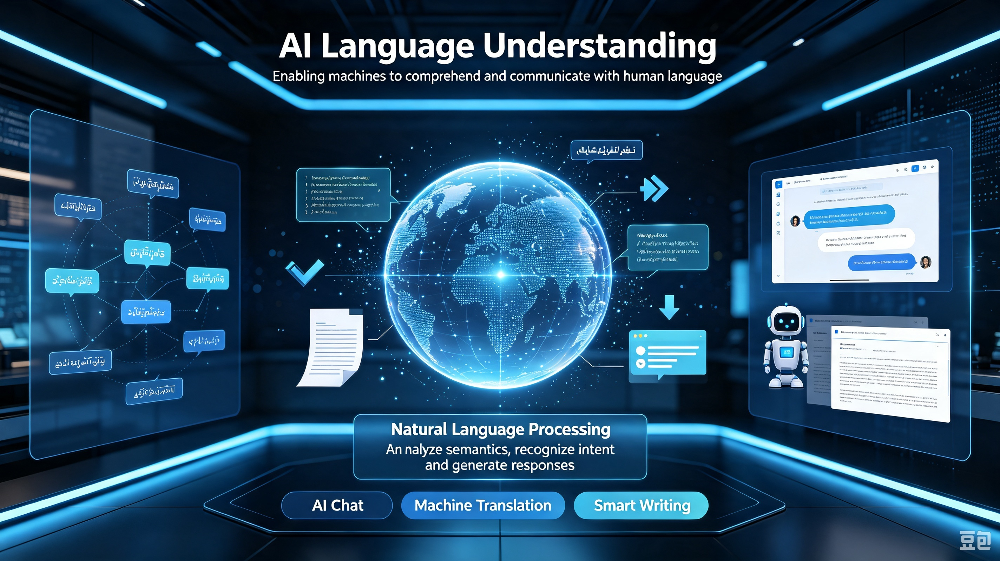

&emsp;&emsp;3. **Autonomous learning capability**: Corresponds to human abilities to accumulate experience and acquire new knowledge. Core technologies include machine learning and deep learning. A typical application is AI autonomously distinguishing cats from dogs through massive image datasets and continuously optimizing recognition accuracy.

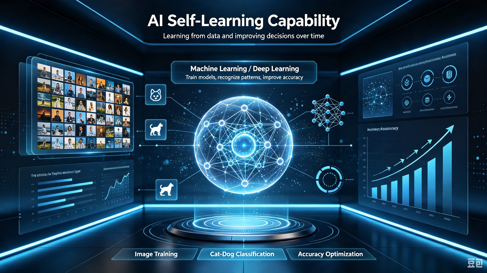

&emsp;&emsp;4. **Logical reasoning capability**: Corresponds to human logical thinking and analytical judgment abilities. This is implemented through algorithms and knowledge bases. Typical applications: AI mathematical problem-solving, intelligent retrieval, and case analysis assistance.

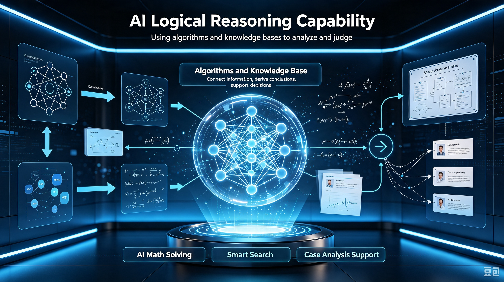

&emsp;&emsp;5. **Autonomous decision-making capability**: Corresponds to human judgment and choice abilities. Core technology is reinforcement learning. Typical applications: AlphaGo Go matches, autonomous driving obstacle avoidance, and intelligent route planning.

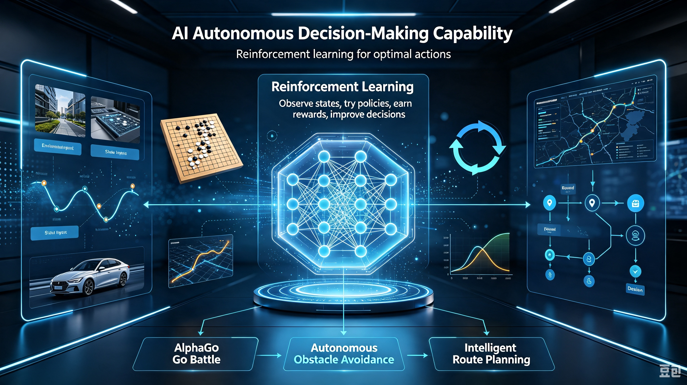

&emsp;&emsp;**In plain terms, AI systems possess the capabilities to listen, see, perceive, speak, act, and reason.**


**(3) Artificial Intelligence in Daily Life**

1. **Campus Classroom Scenario**

AI-powered interactive smartboard: Built-in image recognition and speech recognition AI enable voice-activated retrieval of courseware, automatic grading of multiple-choice questions, and conversion of handwritten board content to digital text. The system analyzes student response data to identify knowledge gaps and pushes corresponding exercises. These functions demonstrate core AI capabilities in data analysis and autonomous content adaptation.


2. **Home Living Scenario**

&emsp;&emsp;① Intelligent Robot Vacuum: Equipped with LiDAR and vision systems, the device autonomously maps an entire living space and detects obstacles such as furniture, shoes, and power cords. It dynamically adjusts suction levels based on floor conditions and logs optimal cleaning paths. With repeated use, the robot continuously refines its spatial mapping through autonomous learning.

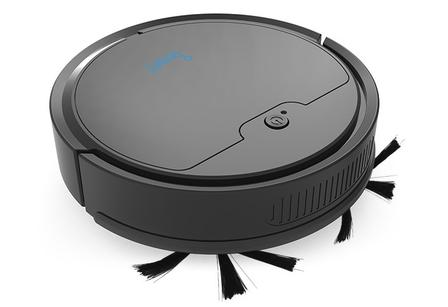

&emsp;&emsp;② Large-screen smart refrigerator: Built-in camera AI identifies ingredients inside the refrigerator, automatically records expiration dates, and pushes reminders. Based on stored ingredients, the system intelligently recommends recipes. Voice interaction through a connected smartphone enables remote temperature adjustment. These functions rely on image recognition and big data analysis to deliver intelligent services.

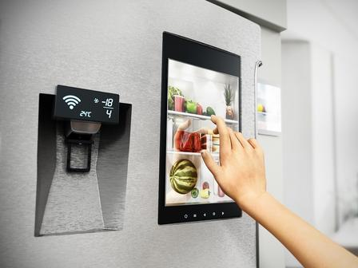

3. **Urban Road Scenario**

Autonomous driving taxi: Multiple cameras and LiDAR AI recognize traffic lights, pedestrians, non-motorized vehicles, and road signs in real time. The system autonomously plans driving routes. When detecting pedestrians crossing the road, the system automatically slows down and yields. Throughout the journey, the system independently judges road conditions without human steering wheel control.

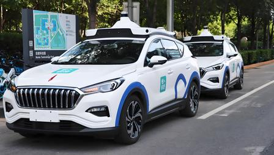

4. **Hospital Medical Scenario**

Hospital service robot: Speech dialogue AI understands patient questions and autonomously guides them to clinics and payment windows. Based on symptoms, the system intelligently recommends corresponding departments. The robot records high-frequency questions and continuously optimizes response logic. This achieves autonomous interaction and autonomous navigation.

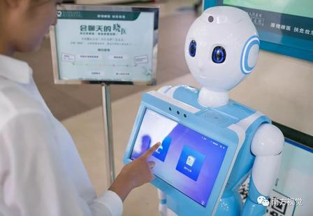

5. **Shopping Mall and Restaurant Scenario**

Food delivery robot: Indoor visual navigation enables automatic identification of table numbers and avoidance of moving customers. The robot completes food delivery and plate collection tasks, autonomously returning to the pickup area. When encountering obstacles, the robot automatically stops and reroutes. This adapts to complex restaurant environments.

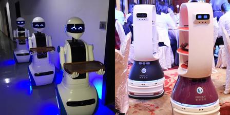

### 3.1.4 Extended Knowledge

**(1) Origins of Artificial Intelligence**

- **Theoretical foundation**: In 1950, Alan Turing published *Computing Machinery and Intelligence*, proposing the classic "Turing Test" and establishing the core theoretical foundation for the feasibility of artificial intelligence. 

- **Official birth**: At the 1956 Dartmouth Conference, leading scientists including John McCarthy and Marvin Minsky first proposed the term "artificial intelligence," marking the formal establishment of AI as an independent scientific discipline.

  

 **(2) Impact of Artificial Intelligence on Human Life**

- More convenient living: Intelligent voice assistants, food delivery algorithms, navigation, face-scan payment, and smart homes simplify daily chores and save time.
- Enhanced work and production efficiency: Office AI assists with copywriting and data organization. Intelligent factory robots and agricultural smart equipment reduce repetitive labor and drive industrial upgrading.
- Improved healthcare and education: AI-assisted imaging diagnosis and the development of new drugs. Personalized learning tools enable teaching according to individual aptitude, lowering the threshold for accessing quality resources.
- Enriched entertainment: AI painting, video generation, and intelligent music and film recommendations create entirely new content formats.


 **(3) Future Trends in Artificial Intelligence**

- Multimodal intelligent fusion: Current AI mostly processes only single modalities such as images or voice. Future AI will simultaneously comprehend visuals, understand speech, read text, and recognize actions. This enables comprehensive perception of the world and more natural interaction.

  

- Deep integration across all industries: AI will no longer remain confined to home appliances and robots. It will penetrate deeply into industrial manufacturing, agricultural cultivation, aerospace, and urban management. Artificial intelligence will enhance productivity across all of society.

  

- Human-robot collaboration becomes the mainstream model: AI will not completely replace human work. Instead, it will serve as an assistive tool. Humans will handle creativity, emotion, and complex decision-making. AI will handle repetitive calculation, environmental perception, and physical labor. The two will divide tasks and cooperate.

  

- Exploration toward general artificial intelligence: Current AI consists of "narrow AI." One machine can only perform one task. A robot vacuum only vacuums. In the future, scientists will research general AI. A single intelligent system will flexibly complete diverse tasks including learning, service, creation, and inspection.

### 3.1.5 Q&A

**Question 1: What are some common weak AI applications in daily life?**

Answer:① Face-scan payment AI has a dedicated task: recognizing faces and completing identity verification. It can only perform face recognition and comparison. ② AI translation tools have a dedicated task: multilingual text and voice translation. They focus exclusively on language conversion. ③ short-video recommendation AI: Its dedicated task is pushing corresponding videos based on viewer preferences. It is only responsible for content recommendation. All three can only complete single-domain tasks and cannot work across domains. These are typical examples of weak artificial intelligence.


**Question 2: Why does current artificial intelligence lack true autonomous thinking capabilities?**

Answer: All current AI systems are tools driven by data, algorithms, and computing power. AI possesses no self-awareness, subjective thinking, or emotions. AI merely summarizes patterns from massive datasets and imitates human behavior. It completes tasks according to preset models. AI cannot autonomously comprehend the meaning of tasks, cannot think independently, and cannot exercise subjective judgment. It does not truly possess human-like consciousness or thinking capabilities.


**Question 3: Is an intelligent robot vacuum an AI carrier or AI itself?**

Answer: It is an AI hardware carrier. The robot vacuum is a physical hardware device. The algorithmic programs for path planning, obstacle avoidance, and cleaning recognition that run inside it constitute artificial intelligence itself. The robot is merely the shell that carries the AI algorithms and implements intelligent cleaning functions. Without the AI algorithms, it is only ordinary mechanical equipment.

###  3.1.6 Technical Support and Product Discussion

If creative ideas emerge after using the product, sharing them in the [Hiwonder community](https://forum.hiwonder.com) is welcome:

<a href="https://forum.hiwonder.com.cn/" target="_blank" rel="noopener noreferrer">


</a>

## 3.2 Implementation Methods of Artificial Intelligence

### 3.2.1 Lesson Introduction

This lesson lifts the veil on artificial intelligence. It focuses on the core implementation technology of AI: machine learning. Through accessible analogies and real-life cases, this lesson explores three mainstream training approaches: supervised learning, unsupervised learning, and reinforcement learning. It compares the similarities and differences between human learning and machine learning.

Through this lesson, learners will understand the technical principles behind various AI products and establish foundational knowledge of AI underlying logic.

### 3.2.2 Learning Objectives

1. **Knowledge Objectives**: Review basic AI evaluation criteria. Memorize the definition of machine learning and its three training modes. Distinguish the commonalities and core differences between human and machine learning. Master foundational theoretical knowledge of AI technology.

2. **Skill Objectives**: Independently identify whether devices in daily life qualify as AI. Accurately distinguish between supervised, unsupervised, and reinforcement learning. Comprehend basic AI training cases and complete simple classification exercises.

3. **Thinking Objectives**: Establish hierarchical logical thinking. Learn to observe intelligent devices from an underlying technical perspective. View the strengths and weaknesses of human and machine learning dialectically. Cultivate objective and rational technological critical thinking.

4. **Application Objectives**: Analyze the machine learning principles behind smart home appliances and robots in the surrounding environment. After class, actively observe AI products in daily life. Apply classroom knowledge to explain the intelligent behaviors of devices.

### 3.2.3 Understanding Machine Learning

**(1) Basic Definition of Machine Learning**

- Core Principle: Massive raw data is fed into machines. Through repeated algorithmic training, intelligent models capable of recognition, judgment, and prediction tasks are generated.
- Three Categories: Based on training data formats and learning logic, machine learning divides into three types: supervised learning, unsupervised learning, and reinforcement learning. All AI products are developed upon these three modes.

**(2) Supervised Learning**

- Basic Concept: Every piece of training data has a corresponding correct answer.
- Accessible Analogy: Multiple images labeled as cats are fed to AI. The AI memorizes core feline features: pointed ears, round eyes, a short muzzle, and a fluffy tail.


- Real-Life Applications: Face recognition, AI-powered waste sorting, automated exam grading, and animal image recognition all belong to supervised learning.

**(3) Unsupervised Learning**

- Basic Concept: The training data lacks corresponding "correct answers." The machine must train and analyze based on relationships within the data itself to derive a "correct answer."
- Accessible Analogy: This resembles a teacher handing students a pile of mixed books and asking them to observe, find patterns, and group the books independently. Throughout this process, no teacher guidance is provided. The students complete the task entirely on their own.


- Real-Life Applications: Personalized recommendations on short video and shopping platforms, automatic categorization of massive image collections, and consumer group segmentation. 

**(4) Reinforcement Learning**

- Basic Concept: No "correct answer" is directly provided. The answer must be found through continuous trial and error.
- Accessible Analogy: This resembles training a puppy to sit. The puppy attempts different actions. If the action is correct, "sitting," it receives a reward. If incorrect, no reward is given or a mild penalty is applied. After repeated attempts, the puppy gradually learns that "sitting" is the optimal action that yields rewards.


- Real-Life Applications: Autonomous driving obstacle avoidance, game AI, warehouse handling robots, and patrol robotic dogs.

### 3.2.4 Human Learning VS Machine Learning

1. Common Ground: The essence of both human learning and machine learning is memorizing the features of something. When encountering similar things again, the memorized features are used for comparison to identify the object.

2. Differences:

- **Vast gap in required data volume:**

① Human learning: Only 1-2 images are needed to remember an animal. Mastery of features requires minimal samples.


② Machine learning: Thousands or tens of thousands of otter images from different angles, environments, and poses are required for training. Insufficient samples lead to recognition errors.


- **Ability to draw inferences and adapt flexibly differs:**

① Human learning: Underlying logic is understood. Knowledge can be flexibly transferred across scenarios.


② Machine learning: Only memorizes fixed trained correspondences. New knowledge cannot be autonomously derived.


3. Complementary Summary:

- Human strengths: Fast learning speed, strong logical reasoning, capacity for innovation, and emotional understanding.
- Machine strengths: Memorizing massive datasets, high-speed computation, and stable 24-hour operation.
- All current intelligent products result from collaborative work: **humans provide data and ideas, while machines complete massive computation and recognition**.

### 3.2.5 Extended Knowledge

​       **(1) Current Mainstream Application Scenarios**

- Life Services: Voice assistants, smart door lock recognition, and robot vacuum navigation.

- Transportation: Autonomous driving and AI traffic inspection robots.

- Medical Industry: AI imaging lesion recognition and guidance robots.

- Education: AI exercise grading and VR immersive teaching recognition.

- Entertainment: Short video intelligent recommendations, AI painting, and intelligent game NPCs.

  **(2) Future Development Trends**

- Lightweight Training: Future AI will not require tens of millions of images. Learning can be completed with small data volumes. This narrows the efficiency gap between human and machine learning.

- Multi-Modal Fusion: Supervised, unsupervised, and reinforcement learning will be combined simultaneously. A single AI system will complete recognition, classification, and autonomous action concurrently.

- Deep Human-Robot Collaboration: Machine learning handles repetitive recognition and computation. Humans handle creativity, decision-making, and emotional judgment.

- Popularization of Large Language Models (LLMs): Built upon the underlying logic of machine learning, large language models achieve complex intelligent behaviors including dialogue, writing, and creation.

### **3.2.6 Q&A**

**Question 1: What are the three machine learning modes and their mutual distinctions?**

Answer: ① Supervised learning: uses standard answers. Applied to image and face recognition. ② Unsupervised learning: autonomous grouping. Applied to recommendations and data categorization.③ Reinforcement learning: trial and error with rewards. Applied to robots and autonomous driving.


**Question 2: What are the commonalities between human and machine learning?**

Answer: ① Both human and machine learning rely on identifying distinguishing features to categorize objects. ② The primary distinction lies in sample efficiency: humans generalize concepts from a few examples, whereas current machine models require large datasets. ③ All intelligent devices in daily life operate on underlying machine learning technology.

###  3.2.7 Technical Support and Product Discussion

If creative ideas emerge after using the product, sharing them in the [Hiwonder community](https://forum.hiwonder.com) is welcome:

<a href="https://forum.hiwonder.com.cn/" target="_blank" rel="noopener noreferrer">


</a>

## 3.3 Initial Introduction to Large Language Models

### 3.3.1 Lesson Introduction

This lesson focuses on the hottest AI product today: large language models. Through a classroom word-chain game analogy, this lesson explains the model operating logic. It covers the definition of large language models, the complete workflow, and hands-on practice with the XiaoZhi AI platform. Learners will experience text generation functions including story continuation and Q&A dialogue. This provides direct understanding of the core AI principle of "generating subsequent text based on preceding context."

### 3.3.2 Learning Objectives

1. **Knowledge Objectives**: Understand the definition of large language models. Comprehend the complete input-analysis-output workflow. Distinguish the differences between human expression and AI text generation.

2. **Skill Objectives**: Log in to the XiaoZhi AI platform. Master basic operations for inputting questions and continuing stories. Learn simple instruction input methods for dialogue with large models.

3. **Thinking Objectives**: Establish logical correspondence thinking through the word-chain analogy. Understand dialectically the generation limitations of large models in "word continuation." View AI text creation capabilities objectively.

4. **Application Objectives**: After class, use large models independently to complete story creation and simple Q&A. Learn to use AI to assist reading and writing. Develop habits of using AI tools reasonably.

### 3.3.3 Understanding Large Language Models

**(1) Basic Definition of Large Language Models**

Large language models are large-scale language processing models trained on massive text data based on artificial intelligence technology. The core capability is understanding the semantics, logic, and context of human language, and generating text that conforms to natural language rules.

In simple terms, a large language model is an intelligent system where AI learns the patterns of language and uses these patterns to solve language problems.

**(2) Complete Processing Workflow of Large Language Models**

A complete interaction consists of three steps:

① Input requirements: Humans type in questions, story beginnings, or demand instructions.

② Content analysis: The model reads the text, organizes the context, and understands the requirements.

③ Output response: Coherent text is generated according to language logic and fed back to them.


**(3) Operating Principle of Large Language Models**

Simply put, this resembles classmates passing notes in sequence. The first student writes the story beginning "Once upon a time, there was." Each subsequent student can only continue with one sentence. Everyone must continue the plot coherently based on preceding content.


The work of large language models is completely identical to the chain game. The model reads all preceding text. According to language patterns learned from massive text, it continues the subsequent text word by word and phrase by phrase.


**(4) Human Expression VS Text Generation by Large Language Models**

Large models differ significantly from human speaking patterns. Human speech combines life experiences and genuine emotions with free association. Large models lack real-life experience. They rely solely on word collocations and sentence patterns from massive text to continue text. No genuine emotions exist. Only text association relationships are matched.


Large model "speech" is essentially playing word relay. It continuously predicts and generates text based on preceding context.


### 3.3.4 Extended Knowledge

 **(1) From Word Chain to Intelligent Understanding**

The essence of large language models is a "probability predictor," not genuine language understanding. Inputting "The weather is very hot, I turned on the..." causes the model to calculate from training data that "air conditioner" has the highest probability and append it. However, the model does not know what "hot" feels like. Its "understanding" is statistical pattern matching, rather than genuine "comprehension" in human terms. Only when the scale is sufficiently large does word guessing become astonishingly accurate. 

**(2) The Three-Step Training Method of Large Language Models**

Transforming large models from "illiterate" to "top student" requires three steps. Pre-training: self-learning language patterns from massive text. Supervised fine-tuning: humans provide Q&A examples to teach correct responses. Reinforcement learning: adjusting output strategy based on response quality scoring. After these three steps, the "word chain" machine becomes an intelligent assistant capable of solving problems.

###  3.3.5 Q & A

**Question 1: What are the operational differences between large language models and search engines?**

Answer: Search engines retrieve existing web pages and present them. They do not produce new content themselves. Large language models understand questions and generate entirely new responses word by word. The former resembles a librarian helping find books. The latter resembles a knowledgeable friend explaining in their own words. The essential distinction: search engines retrieve information, while large language models generate information.

**Question 2: Why can large language models guess subsequent text based on preceding context?**

Answer: Similar to the classroom "word chain" game, the model learns word collocations and sentence organization patterns from massive text. After inputting preceding text, it calculates the probability of each word appearing, selects the highest probability word to append, and repeats this prediction cycle until the response is complete. It is a super-sized "word chain expert."

### 3.3.6 Technical Support and Product Discussion

If creative ideas emerge after using the product, sharing them in the [Hiwonder community](https://forum.hiwonder.com) is welcome:

<a href="https://forum.hiwonder.com.cn/" target="_blank" rel="noopener noreferrer">


</a>

## 3.4 Large Language Model - Semantic Understanding 

### 3.4.1 Lesson Introduction

This lesson explains three layers of semantics: literal, logical, and emotional. It pairs with hands-on practice on the XiaoZhi AI platform. Combined with real-world examples from home and medical devices, this lesson demonstrates landing scenarios of semantic understanding in daily life and industry. A complete cognitive framework for large language model capabilities is established.

### 3.4.2 Learning Objectives

1. **Knowledge Objectives**: Memorize the definition of semantic understanding. Distinguish three semantic layers: literal, logical, and intent-emotion. Master the interpretive function and typical cases for each semantic layer.

2. **Skill Objectives**: Design different question formats on the XiaoZhi AI platform. Observe AI semantic understanding performance in distinguishing word meanings, organizing logic, and recognizing emotions.

3. **Thinking Objectives**: Establish hierarchical logical thinking for text interpretation. Learn to distinguish surface text from hidden underlying meaning. Understand the complete approach of AI language interpretation.

4. **Application Objectives**: List intelligent devices in daily life and healthcare that rely on semantic understanding. Learn precise questioning to help AI comprehend genuine needs.

### 3.4.3 Learning Semantic Understanding

**(1) Basic Definition of Semantic Understanding**

Semantic understanding refers to the capability of models to learn patterns of human language and accurately capture true meaning, logical relationships, emotional tendencies, and intent purposes contained in text or dialogue. This goes beyond mere recognition of surface-level text, such as grammar and spelling.

In simple terms, humans can "read between the lines" when understanding language, and semantic understanding in large language models aims to bring models as close as possible to this human-level "comprehension" capability.

**(2) Three Progressive Goals of Semantic Understanding**

AI text interpretation divides into three levels from shallow to deep. Each level approaches authentic human expression more closely:


1. Literal semantics: The core function is understanding words themselves. This involves recognizing basic meanings of vocabulary, phrases, and sentences. It resolves foundational interpretation of polysemous words and ambiguous sentences.


2. Logical semantics: The core function is understanding relationships between sentences. This involves analyzing causal, contrastive, coordinate, and conditional logical relationships in text, as well as associations between entities.


3. Intent and emotional semantics: The core function is understanding the speaker's purpose and mood. This involves capturing the speaker's underlying purpose and subjective emotional stance.


### 3.4.4 Application Scenarios of Semantic Understanding

**(1) Personal Home Living Scenario**

In everyday life, semantic understanding powers smartphone voice assistants and smart home devices.


**(2) Medical Industry Scenario**

In healthcare environments, semantic understanding is integrated into intelligent triage robots and automated medicine-delivery robots.


### 3.4.5 Extended Knowledge

 **(1) From Understanding Speech to Reading Hearts**

Semantic understanding divides into three levels. Literal semantics: recognizing basic word and sentence meanings, such as "apple" referring to fruit. Logical semantics: analyzing causal, contrastive, and other logical relationships. Intent and emotional semantics: capturing speaking purpose and emotion. "I fell down" may implicitly convey "seeking comfort." The advancement of large models lies not merely in "seeing words" but in striving to "read hearts."

 **(2) Language Traps That Cause AI to Fail**

Language is full of traps. Ambiguity problems: does "apple is delicious" refer to fruit or phones? Reference resolution: in "he couldn't find XiaoGang, because he was too short," who is short? Also irony and sarcasm: "you are so amazing" may be praise or mockery. These are simple for humans but enormous challenges for AI, requiring world knowledge and commonsense reasoning.

### 3.4.6 Q & A

**Question 1: What is the difference between speech recognition and semantic understanding?**

Answer: Speech recognition addresses "transcribing words accurately" by converting audio into text. Semantic understanding solves "understanding what meaning," analyzing intent and emotion behind text. The former is the "ear." The latter is the "brain." Hearing every word clearly does not equal comprehending every sentence.

**Question 2: How does the statement "It is really cold today" illustrate the three levels of semantic understanding?**

Answer: Literal semantics: recognizing word meanings, knowing this describes low temperature. Logical semantics: judging that "cold" describes today's weather. Intent and emotion: if the speaker enters rubbing hands, the intent is "requesting heat" or "complaining." If seeing someone underdressed, the intent is "reminding to wear more clothes." The three levels progress from shallow to deep.

### 3.4.7 Technical Support and Product Discussion

If creative ideas emerge after using the product, sharing in the [Hiwonder community](https://forum.hiwonder.com) is welcome:

<a href="https://forum.hiwonder.com.cn/" target="_blank" rel="noopener noreferrer">


</a>

## 3.5 Initial Introduction to Speech Large Language Model

### 3.5.1  Lesson Introduction

This lesson upgrades the interaction method to explore speech modeling. Communicate with AI directly through speech instead of typing. The lesson first introduces the definition of speech modeling and their applications in everyday devices, then examines the complete structure of the hands-on hardware WonderMind. Step-by-step instructions guide learners through device network configuration and speech conversation practice.

### 3.5.2 Learning Objectives

1. **Knowledge Objectives**: Memorize the core definition of speech modeling. Master the three foundational capabilities of "speech recognition + semantic understanding + speech synthesis." Remember three typical application scenarios in smart home, office, and health contexts.

2. **Skill Objectives**: Proficiently identify all functional ports on the WonderMind hardware. Independently complete device power-on and WiFi network configuration procedures. Use the wake word to initiate voice conversations.

3. **Thinking Objectives**: Distinguish similarities and differences between text-based large models and speech modeling. Understand the complete technical pipeline of "speech-to-text → AI reasoning → text-to-speech." Establish multimodal AI logical thinking.

4. **Application Objectives**: Independently list voice-enabled smart devices in daily life. Complete hands-on speech tasks including Q&A, storytelling, and translation using the hardware after class. Appropriately utilize voice AI to assist learning.

### 3.5.3 Understanding Speech Modeling

**(1) Basic Definition of Speech Modeling**

An AI system that can understand human speech and respond verbally is a large speech model. It possesses "super ears" to receive audio input and a "super mouth" to output spoken responses. The system supports continuous multi-turn natural conversation. This lesson provides systematic study and hands-on operation with speech AI hardware.

Core Characteristics:

- Processes text and language
- Understands speech and generates speech

**(2) Life Interaction Scenarios**

1. Smart Home Speakers: Voice-controlled music playback, weather queries, alarm setting, and idiom games. Built-in speech modeling recognizes voice commands.


2. Children's Early Education Devices: Voice-based storytelling, English reading practice, and science Q&A. Through voice interaction to deliver an immersive learning experience.


3. In-Vehicle Voice Systems: Voice navigation, music switching, and traffic condition queries. Eliminates manual operation while driving to ensure travel safety.


4. Mobile Voice Assistants: Cover extensive voice functions including weather checks, arithmetic, poetry recitation, translation, jokes, and schedule management.


### 3.5.4 Understanding the WonderMind Large Model Module

WonderMind is an AI large model module featuring a high-performance chip. It integrates a high-definition camera, microphone, high-definition display, speaker, and voice recognition chip. The module deeply fuses text, voice, and vision models.


**(1) WonderMind Component Diagram**


|       Component        |                           Function                           |
| :--------------------: | :----------------------------------------------------------: |
|         Screen         | Displays large model conversations and camera feedback images |
|       Microphone       |               Audio input for the large model                |
|         Camera         |              Image capture for the large model               |
|        Button A        |       Activates the large model conversation function        |
|        Button B        | Switches between conversation, expression, and feedback modes |
|        Speaker         |              Plays large model voice responses               |
| I2C communication port |         Communication interface with the controller          |
|      Power switch      |                     Device power control                     |
|     Charging port      |                       Device charging                        |
|  Building block port   |            Mounting point for building block pins            |

**(2) Device Power-On**

1. Toggle the switch on the back of the module. The screen illuminates to indicate successful power-on.


2. After power-on, the display shows **the device hotspot** **name** and **browser network configuration** URL with voice broadcast. Network configuration must be completed before initial use.


**(3) Module Network Configuration**

1. The module initiates network configuration immediately after power-on. The display shows **the device hotspot name** and **browser network configuration URL** with voice broadcast. The large model module activates its own hotspot for connection and configuration. Different devices have different hotspot names following the uniform format **WonderMind-xxxx**. The following instructions use hotspot WonderMind-7885 as an example.


2. Search for and connect to the corresponding hotspot using a computer or mobile phone. This hotspot requires no password.


3. Click the [Network Configuration](http://192.168.4.1/) hyperlink to directly access the device network configuration URL. Alternatively, copy the following URL and open any browser to access the network configuration page.

```py
http://192.168.4.1
```


4. In the interface shown below, enter the desired hotspot name for automatic connection at power-on in field ①. Enter the hotspot connection password in field ②. Finally, click **Connect** in field ③. The module attempts to locate and connect to the matching hotspot in the current environment using the provided connection information.


5. The interface displays a list of currently available hotspots scanned by the module. Clicking any item automatically populates the corresponding hotspot name into field ① for convenience.


6. If the following prompt appears, the hotspot cannot be found in the current environment or the connection password is incorrect. Please re-enter the information.


7. If the following prompt appears, the module has successfully located and connected to the corresponding hotspot. The module automatically restarts and connects to the specified hotspot.


> [!NOTE]
>
> * **Do not enter hotspots that cannot be detected in the current environment, have excessively weak signals, or lack internet connectivity.**
>
> * **If the module previously saved connection information for other hotspots, new hotspot connection information will coexist with existing entries. At next power-on, the module reads each saved connection entry in sequence to attempt matching and connection.**
>
> * **If the module displays Error: Version check failed, retrying in xx seconds after network configuration, the current hotspot may lack internet access or have poor network quality. Please attempt to switch networks.**

**(4) XiaoZhi Platform Account Login and Authentication** 

- #### XiaoZhi Platform Account Login

1. Click the [XiaoZhi AI Chatbot](https://xiaozhi.me/) hyperlink to directly access the device binding URL. Alternatively, copy the following URL and open any browser to access the device binding page.

```py
https://xiaozhi.me
```


2. Click **Console** to enter the XiaoZhi AI agent management platform.


3. Log in directly with an existing username and password. For first-time access, register a platform account first.


4. Complete the required information and click **Send Code** to obtain the verification code needed for account registration.


5. Check the agreement and privacy policy boxes, then click **Login**.


6. Complete the required information and click **Confirm** to finish registration and login.


- #### GitHub Platform Login

> [!NOTE]
>
> * **Refer to the diagram below for the main permission differences between standard accounts and GitHub-authenticated accounts.**
>
> 
>
> * **Skip GitHub authentication and proceed directly to [Device Binding](#section-3-5-4-5) after logging in, or follow the steps below to complete GitHub authentication.**

1. On the XiaoZhi platform, click the icon and select **GitHub Verification**. Wait for the interface to redirect to the authentication page, then click **Link GitHub**.


2. Wait for the interface to redirect to the GitHub account login page.


3. If a GitHub account already exists, log in directly with username and password and proceed to [【Binding XiaoZhi Platform with GitHub Platform】](#section-3-5-4-4-3). If no GitHub account exists, click **Create an account**.


4. In the popup interface, enter personal email, login password, username, and location information in sequence. Click **Create account** to submit registration information.


5. Click **Visual puzzle** on the page to begin image verification.


6. After completing image verification, the GitHub platform sends a verification email to the previously entered registration email. Copy the confirmation code sent to the registered email address and enter it into the page.


7. Once verified, the page redirects to login and confirms account creation.


<a id ="section-3-5-4-4-3"></a>

- ####  Binding XiaoZhi Platform with GitHub Platform

1. Click **Authorize tenclass** to complete binding between the XiaoZhi platform and GitHub platform.


2. Complete the binding to finish XiaoZhi platform authentication, return to the previous authentication page, and verify the confirmation message shown below.


<a id ="section-3-5-4-5"></a>

**(5) Device Binding**

1. After completing XiaoZhi platform registration, login, and authentication, click **Agents** to enter the following interface.


2. Click the **∨** shaped button at the add device button location, then click **Create Agent**.


3. Enter the agent name, then click **Confirm** to complete agent addition.


4. Click **Configure** to access various function configurations for the agent.


5. Click **Role** to configure the agent role. Select the desired conversation language at the field ①, choose the desired character voice at the field ②, and configure voice settings at the field ③.


6. Click **Model & memory**. Select **DeepSeek V4 (Rich Personality)** for the language model. Disable the memory function. Keep all other settings at default.


7. Click **Extensions**. Check all Official Services. Keep all other settings at default. Finally, click **Save**.


8. Click **Devices** to enter the device management function.


9. Click **Link new device**. Enter the **6-digit code** in the popup and click **Link**.


10. If binding succeeds, the page displays **Device added successfully**. Then select **Open Source** and click **Start Using**.


11. After successful device binding, the module enters the MCP configuration waiting interface. The current mode waits for an external main controller to configure MCP for the large model. Since no external main controller is currently connected, simply short-press **Button A** to enter the large model expression mode normally.


12. When entering the large model expression mode, the module displays expressions. Network configuration and binding are now complete.


**（6） Free Conversation**

After completing all module preparation steps, press **Button B twice** to switch to conversation mode. In conversation mode, speak the **wake word** **Hello Hiwonder** or **short-press Button A**  to activate the module's voice interaction mode.

The module includes special functions accessible through commands during human-machine conversation interaction. Issue voice commands to the WonderMind module using phrases such as ① **What can you do?** or ② **Introduce your features** to query all supported functions.&emsp;

Use the following commands to invoke corresponding features:

&emsp;&emsp;1.Weather query: **Check the weather in [location]**.


&emsp;&emsp;2. News Broadcast Function: **① Broadcast today's news ② Introduce today's hot events.**


&emsp;&emsp;3. Outfit recommendation: **Give an outfit recommendation for today.**


&emsp;&emsp;4. Joke telling:  **① Tell a joke. ② Tell a joke to lighten the mood.**


&emsp;&emsp;5. Almanac Query Function: **Check today's horoscope for [zodiac sign].**


&emsp;&emsp;6. Music Playback Function: **Play a random song.**

> [!NOTE]
>
> **Lower the module volume before using the music playback function.**


### 3.5.5 Extended Knowledge

(1) **The** **Homophone Trap** **in Speech Recognition**

When speech modeling recognizes speech, they do not simply convert sounds to words in isolation, but rather combine context to infer the most likely text. However, Chinese contains a large number of homophones. For instance, "明天要去市场调研" and "明天要去时常调研" sound identical, and the model must rely on surrounding context to determine which phrase is more reasonable. When contextual information is insufficient, the model is prone to errors. Furthermore, variations in accents, speech rates, and vocal habits all affect recognition results. Behind this lies the collaborative work of acoustic models and language models, the acoustic model is responsible for hearing pronunciation clearly, while the language model is responsible for guessing meaning correctly. The better these two work together, the more accurate the recognition becomes.

**(2) From Robot Voice to Human-like Quality**

Early text-to-speech synthesis produced rigid, flat intonation that immediately revealed a machine was speaking, commonly dubbed the "robot voice." Modern speech modeling can synthesizes highly natural speech, and the secret lies in their departure from simply concatenating individual phonemes. Instead, they learn from vast samples of human speech, mastering details such as tonal inflections, pause durations, and emotional variations. More importantly, contemporary speech synthesis can automatically adjust tone based on context, employing a light, lively intonation when telling jokes, or raising pitch at sentence endings to express questions. Making machines "speak" like real people is essentially teaching them "how to speak" rather than merely "what to say."

### 3.5.6 Q&A

**Question 1: Are speech recognition and voice large model identical concepts?**

Answer: These are concepts at different hierarchical levels.

- Automatic Speech Recognition, commonly abbreviated as ASR, is a specific technical task aimed at converting audio signals into corresponding text. It addresses the question of "what words were spoken" without involving semantic understanding. Traditional speech recognition systems rely on the collaboration of acoustic models, language models, and pronunciation dictionaries to accomplish this conversion.
- Voice large model is a broader system concept. It typically contains a speech recognition module but extends far beyond. A complete voice large model usually consists of three components: ① Speech front-end module: Contains speech recognition ASR, responsible for converting voice audio to text. Also performs audio preprocessing including noise reduction and echo cancellation. ② Large language model core: Receives text output from ASR, completes semantic understanding, logical reasoning, and dialogue generation. Comprehends the underlying intent and generates response text. ③ Speech synthesis TTS module: Converts response text output from the large model into natural, fluent voice audio for output. 

**Question 2: Voice large models enable multi-turn conversation. Compared to single-turn Q&A, what additional technical challenges does this present?**

Answer: Multi-turn conversation is a key capability distinguishing voice large models from traditional voice assistants, but it introduces significant technical challenges:

- From the "memory" perspective: The model must remember key information from previous conversation turns, such as locations, people, and preferences mentioned earlier. This technically depends on context window management. If conversation extends too long, the model may "forget" earlier information, causing contradictory responses.
- From the "understanding" perspective: Expressions in multi-turn conversation frequently contain referential ellipsis. For example, the first turn states "I want to listen to Jay Chou's songs," and the second turn states "Play another slow song by him." The model must recognize that "him" refers to Jay Chou, and "play another" indicates switching within the previously recommended song scope.

### 3.5.7 Technical Support and Product Discussion

If creative ideas emerge after using the product, sharing in the [Hiwonder community](https://forum.hiwonder.com) is welcome:

<a href="https://forum.hiwonder.com.cn/" target="_blank" rel="noopener noreferrer">


</a>

## 3.6 Voice Interaction Practice

### 3.6.1 Lesson Introduction

This lesson introduces the AiBlock controller as the device "command brain," paired with WonderMind voice hardware to complete a full voice interaction project. The lesson sequentially covers voice interaction concepts, hardware structures for both systems, standardized wiring and power-on procedures, complete WonderLab programming software operations, basic logic code, and voice interaction program writing. The final outcomes include button-triggered text output and voice conversation practice, achieving software-controlled hardware with human-robot voice interaction.

### 3.6.2 Learning Objectives

1. **Knowledge Objectives**: Clearly understand the complete definition of voice interaction. Memorize all port functions on the AiBlock controller and WonderMind hardware. Master the underlying logic of software-hardware integration. Distinguish between controller interaction and human-robot interaction modes.

2. **Skill Objectives**: Proficiently complete standardized hardware wiring and correct power-on sequence. Independently operate WonderLab software to create new projects, load the controller and voice extension modules. Write and execute basic programs for button-triggered printing and voice conversation.

3. **Thinking Objectives**: Establish a three-layer engineering mindset of "hardware platform + graphical code + AI voice model." Understand program loops, conditionals, and variable logic. Map the complete signal transmission chain.

4. **Application Objectives**: Independently build a simple voice interaction robot. Expand to voice-controlled buzzer, lights, and other peripherals after class. Use programming to modify voice interaction response logic.

### 3.6.3 Preparation Work

**(1) Hardware Preparation**

- AiBlock controller
- WonderMind large model module
- Module cable 
- Type-C data cable
- Computer

**(2) Software Preparation**

- WonderLab programming software

### 3.6.4 Hands-On Project

**(1) Project Analysis**

This lesson contains two core tasks. Task one is controller interaction: press the left button on the controller, the buzzer plays a tone, and "Hello" is printed. Task two is human-robot interaction: initialize WonderMind, configure MCP, and achieve voice wake-up conversation. Final integration: pressing the button triggers WonderMind to start conversation while the controller buzzer responds.

**(2) Understanding the AiBlock Controller**

AiBlock can connect to many components such as motors, servos, and sensors. It supports both graphical programming and Python programming. The controller has 4 servo ports, 4 motor ports, 4 sensor ports, 2 programmable buttons, and a buzzer for sound output.


The corresponding functions are shown below:

| Port                   | Description                                             |
| :--------------------- | :------------------------------------------------------ |
| Type-C port            | Program upload and power supply                         |
| Power switch           | OFF / ON two-position toggle                            |
| Power indicator        | Displays power status                                   |
| A to D (I2C ports)     | Sensor ports                                            |
| M1 to M4               | Long motor ports                                        |
| S1 to S4               | Block servo and block motor ports                       |
| 2 Programmable buttons | Customizable trigger functions                          |
| Buzzer                 | Plays tones and alert sounds                            |
| Building block ports   | Compatible with standard building block pin connections |

**(3) Understanding the WonderLab Programming Platform**

- **Platform Introduction**

WonderLab is a dedicated Scratch-based programming software tool for Hiwonder products. The software supports automatic conversion between graphical instruction blocks and Python code. Programs are created through drag-and-drop block manipulation, making it highly suitable for beginner programming education.


- **Software Download and Installation**

1. Programming software installer download link: [WonderLab Software](https://k12.hiwonder.com.cn/download/pcSoftware?get_pc=1&os=windows)

2. Open the **WonderLab setup.exe** software installer.


3. Select language, then click **OK**.


4. Select installation location, then click **Next**.


5. Click **Next**.


6. Click **Install**.


7. After successful installation, click **Finish**.


- **WonderLab Interface Introduction**

The following diagram shows the functional area layout of the "WonderCode" software: ① Menu Bar, ② Instruction Area, ③ Script Area, ④ Code Display Area.


The corresponding functions are shown in the table below:

| Icon                                                         | Function                                                     | Icon                                                         | Function                                                     |
| :----------------------------------------------------------- | :----------------------------------------------------------- | :----------------------------------------------------------- | :----------------------------------------------------------- |
|  | Create, save, and open program files                         |  | Undo or redo operations during programming                   |
|  | For online mode, for reference only, no mastery required     |  | Edit mode toggle button, "Auto Transcode" converts block programs to Python form, switch to "Python Coding" to directly edit programs using Python |
|  | Determines device connection with software and confirms connection port |  | Saves program in Python code form                            |
|  | Used for finding help materials, checking updates, and installing drivers |  | Opens saved Python files                                     |
|  | Displays program file name, shows "Scratch Project" when programming has not started or file is unsaved |  | Performs device interaction and uploads program to the controller board |
|  | Interface toggle button, switches between "Online Mode" and "Upload Mode" |  | Used for adding device extension packages                    |
|  | Selects interface display language, switches between English, Simplified Chinese, and Traditional Chinese |  | From top to bottom: controls code editor zoom in, zoom out, and restore default size |

**(4) Hardware Wiring**

- Connect the WonderMind module to port **A** of the controller using a 4-pin module cable.


**(5) Adding Extensions**

- Select **WonderMind AI** **large model module** under the **Input Module** category. 


**(6) Core Blocks**

| Icon                                                         | Category                                                     | Function                                                     |
| :----------------------------------------------------------- | :----------------------------------------------------------- | :----------------------------------------------------------- |
|  |  | Drives the buzzer to play notes at specified pitch and beat duration, runs in background mode without blocking subsequent program execution. |
|  |  | Prints custom text strings to the computer via serial port for debugging and information display. |
|  |  | Initializes the hardware interface of the WonderMind AI large model module. |
|  |  | Loads default MCP protocol parameter configuration to complete basic large model interaction channel setup. |
|  |  | Activates the MCP conversation channel to enable large model interaction functions. |
|  |  | Pushes action completion command to the large model to notify that the current robot action execution is finished. |
| 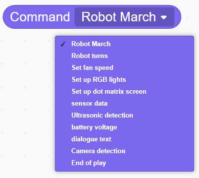 |  | Issues motion control commands to the robot, dropdown menu provides multiple robot actions and device control commands. |


**(7) Program Description and Upload**

- Program Schematic


- Complete Program

  1. After the controller powers on, a startup sound plays. When the WonderMind interface displays MCP configuration, press the left button on the controller. The buzzer then plays a ready sound.

  2. Retrieve data sent from WonderMind to the controller, store as "return data," then check whether "return data" contains "conversation text" command.

  3. Extract the conversation text from "return data," store in the "conversation text" variable, and finally print the conversation text in the small black box at the lower right corner.


> [!NOTE]
>
> **The source files are available for download under [Program Files](https://drive.google.com/drive/folders/1cIZD1yG0hj_lme2SCWtL_KWlalJhd6ib?usp=sharing).**

- Program Upload: When uploading the program, **first power on the controller, then power on WonderMind** **switch**.


- Device restart: After successful program upload, the large model module requires **restart** before program verification. **The power-on sequence must strictly follow controller first, then WonderMind**. **First, in the field ①, then in the field ②**. **Wait for WonderMind to enter the Waiting for MCP extension tool configuration, press Button A to skip interface, then press the left button on the controller to run the program normally**. If the uploaded program is unchanged, the WonderMind restart step is not required.


### 3.6.5 Extended Knowledge

**(1) Voice Interaction Basic Definition and Complete Working Chain**

Voice interaction is a natural interaction method where machines understand human speech and respond verbally. The complete process contains three core modules: ASR speech recognition serves as the machine's ears, converting sound to text. NLP semantic understanding serves as the machine's brain, comprehending the meaning behind words. TTS speech synthesis serves as the machine's mouth, converting responses into human voice broadcast. No button presses or screen touches are needed throughout. This is the interaction form closest to human-to-human communication, widely covering smart home, in-vehicle, robot, and translation device applications. The voice module in this lesson is a compact implementation of this complete voice interaction system.

**(2) Voice Interaction Century-long Development History**

The evolution of voice interaction can be divided into three distinct phases: 1950–2000 incubation period, devices could only recognize fixed numbers and words with slow standard pronunciation required. 2000–2015 popularization period, mobile voice assistants and smart speakers emerged capable of executing short command sentences. 2015 to present large model era, supporting multi-turn conversation, dialect recognition, and emotional voice. From laboratory niche technology to everyday universal tool, comparing interaction differences across three generations directly demonstrates how AI technology enables machines to understand free-form spoken language.

### 3.6.6 Q&A

**Question 1: What roles do AI Blocks Board and WonderMind extensions serve in WonderLab?**

Answer: The AI Blocks Board extension opens the controller IO ports and basic hardware operation code blocks. This is the foundation for all peripheral control. The WonderMind extension provides dedicated commands for voice module network configuration, voice transmission and reception, and conversation parsing. Neither can be omitted to complete voice interaction.

**Question 2: What is the function of the Get Return Data command, and how is voice content parsed from it?**

Answer: This command receives JSON-format interaction data transmitted from WonderMind. The program uses conditional checking commands to search whether the data contains conversation text, extracts the speech text, and uses it for subsequent logic judgment and hardware control.

### 3.6.7 Technical Support and Product Discussion

If creative ideas emerge after using the product, sharing in the [Hiwonder community](https://forum.hiwonder.com) is welcome:

<a href="https://forum.hiwonder.com.cn/" target="_blank" rel="noopener noreferrer">


</a>

## 3.7 Hardware Chassis Control

### 3.7.1 Lesson Introduction

This lesson enters the robot "body" control phase: tracked chassis. The lesson explores the stability advantages of triangular track structures, studies motor drive principles, and programs the chassis to perform basic motions including forward movement, backward movement, turning, and in-place rotation. This lesson forms the foundation for robot motion control, providing mechanical and programming fundamentals for subsequent integrated projects such as voice control and vision navigation. Through chassis assembly and programming debugging, the lesson delivers direct experience of the energy conversion process from "electrical energy → rotational force → mechanical motion."

### 3.7.2 Learning Objectives

1. **Knowledge Objectives**: Understand the mechanical advantages of triangular tracks, namely their large contact area and high stability. Master motor drive principles, including PWM speed regulation and forward-reverse rotation.

2. **Skill Objectives**: Complete assembly of the tracked chassis. Write programs to control motors for forward movement, backward movement, left and right turning, and in-place rotation.

3. **Thinking Objectives**: Establish "differential steering" thinking: achieving turns through speed differences between left and right motors.

4. **Application Objectives**: Understand tracked mobility applications in off-road scenarios, robotic vacuums, and related fields.

### 3.7.3 Preparation

**(1) Hardware Preparation**

- AiBlock controller 
- WonderMind large model module
- 360° block motor
- Building block parts
- Module cable
- Type-C data cable

**(2) Software Preparation**

- WonderLab programming software

### 3.7.4 Hands-On Project

**(1) Project Analysis**

The primary focus of this lesson is programming motor actuation across four basic motion modes. Forward Movement: Both motors rotate forward at identical speeds. Backward Movement: Both motors rotate in reverse at identical speeds. Right Turn: The left motor runs faster than the right motor, or the right motor reverses. In-Place Rotation: The left and right motors rotate in opposite directions simultaneously. A program shall be created to execute different motion sequences upon keypress.

**(2) Assembly Guide**

<pdf src="../_static/shared/pdf/chapter_3/1.pdf" />

**(3) Hardware Wiring**

- Connect the left wheel 360° block motor to port **S1** of the controller using a 3-pin servo cable.
- Connect the right wheel 360° block motor to port **S2** of the controller using a 3-pin servo cable.


**(4) Adding Extensions**

- Select **360° Motor** under the **Motion module** category.


**(5) Core Blocks**

| Block                                                        | Category                                                     | Function                                                     |
| :----------------------------------------------------------- | :----------------------------------------------------------- | :----------------------------------------------------------- |
|  |  | Controls the specified port 360° block motor with custom running speed. Select forward or reverse rotation direction for continuous operation. |
|  |  | Cuts output to the specified port 360° block motor, causing the motor to stop rotating immediately. |

**(6) Program Description and Upload**

- Program Schematic


- Complete Program

  When the left button is pressed, the tracked vehicle moves forward for 2 seconds, backward for 2 seconds, turns left for 2 seconds, turns right for 2 seconds, rotates clockwise for 2 seconds, and rotates counterclockwise for 2 seconds.


> [!NOTE]
>
> **The source files are available for download under [Program Files](https://drive.google.com/drive/folders/1cIZD1yG0hj_lme2SCWtL_KWlalJhd6ib?usp=sharing).**

- Program Upload: When uploading the program, **first power on the controller, then power on WonderMind switch**.


- Device restart:  After successful program upload, the large model module requires **restart** before program verification. **The power-on sequence must strictly follow controller first, then WonderMind. First, in the field ①, then in the field ②. Wait for WonderMind to enter the Waiting for MCP extension tool configuration, press Button A to skip interface, then press the left button on the controller to run the program normally**. If the uploaded program is unchanged, the WonderMind restart step is not required.


### 3.7.5 Extended Knowledge

**(1) Smooth Acceleration and Deceleration Speed Curve Programming**

Write a segmented speed regulation program to control the tracked chassis gradually accelerating from low speed to full speed, then slowly reducing rotational speed for smooth stopping before motion ends. This simulates real-world vehicle starting and braking states. The practice deepens understanding of PWM continuous speed regulation principles, optimizes robot motion smoothness, and reduces chassis shaking caused by abrupt starts and stops. Expandable to speed control scenarios including inspection vehicles and smart personal mobility robots.

**(2) Rectangular Closed-Loop Path Planning Programming**

Independently design a complete rectangular walking timing logic. The program cyclically executes forward movement, delay, and right turn actions. Delay commands precisely control each segment travel distance, enabling the chassis to complete a closed rectangular motion trajectory. This exercise practices spatial logic design and action timing arrangement, developing thinking skills for step-by-step decomposition of complex motion tasks. Extends to fixed-route warehouse vehicle inspection and campus patrol robot applications.

### 3.7.6 Q&A

**Question 1: What advantages does a triangular tracked chassis have compared to ordinary wheeled chassis?**

Answer: Triangular tracks have larger ground contact area, stronger traction, better passability on sand and uneven terrain, and higher driving stability with reduced rollover risk. Suitable for complex terrain inspection and off-road robot applications.

**Question 2: Explain the implementation method for tracked chassis right turns from motor operation logic.**

Answer: A right turn can be achieved through two primary methods. Differential Turning: The left motor runs at a higher speed than the right motor, creating a speed discrepancy that gently arcs the chassis to the right.  In-Place Turning: The left motor rotates forward while the right motor rotates in reverse simultaneously, causing the chassis to spin sharply to the right around its central axis.

### 3.7.7 Technical Support and Product Discussion

If creative ideas emerge after using the product, sharing in the [Hiwonder community](https://forum.hiwonder.com) is welcome:

<a href="https://forum.hiwonder.com.cn/" target="_blank" rel="noopener noreferrer">


</a>

## 3.8 Intelligent Voice Control

### 3.8.1 Lesson Introduction

This lesson combines voice interaction with chassis movement to achieve voice-controlled forward, backward, and turning motions on a tracked robot. Building upon the previous two lessons, the lesson integrates the WonderMind voice module and motor drive systems. The program parses speed and duration parameters from voice commands and maps them to motor control signals. This lesson is the key practice for linking "hearing" and "action," delivering the complete "voice → command → execution" closed-loop experience.

### 3.8.2 Learning Objectives

1. **Knowledge Objectives**: Understand the core logic of voice control, encompassing voice command parsing, parameter extraction, and action mapping. Understand the signal transmission flow from WonderMind to the main controller and then to the motor. 

2. **Skill** **Objectives**: Write programs to control chassis movement using voice commands such as "move forward for 2 seconds." Parse speed and duration parameters from commands.

3. **Thinking Objectives**: Establish "parameterized control" thinking: dynamic adjustment based on command parameters rather than fixed actions.

4. **Application Objectives**: Understand the technical principles behind voice-controlled vehicles, smart wheelchairs, and related applications.

### 3.8.3 Preparation

**(1) Hardware Preparation**

- AiBlock controller
- WonderMind large model module
- 360° block motor
- Building block parts
- Module cable
- Type-C data cable

**(2) Software Preparation**

- WonderLab programming software

### 3.8.4 Hands-On Project

**(1) Project Analysis**

The program needs to implement the following: initialize WonderMind, cyclically retrieve returned data, and parse whether "dialogue text" exists. If present, extract parameters such as speed indicated by phrases like "speed 70" and duration indicated by phrases like "last for 3 seconds", then drive the motor to move at the corresponding speed and direction. Default value handling also needs to be set up.

**(2) Assembly Guide**

<pdf src="../_static/shared/pdf/chapter_3/1.pdf" />

**(3) Hardware Wiring**

- Connect the left wheel 360° block motor to port **S1** of the controller using a 3-pin servo cable.
- Connect the right wheel 360° block motor to port **S2** of the controller using a 3-pin servo cable.
- Connect the WonderMind module to port **A** of the controller using a 4-pin module cable.


**(4) Adding Extensions**

- Select **WonderMind AI** **large model module** under the **Input Module** category.


- Select **360° Motor** under the **Motion module** category.


**(5) Core Blocks**

| Block                                                        | Category                                                     | Function                                                     |
| :----------------------------------------------------------- | :----------------------------------------------------------- | :----------------------------------------------------------- |
|  |  | Drives the buzzer to play notes at specified pitch and beat duration, runs in background mode without blocking subsequent program execution. |
|  |  | Real-time detection of specified button current level state, returns boolean value indicating whether button is pressed. |
|  |  | Initializes the hardware interface of the WonderMind AI large model module. |
|  |  | Loads default MCP protocol parameter configuration to complete basic large model interaction channel setup. |
|  |  | Activates the MCP conversation channel to enable large model interaction functions. |
|  |  | Pushes action completion command to the large model to notify that current robot action execution is finished. |
|  |  | Reads reply commands and text data issued by the large model for subsequent program calls. |
|  |  | Issues motion control commands to the robot, dropdown menu provides multiple robot actions and device control commands. |
| 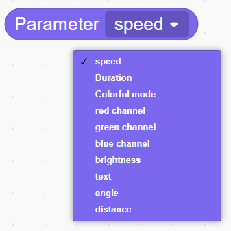 |  | Reads corresponding parameter values from large model issued commands, dropdown selection provides various parameters for acquiring action speed, running duration, light color, servo angle, ranging distance, and other data for program logic calls. |
|  |  | Controls the specified port 360° block motor with custom running speed, select forward or reverse rotation direction for continuous operation. |
|  |  | Cuts output to the specified port 360° block motor, causing the motor to stop rotating immediately. |

**(6) Program Description and Upload**

- Program Schematic


- Complete Program

  1. After the controller powers on, a startup sound plays. When the WonderMind interface displays MCP configuration, press the left button on the controller. The buzzer then plays a ready sound.

  2. Continuously cycle to retrieve data sent from WonderMind to the controller, store as "return data," then check whether "return data" contains voice action commands.

  3. Extract action direction, running speed, and duration parameters from "return data." Set default parameters as fallback. Drive S1 and S2 motors to complete corresponding movement actions. Delay ends and motors stop. After the complete action set finishes, push action completion information.


> [!NOTE]
>
> **The source files are available for download under [Program Files](https://drive.google.com/drive/folders/1cIZD1yG0hj_lme2SCWtL_KWlalJhd6ib?usp=sharing).**

- Program Upload: When uploading the program, **first power on the controller, then power on WonderMind** **switch**.


- **Device restart:** After successful program upload, the large model module requires **restart** before program verification. **The power-on sequence must strictly follow controller first, then WonderMind. First, in the field ①, then in the field ②. Wait for WonderMind to enter the Waiting for MCP extension tool configuration, press Button A to skip interface, then press the left button on the controller to run the program normally**. If the uploaded program is unchanged, the WonderMind restart step is not required.


### 3.8.5 Extended Knowledge

**(1) Segmented Parsing of Continuous Compound Voice Commands**

Perform text segmentation on long-form voice input to extract multiple action and duration parameter sets. Achieve serial execution of continuous action sequences such as "move forward 3 seconds, turn right 2 seconds, move backward 1 second." The underlying implementation relies on MCP parameter multi-segment reading logic. String splitting completes queued execution of multiple commands. Extends to campus patrol robots with single voice command issuance of complete patrol routes.

**(2) Abnormal Command Voice Feedback Mechanism**

Add command validity judgment branches. When voice content lacks valid motion parameters or recognition is ambiguous, WonderMind automatically broadcasts prompt voice. Semantic layered recognition capability filters invalid text to improve human-robot interaction fault tolerance. Applicable to elderly smart personal mobility voice vehicles.

### 3.8.6 Q&A

**Question 1: What advantages do triangular tracks have compared to ordinary tracks?**

Answer: Triangular tracks have a larger ground contact area, providing stronger traction and better passability. They offer higher stability in complex terrain such as sandy ground and staircases, making them less prone to tipping over.

**Question 2:** **What chassis movements correspond to motor forward rotation and reverse rotation?**

Answer: Standard definition: both motors rotating forward moves the chassis forward; reverse rotation moves the chassis backward. When both motors rotate in opposite directions, the chassis rotates in place.

### 3.8.7 Technical Support and Product Discussion

If creative ideas emerge after using the product, sharing in the [Hiwonder community](https://forum.hiwonder.com) is welcome:

<a href="https://forum.hiwonder.com.cn/" target="_blank" rel="noopener noreferrer">


</a>

## 3.9 Initial Introduction to Visual Models

### 3.9.1 Lesson Introduction

This lesson shifts from voice to vision, introducing the core capabilities of visual models, seeing and distinguishing. Visual models can not only recognize objects and scenes in images, but also generate image descriptions, functioning like intelligent eyes for humans. Through application scenarios such as smart photo album classification, security monitoring, and industrial quality inspection, this course helps us understand the wide-ranging uses of visual models. Meanwhile, the lesson also introduces the visual module of WonderMind, namely its camera functionality, laying groundwork for subsequent practical lessons on face recognition, color recognition, and more. 

### 3.9.2 Learning Objectives

1. **Knowledge Objectives**: Understand the basic concepts of visual models. Know their capabilities in recognizing and understanding image content. Distinguish differences between vision large models and conventional image processing algorithms.

2. **Skill Objectives**: Identify real-world application scenarios of visual models. Operate the photo capture or image detection functions of WonderMind.

3. **Thinking Objectives**: Establish image recognition thinking based on "feature extraction + matching."

4. **Application Objectives**: Understand the important role of vision AI in security monitoring, medical imaging, and autonomous driving.

### 3.9.3 Understanding Visual Models

**(1) Basic Definition of Visual Models**

An AI system that captures images and video, autonomously identifies objects, people, and environments, and comprehends visual content is defined as a Large Vision Model. It functions as the "super eyes" of AI, paired with computing chips to complete image parsing. The system supports real-time camera recognition, static image analysis, and image text description output. It can link with speech modeling to achieve multimodal interaction of "seeing the scene + voice broadcast of recognition results."

Core Characteristics:

- Processes pictures and dynamic video frame information
- Understands objects, distinguishes scenes, and generates image-text descriptions
- Can combine with speech modeling to complete linked interaction of "visual recognition + voice broadcast"

**(2) Life Interaction Scenarios**

1. Autonomous driving vehicle vision: Recognizes roads, pedestrians, vehicles, and traffic signs.


2. Satellite remote sensing image analysis: Monitors vegetation, land, and environmental changes.


3. Medical image analysis: Parses CT and X-ray images to assist lesion identification.


4. Security monitoring: Human figure recognition and abnormal behavior capture.


5. Factory assembly line quality inspection: Camera identification of product appearance defects and material differentiation.


6. Unmanned convenience stores: Full-process visual recognition of customers, products, and entry-exit records.


7. Mobile image recognition tools: Automatic species identification from photos of flowers, animals, and objects.


8. AR virtual try-on: Real-time camera overlay of virtual watches and clothing.


9. Smart waste sorting equipment: Camera recognition of waste types with automatic lid opening.


### **3.9.4 Understanding WonderMind Large Model Module Vision Functions**

1. Person Count Recognition: "Hello Hiwonder, take a quick look, how many people are standing in front of you?"

Operation: Multiple people stand before the camera and ask the count. The large model tallies the number and performs voice broadcast.


2. Object Recognition: "Hello Hiwonder, what is that thing in front of you?"

Operation: Place a water cup, fruit, book, or other item before the camera. The device recognizes and voice broadcasts the item name.


3. Interactive Game Recognition: "Hello Hiwonder, do you know rock-paper-scissors?"

Operation: Make a gesture before the camera. The large model recognizes the gesture and interacts.


###  3.9.5 Extended Knowledge

**(1) Core Differences Between Large Language Models and Visual Models**

Large speech models take audio signals as input, with a pipeline of speech-to-text, semantic understanding, and text-to-speech, processing auditory information. Visual models take image or video signals as input, with a pipeline of image acquisition, feature extraction, content parsing, and image-text output, processing visual scenes. Both can fuse into multimodal large models, simultaneously receiving sound and visual information to achieve more intelligent human-robot interaction.

**(2) Differences Between Traditional Image Processing Algorithms and Visual Models**

Traditional algorithms can only complete fixed-rule operations such as cropping, filters, and fixed contour detection. They cannot learn autonomously. Vision large models train on massive image datasets. They can autonomously identify objects never seen before, with stronger generalization capability.

### 3.9.6 Q&A

**Question 1:** **In WonderMind, why must the description text within detection boxes use English?**

Answer: The underlying model training data primarily uses English labels. English usage ensures accurate matching with pretrained categories. Chinese may cause parsing failure.

**Question 2:** **If the captured image is very blurry, can the vision large model still accurately recognize objects?**

Answer: Precise recognition is difficult. Vision large models rely on extracting image color, contour, and texture features to complete matching. Blurry images lose substantial valid features. The model cannot complete accurate comparison and is prone to recognition errors.

### 3.9.7 Technical Support and Product Discussion

If creative ideas emerge after using the product, sharing in the [Hiwonder community](https://forum.hiwonder.com) is welcome:

<a href="https://forum.hiwonder.com.cn/" target="_blank" rel="noopener noreferrer">


</a>

## 3.10 Facial Recognition Practice

### 3.10.1 Lesson Introduction

This lesson focuses on facial recognition technology within vision large models. The lesson studies the basic facial recognition workflow: detecting faces, extracting features, and matching identities. WonderMind is used to achieve "recognize face → trigger action." The program integrates with the dot matrix module. When a face is detected, the dot matrix displays "Hello" and the chassis rotates one full turn. When no face is detected, the display shows "X." This lesson integrates vision, display, and motion control to advance comprehensive programming skills.

###  3.10.2 Learning Objectives

1. **Knowledge Objectives**: Understand the core steps of face recognition, namely detection, feature extraction, and comparison. Understand the working principles of dot matrix modules.

2. **Skill Objectives**: Program facial detection and control the dot matrix display pattern. Combine with motors to achieve action response.

3. **Thinking Objectives**: Establish "conditional trigger" logic: detection results determine subsequent behavior.

4. **Application Objectives**: Connect to real-world applications such as mobile face unlock and attendance check-in systems.

### 3.10.3 Preparation

**(1) Hardware Preparation**

- AiBlock controller
- WonderMind large model module
- 360° block motor
- Dot matrix module
- Building block parts
- Module cable
- Type-C data cable

**(2) Software Preparation**

- WonderLab programming software

### 3.10.4 Hands-On Project

**(1) Project Analysis**

The program cyclically detects camera frames. If the return contains "face detected," the dot matrix displays "Hello" and the chassis rotates in place one full turn. Otherwise, the display shows "X" and the chassis halts. Additionally, button-triggered detection can be added.

**(2) Assembly Guide**

<pdf src="../_static/shared/pdf/chapter_3/2.pdf" />

**(3) Hardware Wiring**

- Connect the left wheel 360° block motor to port **S1** of the controller using a 3-pin servo cable.
- Connect the right wheel 360° block motor to port **S2** of the controller using a 3-pin servo cable.
- Connect the WonderMind module to port **A** of the controller using a 4-pin module cable.
- Connect the dot matrix module to port **B** of the controller using a 4-pin module cable.


**(4) Adding Extensions**

- Select **WonderMind AI** **large model module** under the **Input Module** category.


- Select **360° Motor** under the **Motion module** category.


- Select **Dot matrix module** under the **Output module** category.


**(5) Core Blocks**

| Block                                                        | Category                                                     | Function                                                     |
| :----------------------------------------------------------- | :----------------------------------------------------------- | :----------------------------------------------------------- |
|  |  | Drives the buzzer to play notes at specified pitch and beat duration, runs in background mode without blocking subsequent program execution. |
|  |  | Prints custom text strings to the computer via serial port for debugging and information display. |
|  |  | Real-time detection of specified button current level state, returns boolean value indicating whether button is pressed. |
|  |  | Initializes the hardware interface of the WonderMind AI large model module. |
|  |  | Loads default MCP protocol parameter configuration to complete basic large model interaction channel setup. |
|  |  | Activates the MCP conversation channel to enable large model interaction functions. |
|  |  | Outputs the entered text content through voice broadcast.    |
|  |  | Temporarily interrupts current large model conversation flow and pauses message transmission and reception. |
|  |  | Calls the camera to capture real-time frames for visual recognition and image reasoning tasks. |
|  |  | Pushes action completion command to the large model to notify that current robot action execution is finished. |
|  |  | Reads reply commands and text data issued by the large model for subsequent program calls. |
|  |  | Issues motion control commands to the robot, dropdown menu provides multiple robot actions and device control commands. |
|  |  | Controls the specified port 360° block motor with custom running speed, select forward or reverse rotation direction for continuous operation. |
|  |  | Cuts output to the specified port 360° block motor, causing the motor to stop rotating immediately. |
|  | 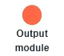 | Controls the specified port dot matrix display to load and show preset graphic patterns. |

**(6) Program Description and Upload**

- Program Schematic


- Complete Program

  1. After the controller powers on, a startup sound plays. When the WonderMind interface displays MCP configuration, press the left button on the controller. The buzzer then plays a ready sound.

  2. Press the right button on the controller to pause large model conversation, actively call the camera to capture frames, activate conversation message output, and voice broadcast the detection prompt. Continuously cycle to retrieve return data transmitted from WonderMind and search frame detection results.

  3. If the detection result contains character "1," the dot matrix module displays the "Hello" pattern and controls the chassis to rotate in place. If the detection result contains character "0," the dot matrix module displays the "❌️" pattern and motors remain stopped. After action execution completes, uniformly send action completion information.


> [!NOTE]
>
> **The source files are available for download under [Program Files](https://drive.google.com/drive/folders/1cIZD1yG0hj_lme2SCWtL_KWlalJhd6ib?usp=sharing).**

- Program Upload: When uploading the program, **first power on the controller, then power on WonderMind** **switch**.


- Device Restart: After successful program upload, the large model module requires **restart** before program verification. **The power-on sequence must strictly follow controller first, then WonderMind. First, in the field ①,then in the field ②. Wait for WonderMind to enter the Waiting for MCP extension tool configuration, press Button A to skip interface, then press the left button on the controller to run the program normally**. If the uploaded program is unchanged, the WonderMind restart step is not required.


### 3.10.5 Expansion and Challenge

**(1) Face Attribute Recognition Linked Control**

Modify the detection prompt to "Detect whether there is a boy or girl in the image." Return values of 1 or 0 to execute different actions such as turning left or turning right, distinguishing the gender of faces in the frame and matching differentiated chassis movements to different recognition results. This relies on facial keypoint feature classification algorithms to achieve attribute determination, and can be extended to campus face greeting robots that distinguish between visitors and staff to perform different interactive actions.

**(2) Multi-Face Counting Interaction Program**

Cyclically tally the total number of faces in the frame. Pass the numerical value to the dot matrix display for dynamic display. Simultaneously adjust light brightness based on person count. Relies on multi-person feature independent matching logic. Applicable to exhibition hall visitor flow counting robots.

### 3.10.6 Q&A

**Question 1: What is the general workflow of facial recognition?**

Answer: First detect the face position, then extract facial features such as keypoints, and finally compare them with features in the database to output identity or verification results. This lesson simplifies the process to detection only.

**Question 2: What states do Hello and X on the dot matrix display represent?** 

Answer: "Hello" indicates successful face detection. "X" indicates no face detected. The two states form intuitive visual feedback for understanding program operation.

###  3.10.7 Technical Support and Product Discussion

If creative ideas emerge after using the product, sharing in the [Hiwonder community](https://forum.hiwonder.com) is welcome:

<a href="https://forum.hiwonder.com.cn/" target="_blank" rel="noopener noreferrer">


</a>

## 3.11  Color Recognition Application

### 3.11.1 Lesson Introduction

This lesson uses vision large models to achieve color recognition and links with the RGB light module to synchronously display detected colors. The lesson covers RGB color mixing principles and RGB light control commands. The program detects color cards through the WonderMind camera, returns color information, then controls the RGB light to display the corresponding color. Simultaneously the chassis can turn or stop. This lesson combines visual perception with light feedback to demonstrate the "perception-feedback" closed loop.

### 3.11.2 Learning Objectives

1. **Knowledge Objectives**: Understand the RGB color model based on the mixing of red, green, and blue as the three primary colors. Understand the technical principles of color recognition, which involve mapping pixels to a color gamut.

2. **Skill Objectives**: Program color detection and control the RGB light display. Combine vision, light, and motion control systems.

3. **Thinking Objectives**: Establish "feature encoding" thinking: encoding color information as RGB numerical values.

4. **Application Objectives**: Connect to smart home lighting adjustment, autonomous driving traffic light recognition, and related applications.

### 3.11.3 Preparation

**(1) Hardware Preparation**

- AiBlock controller
- WonderMind large model module
- 360° block motor
- RGB light module
- Building block parts
- Module cable
- Type-C data cable

**(2) Software Preparation**

- WonderLab programming software

### 3.11.4 Hands-On Project

**(1) Project Analysis**

The program initializes each module, then cyclically detects the camera feed to identify colors such as red, green, and blue. Based on the recognition results, it sets the R, G, and B values of the RGB light, for example, red corresponds to (255, 0, 0) and commands the chassis to execute corresponding actions, such as stopping upon recognizing red or moving forward upon recognizing green.

**(2) Assembly Guide**

<pdf src="../_static/shared/pdf/chapter_3/2.pdf" />

**(3) Module Installation**

First remove the dot matrix module, then complete RGB light module installation according to the following diagram.


**(4) Hardware Wiring**

- Connect the left wheel 360° block motor to port **S1** of the controller using a 3-pin servo cable.
- Connect the right wheel 360° block motor to port **S2** of the controller using a 3-pin servo cable.
- Connect the WonderMind module to port **A** of the controller using a 4-pin module cable.
- Connect the RGB light module to port **B** of the controller using a 4-pin module cable.


**(5) Adding Extensions**

- Select **WonderMind AI** **large model module** under the **Input Module** category.


- Select **360° Motor** under the **Motion module** category.


- Select **RGB module** under the **Output module** category.


**(6) Core Blocks**

| Block                                                        | Category                                                     | Function                                                     |
| :----------------------------------------------------------- | :----------------------------------------------------------- | :----------------------------------------------------------- |
|  |  | Drives the buzzer to play notes at specified pitch and beat duration, runs in background mode without blocking subsequent program execution. |
|  |  | Real-time detection of specified button current level state, returns boolean value indicating whether button is pressed. |
|  |  | Initializes the hardware interface of the WonderMind AI large model module. |
|  |  | Loads default MCP protocol parameter configuration to complete basic large model interaction channel setup. |
|  |  | Activates the MCP conversation channel to enable large model interaction functions. |
|  |  | Pushes action completion command to the large model to notify that current robot action execution is finished. |
|  |  | Reads reply commands and text data issued by the large model for subsequent program calls. |
|  |  | Issues motion control commands to the robot, dropdown menu provides multiple robot actions and device control commands. |
|  |  | Reads corresponding parameter values from large model issued commands, dropdown selection provides various parameters for acquiring action speed, running duration, light color, servo angle, ranging distance, and other data for program logic calls. |
|  |  | Controls the specified port 360° block motor with custom running speed, select forward or reverse rotation direction for continuous operation. |
|  |  | Cuts output to the specified port 360° block motor, causing the motor to stop rotating immediately. |
|  |  | Customizes light color through RGB three-channel numerical values, separately sets red, green, and blue brightness parameters to achieve any solid color light effect. |
|  |  | Activates preset colorful dynamic light effects on the specified port RGB light, automatically cycles color changes. |

**(7) Program Description and Upload**

- Program Schematic


- Complete Program

  1. After the controller powers on, a startup sound plays. When the WonderMind interface displays MCP configuration, press the left button on the controller. The buzzer then plays a ready sound.

  2. Continuously cycle to retrieve data sent from WonderMind to the controller, store as "return data," and separately identify chassis motion commands and RGB light control commands.

  3. When a turn command is identified, parse speed, duration, and angle parameters, map to motor running time, drive S1 and S2 differential motors to rotate, delay stop, then push action completion information. When a light command is identified, read RGB three-color values and colorful mode switch, switch to corresponding light effect, and push action completion information after execution.


> [!NOTE]
>
> **The source files are available for download under [Program Files](https://drive.google.com/drive/folders/1cIZD1yG0hj_lme2SCWtL_KWlalJhd6ib?usp=sharing).**

- Program Upload: When uploading the program, **first power on the controller, then power on WonderMind** **switch**.


- Device Restart: After successful program upload, the large model module requires **restart** before program verification. **The power-on sequence must strictly follow controller first, then WonderMind. First in the field ①, then in the field ②. Wait for WonderMind to enter the Waiting for MCP extension tool configuration, press Button A to skip interface, then press the left button on the controller to run the program normally**. If the uploaded program is unchanged, the WonderMind restart step is not required.


### 3.11.5 Expansion and Challenge

 **(1) Dynamic Color Target Tracking Program**

Real-time reading of frame color coordinate offset dynamically adjusts left and right motor differential speed, enabling the chassis to continuously follow colored target movement. This method relies on pixel color gamut positioning. The application extends to assembly line colored material following transport vehicles.

**(2) Multi-Color Material Automatic Sorting Logic**

Set up three color determination branches for red, blue, and green respectively. After identifying the corresponding color blocks, drive the chassis to move to the designated storage area. Based on the principle of RGB threshold range differentiation, simulate the operational workflow of an automated factory sorting robot.

### 3.11.6 Q&A

**Question 1: How does the RGB light mix multiple colors?**

Answer: The RGB light consists of three independent LEDs in red, green, and blue. By individually controlling the brightness ratio of each through PWM from 0 to 255, it can theoretically produce approximately 16.7 million colors, calculated as 16,777,216 colors, 256^3.

**Question 2:** **What applications does color recognition have in autonomous driving?**

Answer: Autonomous driving requires recognizing traffic signals such as red and green lights, as well as lane markings in white or yellow. Color information serves as a critical basis for decision-making — for instance, stopping at red lights and proceeding at green lights.

### 3.11.7 Technical Support and Product Discussion

If creative ideas emerge after using the product, sharing in the [Hiwonder community](https://forum.hiwonder.com) is welcome:

<a href="https://forum.hiwonder.com.cn/" target="_blank" rel="noopener noreferrer">


</a>

## 3.12 Text Interaction Control

### 3.12.1 Lesson Introduction

This lesson uses the optical character recognition, also known as OCR, function of vision large models to enable robots to "read" text in scenes and trigger actions based on text content. For example, print information when "Hello" is detected, and stop when "STOP" is detected. The lesson covers configuring the vision module for text detection and writing conditional judgment programs. This lesson expands the robot's information acquisition dimension from image to semantics, adding new capability to multimodal interaction.

### 3.12.2 Learning Objectives

1. **Knowledge Objectives**: Understand the basic principles of optical character recognition, commonly known as OCR, and know how large vision models convert image text into readable text.

2. **Skill Objectives**: Program text detection and extract text. Control robot actions based on specific keywords.

3. **Thinking Objectives**: Establish "semantic trigger" thinking: text content serves as control commands.

4. **Application Objectives**: Understand applications such as license plate recognition, package sorting, and document scanning.

### 3.12.3 Preparation

**(1) Hardware Preparation**

- AiBlock controller
- WonderMind large model module
- 360° block motor
- Building block parts
- Module cable
- Type-C data cable

**(2) Software Preparation**

- WonderLab programming software

### 3.12.4 Hands-On Project

**(1) Project Analysis**

This lesson focuses primarily on assembly and conceptual understanding, with the programming portion reserved for subsequent courses. Robotic arm assembly and servo rotation verification are required and test the servo rotation range to prepare for future object grasping tasks. Basic actions such as servo homing and arm lifting can be programmed and implemented.

**(2) Assembly Guide**

<pdf src="../_static/shared/pdf/chapter_3/2.pdf" />

**(3) Hardware Wiring**

- Connect the left wheel 360° block motor to port **S1** of the controller using a 3-pin servo cable.
- Connect the right wheel 360° block motor to port **S2** of the controller using a 3-pin servo cable.
- Connect the WonderMind module to port **A** of the controller using a 4-pin module cable.


**(4) Adding Extensions**

- Select **WonderMind AI** **large model module** under the **Input Module** category.


- Select **360° Motor** under the **Motion module** category.


**(5) Core Blocks**

| Block                                                        | Category                                                     | Function                                                     |
| :----------------------------------------------------------- | :----------------------------------------------------------- | :----------------------------------------------------------- |
|  |  | Drives the buzzer to play notes at specified pitch and beat duration, runs in background mode without blocking subsequent program execution. |
|  |  | Prints custom text strings to the computer via serial port for debugging and information display. |
|  |  | Real-time detection of specified button current level state, returns boolean value indicating whether button is pressed. |
|  |  | Initializes the hardware interface of the WonderMind AI large model module. |
|  |  | Loads default MCP protocol parameter configuration to complete basic large model interaction channel setup. |
|  |  | Activates the MCP conversation channel to enable large model interaction functions. |
|  |  | Temporarily interrupts current large model conversation flow and pauses message transmission and reception. |
|  |  | Calls the camera to capture real-time frames for visual recognition and image reasoning tasks. |
|  |  | Pushes action completion command to the large model to notify that current robot action execution is finished. |
|  |  | Reads reply commands and text data issued by the large model for subsequent program calls. |
|  |  | Issues motion control commands to the robot, dropdown menu provides multiple robot actions and device control commands. |

**(6) Program Description and Upload**

- Program Schematic


- Complete Program

  1. After the controller powers on, a startup sound plays. When the WonderMind interface displays MCP configuration, press the left button on the controller. The buzzer then plays a ready sound.

  2. Press the right button on the controller to pause large model conversation, call the camera to capture frames. Continuously cycle to retrieve return data transmitted from WonderMind and read frame text detection results.

  3. If the detection result contains character "1," print debug text in the lower right corner black box of the software. Push action completion information after finishing.


> [!NOTE]
>
> **The source files are available for download under [Program Files](https://drive.google.com/drive/folders/1cIZD1yG0hj_lme2SCWtL_KWlalJhd6ib?usp=sharing).**

- Program Upload: When uploading the program, **first power on the controller, then power on WonderMind switch**.


- Device Restart: After successful program upload, the large model module requires **restart** before program verification. **The power-on sequence must strictly follow controller first, then WonderMind. First, in the field  ①, then in the field ②. Wait for WonderMind to enter the Waiting for MCP extension tool configuration, press Button A to skip interface, then press the left button on the controller to run the program normally**. If the uploaded program is unchanged, the WonderMind restart step is not required.


### 3.12.5 Expansion and Challenge

**(1) Long Text Keyword Extraction Command Parsing**

Recognize and retrieve keywords such as "forward," "stop," and "turn left" from complete paragraphs, ignoring unrelated text to extract control commands. Relies on string search logic. Adapts to outdoor visual navigation robots for road signs and marker recognition.

**(2) Chinese-English Bilingual Text Compatible Recognition**

Switch OCR model language parameters to respectively adapt to English keywords and Chinese control vocabulary, setting up two determination branches. Optimize underlying text label library. Adapts to multilingual guide service robots.

### 3.12.6 Q&A

**Question 1:** **Why must text detection command descriptions in this lesson use English?**

Answer: As with previous lessons, the underlying vision model is pretrained on English datasets. English keywords ensure accurate command matching. Chinese requires a dedicated Chinese OCR model.

**Question 2:** **If the recognized text contains multiple words, how is key information extracted?**

Answer: String search or regular expression matching can be used for specific terms. For example, the program can search for the keyword "STOP" to trigger braking routines.

### 3.12.7 Technical Support and Product Discussion

If creative ideas emerge after using the product, sharing in the [Hiwonder community](https://forum.hiwonder.com) is welcome:

<a href="https://forum.hiwonder.com.cn/" target="_blank" rel="noopener noreferrer">


</a>

## 3.13 Initial Acquaintance with Embodied Intelligence

### 3.13.1 Lesson Introduction

This lesson integrates the large language, voice, and vision models from the previous 12 lessons, introducing the concept of "embodied intelligence." AI possesses not only a "brain" but also a "body," capable of perceiving, interacting, and executing in the physical world. The lesson reviews each model's functions, poses the question of "how to bring AI from virtual to reality," and then introduces the significance of multimodal integration. The lesson guides through building a robotic arm robot to experience the basic form of embodied intelligence, laying foundation for subsequent integrated projects in object recognition and environmental perception.

### 3.13.2 Learning Objectives

1. **Knowledge Objectives**: Understand the definition of embodied intelligence: intelligent agents achieve perception, learning, and adaptation through physical form interaction with the environment. Learn the necessity of multimodal fusion.

2. **Skill Objectives**: Capable of completing the construction of a robotic arm robot, able to describe the typical architecture of an embodied intelligence system, encompassing perception, decision-making, and execution. 

3. **Thinking Objectives**: Establish "system integration" thinking: combining multiple modules into a complete robot system.

4. **Application Objectives**: Understand the value of embodied intelligence applications such as service robots and industrial robotic arms.

### 3.13.3 Understanding Embodied Intelligence

**(1) Basic Definition of Embodied Intelligence**

Embodied intelligence is an artificial intelligence system equipped with physical hardware, integrating multimodal perception modules for auditory and visual sensing, a decision-making main controller, and motion execution mechanisms. It relies on sensors to collect real-world environmental information, plans actions through model computation, and then operates on the physical world via components such as motors and servo motors, enabling autonomous learning and scene adaptation through continuous interaction with the real environment.

It can be simply understood as: AI possesses a brain, sensory organs, and limbs, the brain handles thinking, the sensory organs comprising microphones and cameras handle perception, and the limbs including robotic arms and tracked chassis handle action.

Core Characteristics:

- Fuses multimodal capabilities: simultaneously possesses listening, speaking, seeing, and text understanding functions.
- Possesses physical entity carrier, capable of touching and manipulating real objects.
- Follows "perception input → model decision → physical execution" closed-loop operation logic.
- Continuously optimizes actions and judgments through real-world interaction.


**(2) Life Interaction Scenarios**

Home cleaning humanoid robot: Equipped with camera and voice module, autonomously avoids obstacles and cleans floors, supports voice call for start and stop.


Exhibition guide service robot: Visually recognizes crowds, conducts voice dialogue Q&A, navigates autonomously.


Medical rehabilitation exoskeleton Robot: Senses human body movements, assists mobility-impaired individuals with walking.


**(3) Embodied Intelligence Three-Layer System Architecture Breakdown**

- **Perception layer refers to sensory organs:** Handled by the WonderMind module. Microphone collects voice. Camera collects images. Completes auditory and visual environmental information input.
- **Decision layer refers to brain:** Controller + multimodal large model. Receives perception data, analyzes scenarios, plans action sequences, and issues motion commands.
- **Execution layer refers to limbs:** Tracked drive motors, robotic arm servos. Receives controller commands and completes physical actions including movement, grasping, lifting, and rotation.

### 3.13.4 Hands-On Project

**(1) Hardware Preparation**

- AiBlock controller  
- WonderMind large model module
- 360° block motor
- 180° block servo
- Ultrasonic sensor
- Dot matrix module
- Building block parts
- Module cable
- Type-C data cable

**(2) Assembly Guide**

<pdf src="../_static/shared/pdf/chapter_3/3.pdf" />

**(3) Hardware Wiring**

- Connect the left wheel 360° block motor to port **S1** of the controller using a 3-pin servo cable.
- Connect the right wheel 360° block motor to port **S2** of the controller using a 3-pin servo cable.
- Connect the robotic arm control 180° block servo to port **S3** of the controller using a 3-pin servo cable.
- Connect the gripper control 180° block servo to port **S4** of the controller using a 3-pin servo cable.
- Connect the WonderMind module to port **A** of the controller using a 4-pin module cable.


### 3.13.5 Expansion and Challenge

**(1) Significance of Multimodal Fusion for Embodied Intelligence**

Single voice or vision models can only receive one type of information, with limited scene recognition capability. After multimodal fusion, robots can simultaneously "hear commands and see objects," combining both information types for comprehensive judgment. Action planning becomes more precise. Interaction becomes more aligned with real-life needs. This is the core foundation enabling embodied intelligence to achieve practical deployment.

**(2) Current Technical Limitations of Embodied Intelligence**

Embodied intelligence currently has three main technical limitations. First, visual recognition accuracy decreases in complex occlusion environments, leading to grasping failures. Second, long-sequence continuous actions are prone to motion stuttering and positioning deviation. Third, autonomous path planning capability in completely unfamiliar environments is limited and requires continuous training optimization.

###  3.13.6 Q&A

**Question 1: What is embodied intelligence? How does it differ from pure software AI?**

Answer: Embodied intelligence refers to intelligent agents that possess physical bodies, perceive the environment through sensors, and influence the environment through actuators. The key difference is that embodied intelligence emphasizes interaction with the real world, while pure software AI only processes information in digital space.

**Question 2: What perception and action components are integrated in the robotic arm robot built in this lesson?**

Answer: ① Perception components: The perception components include the WonderMind module for vision and speech. ② The action components comprise motors for chassis propulsion and servos for robotic arm and gripper control. ③ The controller is responsible for decision-making.

### 3.13.7 Technical Support and Product Discussion

If creative ideas emerge after using the product, sharing in the [Hiwonder community](https://forum.hiwonder.com) is welcome:

<a href="https://forum.hiwonder.com.cn/" target="_blank" rel="noopener noreferrer">


</a>

## 3.14 Object Recognition Interaction

### 3.14.1 Lesson Introduction

This lesson implements object recognition and autonomous grasping with a robotic arm under the embodied intelligence framework. A vision large model identifies obstacle positions, combined with ultrasonic sensor distance measurement. When an object enters a designated zone, the robotic arm automatically clamps and transports it. The dot matrix display shows distance information. This lesson integrates vision, distance measurement, servos, motors, and display modules into a highly comprehensive hands-on project.

### 3.14.2 Learning Objectives

1. **Knowledge Objectives**: Understand the working principle of the ultrasonic sensor, which measures distance through sound wave reflection, and master the programming method for the servo-driven clamping action.

2. **Skill Objectives**: Program the complete workflow of object detection, distance measurement, clamping, and placement. Encapsulate functions to simplify code.

3. **Thinking Objectives**: Build multi-sensor fusion logic by combining visual perception with distance measurement to improve environmental awareness accuracy.

4. **Application Objectives**: understand the core technologies of intelligent warehousing and sorting robots.

### 3.14.3 Preparation

**(1) Hardware Preparation**

- AiBlock controller
- WonderMind large model module
- 360° block motor
- 180° block servo
- Ultrasonic sensor
- Dot matrix module
- Building block parts
- Module cables
- Type-C data cable

**(2) Software Preparation**

- WonderLab programming software

### 3.14.4 Hands-On Project

**(1) Project Analysis**

The program needs to achieve continuous ultrasonic distance measurement. When the distance falls below a threshold such as 15 cm, and vision detects an obstacle, it triggers the robotic arm clamping action driven by a servo rotating the gripper, then places the object in a designated area through a servo rotating the arm. The dot matrix display shows distance values in real time.

**(2) Assembly Guide**

<pdf src="../_static/shared/pdf/chapter_3/3.pdf" />

**(3) Module Installation**

Complete the installation of the dot matrix module according to the figure below.


**(4) Hardware Wiring**

- Connect the left wheel 360° block motor to port **S1** of the controller using a 3-pin servo cable.
- Connect the right wheel 360° block motor to port **S2** of the controller using a 3-pin servo cable.
- Connect the robotic arm control 180° block servo to port **S3** of the controller using a 3-pin servo cable.
- Connect the gripper control 180° block servo to port **S4** of the controller using a 3-pin servo cable.
- Connect the WonderMind module to port **A** of the controller using a 4-pin module cable.
- Connect the ultrasonic sensor to port **B** of the controller using a 4-pin module cable.
- Connect the dot matrix module to port **C** of the controller using a 4-pin module cable.


**(5) Adding Extensions**

- Select **Ultrasonic sensor** and **WonderMind AI large model module** under the **Input Module** category.


- Select **180° servo** and  **360° Motor** under the **Motion module** category.


- Select **Dot matrix module** in the **Output module** category.


**(6) Core Blocks**

| Block                                                        | Category                                                     | Function                                                     |
| :----------------------------------------------------------- | :----------------------------------------------------------- | :----------------------------------------------------------- |
|  |  | Drives the buzzer to play a note with specified pitch and beat in background mode without blocking subsequent program execution. |
| 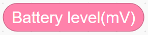 |  | Reads the current battery voltage in millivolts for power monitoring and judgment. |
|  |  | Real-time detection of the specified button's current level state, returning a boolean value to determine whether the button is pressed. |
|  |  | Creates a custom function with no input parameters, encapsulating a segment of reusable program logic internally. |
|  |  | Calls a defined parameter-free function, executing all program logic encapsulated within the function. |
|  |  | Generates an empty list container that can store multiple data types such as numbers and text for subsequent add, delete, modify, and query operations. |
|  |  | Appends a new element at the end of the list to expand list content. |
|  |  | Clears all stored elements in the target list, resetting the list to empty. |
|  |  | Inserts custom content before the element at the specified index in the list. |
|  |  | Initializes the hardware interface of the WonderMind AI large model module. |
|  |  | Loads default MCP protocol parameter configuration to complete the basic setup of the large model interaction channel. |
|  |  | Opens the MCP dialogue channel to activate large model interaction functionality. |
|  |  | Pushes an action completion command to the large model to notify that the current robot action execution is finished. |
|  |  | Pushes custom status information to the MCP large model channel, uploading the text in the block as a status command to inform the large model of the robot's current operating status for decision-making. |
|  |  | Reads the reply commands and text data issued by the large model for subsequent program calls. |
|  |  | Issues motion control commands to the robot, with dropdown selection of multiple robot actions and device control commands. |
|  |  | Reads the parameter value corresponding to the command issued by the large model, with dropdown selection of various parameters for obtaining action speed, runtime duration, light color, servo angle, measured distance, and other data for program logic calls. |
|  |  | Initializes the hardware interface of the ultrasonic sensor. |
|  |  | Obtains the obstacle distance data measured by the ultrasonic sensor, unit: centimeter or cm. |
|  |  | Controls the 360° block motor at the specified port to run continuously at a custom speed, selecting forward / reverse rotation direction. |
|  |  | Cuts off the output of the 360° block motor at the specified port, causing the motor to stop rotating immediately. |
|  |  | Controls the 180° block servo at the specified port to run at a custom speed for a specified duration, selecting no-delay mode allows the program to continue executing subsequent blocks without waiting for the motor motion to finish. |
|  |  | Controls the dot matrix display at the specified port to load and display a preset graphic pattern. |

**(7) Program Description and Upload**

- Program Schematic


- Complete Program

  1. Upon powering on, the controller initializes the ultrasonic sensor connected to port **B**, resets servos **S3** and **S4** to their initial angles, and plays the startup sound. Once the WonderMind interface displays the MCP configuration, press the left button on the controller; the buzzer will then sound to indicate it is ready.
  2. Pre-define three motion functions for homing, gripping, and placing. These functions control the timed servo movements of the robotic arm and gripper. In the main loop, continuously read the data returned by WonderMind and classify it into grasp, chassis movement, or sensor reading commands.
  3. For grasp commands, the system executes the corresponding motion based on parameter 0, 1, or 2, simultaneously displays an icon on the dot-matrix screen, and sends an action completion message. For motion commands, it parses the speed and duration parameters to drive motors **S1** and **S2** for the specified duration before stopping them. For sensor commands, it reads the voltage and ranging data into a list, reports the device status, and then clears the buffer.


> [!NOTE]
>
> **The source files are available for download under [Program Files](https://drive.google.com/drive/folders/1cIZD1yG0hj_lme2SCWtL_KWlalJhd6ib?usp=sharing).**

- Program Upload: When uploading the program, **turn on the controller switch first, then turn on the WonderMind switch**.


- Device restart: After successful program upload, the large model module needs to be **restarted** before program verification. **The power-on sequence must strictly follow controller first, then WonderMind, first in the field ①, then in the field ②. Wait until WonderMind enters the Waiting for MCP extension tool configuration, press A key to skip interface, then press the left button on the controller for normal program operation.** If the uploaded program has not been modified, no WonderMind restart is needed.


### 3.14.5 Expansion and Challenge

**(1) Color + Distance Dual-Fusion Sorting Program**

Simultaneously read ultrasonic distance and visual color information, executing corresponding grasping and transport actions after dual verification. Multi-sensor fusion reduces the misjudgment probability of single recognition, applicable to material classification warehousing robots.

 **(2) Voice-Triggered Automatic Grasping Workflow**

Add a voice wake-up grasping switch, activating distance measurement and visual detection only after receiving the "grasp" command. Rely on multi-round dialogue context memory to prevent the robot from falsely triggering clamping actions.

 

### 3.14.6 Q&A

**Question 1: Why can ultrasonic sensors measure distance? What factors affect their measurement range?**

Answer: It emits ultrasonic waves and receives the echo, calculating the distance by multiplying the time difference by the speed of sound. The measurement range is affected by environmental noise and object material, such as sound-absorbing materials.

**Question 2: Why does this lesson encapsulate functions such as clamping and placement?**

Answer: Encapsulating functions makes the main program more concise, facilitating repeated calls and debugging. It also improves code readability and maintainability, representing good programming practice.

###  3.14.7 Technical Support and Product Discussion

If creative ideas emerge after using the product, sharing in the [Hiwonder community](https://forum.hiwonder.com) is welcome:

<a href="https://forum.hiwonder.com.cn/" target="_blank" rel="noopener noreferrer">


</a>

## 3.15 Environmental Perception Applications

### 3.15.1 Lesson Introduction

This lesson introduces the light sensor, the temperature and humidity sensor, enabling the robot to perceive its environment and implement "a smart potted plant care scenario." The robot can detect light intensity and temperature and humidity data, provide care recommendations through WonderMind such as "sufficient light" or "needs watering", and simulate automatic watering actions through robotic arm swinging. This lesson emphasizes the complete intelligent closed loop from data to decision to action, cultivating the ability to solve practical problems.

### 3.15.2 Learning Objectives

- **Knowledge Objectives**: Understand the working principles of the light sensor and the temperature and humidity sensor, learn how environmental data is converted into digital signals.
- **Skill Objectives**: Program the robot to read sensor data and determine environmental states based on thresholds, control a servo to simulate the watering action.
- **Thinking Objectives**: Establish "threshold-based decision-making" thinking — making decisions by comparing measured values against preset thresholds.
- **Application Objectives**: Connect to applications such as smart agricultural greenhouses and smart home environmental control.

### 3.15.3 Preparation

**(1) Hardware Preparation**

- AiBlock controller
- WonderMind large model module
- 360° block motor
- 180° block servo
- Ultrasonic sensor
- Temperature and humidity sensor
- Light sensor
- Building block parts
- Module cables
- Type-C data cable

**(2) Software Preparation**

- WonderLab programming software

### 3.15.4 Hands-On Project

**(1) Project Analysis**

The program cyclically reads light intensity values ranging from 0 to 100 and temperature and humidity values. Based on predefined thresholds, it determines that light intensity greater than 70 is considered strong light, while less than 30 is considered weak light. Humidity below 40% indicates dry conditions requiring watering. WonderMind broadcasts recommendations accordingly and executes watering actions by rotating a servo motor to simulate sprinkling.

**(2) Assembly Guide**

<pdf src="../_static/shared/pdf/chapter_3/3.pdf" />

**(3) Module Installation**

First remove the dot matrix module, then complete the installation of the light sensor according to the figure below.


Then complete the installation of the temperature and humidity sensor according to the figure below.


**(4) Hardware Wiring**

- Connect the left-wheel 360° block motor to port **S1** of the controller using a 3-pin servo cable.
- Connect the right-wheel 360° block motor to port **S2** of the controller using a 3-pin servo cable.
- Connect the 180° block servo controlling the robotic arm to port **S3** of the controller using a 3-pin servo cable.
- Connect the 180° block servo controlling the gripper to port **S4** of the controller using a 3-pin servo cable.
- Connect the WonderMind module to port **A** of the controller using a 4-pin module cable.
- Connect the light sensor to port **B** of the controller using a 4-pin module cable.
- Connect the dot matrix module to port **C** of the controller using a 4-pin module cable.


**(5) Adding Extensions**

- Select **Light sensor**, **Temperature humidity sensor**, **WonderMind AI**  **large model module** under the **Input Module** category.  


- Select **180° servo** and **360° Motor** under the **Motion module** category.


**(6) Core Blocks**

| Block                                                        | Category                                                     | Function                                                     |
| :----------------------------------------------------------- | :----------------------------------------------------------- | :----------------------------------------------------------- |
|  |  | Drives the buzzer to play notes at specified pitch and beat in background mode without blocking subsequent program execution. |
|  |  | Prints custom text strings to the computer via serial port for debugging and information viewing. |
|  |  | Real-time detection of the current electrical level state of the specified button, returning a Boolean value to determine whether the button is pressed. |
|  |  | Creates a custom function with no input parameters, encapsulating a segment of reusable program logic internally. |
|  |  | Calls a defined parameter-free function and executes all program logic encapsulated within the function. |
|  |  | Generates an empty list container that can store multiple data types including numbers and text for subsequent add, delete, modify, and query operations. |
|  |  | Clears all stored elements in the target list and resets the list to empty. |
|  |  | Inserts custom content before the element at the specified index in the list. |
|  |  | Initializes the hardware interface of the WonderMind AI large model module. |
|  |  | Loads default MCP protocol parameter configuration to complete the basic setup of the large model interaction channel. |
|  |  | Activates the MCP dialogue channel to enable large model interaction functionality. |
|  |  | Pushes an action completion command to the large model to notify that the current robot action has been executed. |
|  |  | Pushes custom text information to the MCP large model channel to achieve device interaction communication. |
|  |  | Configures MCP tool invocation related parameters, defining tool identifier, function description, trigger command, and return data format, and setting whether to block and wait for tool execution completion, used to build robot tool interfaces callable by the large model. |
|  |  | Pushes custom status information to the MCP large model channel, uploading the text in the block as a status command to inform the robot's current operating status for large model decision-making. |
|  |  | Reads reply commands and text data issued by the large model for subsequent program invocation. |
|  |  | Initializes the hardware interface of the temperature and humidity sensor. |
|  |  | Real-time reading of temperature or humidity values.         |
|  |  | Controls the specified port 360° block motor to run continuously at a custom speed, selecting forward / reverse direction. |
|  |  | Cuts off the output of the specified port 360° block motor, causing the motor to stop rotating immediately. |
|  |  | Controls the specified port 180° block servo to run for a specified duration at a custom speed, in non-delay mode, the program does not wait for the motor to finish running and continues executing subsequent blocks directly. |

**(7) Program Description and Upload**

- Program Schematic


- Complete Program

  1. After the controller powers on, initialize the temperature and humidity sensor at port **C**, reset servos **S3** and **S4** to initial angles, and play the startup sound effect. Wait until the WonderMind interface displays the MCP configuration, then press the left button on the controller, and the buzzer plays the ready sound effect.

  2. Define a custom watering function that controls servo **S4** to rotate to the watering position, automatically resetting after a 3-second delay. Continuously loop to obtain return data from WonderMind, distinguishing between environmental collection commands and mechanical control commands.

  3. Identify temperature and humidity collection commands and store the values in a data list. Identify watering control commands, drive the chassis to run for 1 second and stop when conditions are met, call the watering function, and push action completion information. When the list contains valid environmental data, push device status information outward, then clear the list and wait for the next round of collection.


> [!NOTE]
>
> **The source files are available for download under [Program Files](https://drive.google.com/drive/folders/1cIZD1yG0hj_lme2SCWtL_KWlalJhd6ib?usp=sharing).**

* Program Upload: When uploading the program, **turn on the controller switch first, then turn on the WonderMind switch**.


- Restart the device: After successful program upload, the large model module needs to **restart** before program verification. **The power-on sequence must strictly follow controller first, then WonderMind, first in the field ①, then in the field ②. Wait until WonderMind enters the Waiting for MCP extension tool configuration, click Button A to skip interface, then press the left button on the controller to run the program normally**. If the uploaded program has not been modified, no restart of WonderMind is required.


### 3.15.5 Expansion and Challenge

**(1) Multi-Point Plant Zone Inspection**

The chassis carries the sensor module and cycles to multiple detection points to collect temperature, humidity, and light data respectively. Relying on cyclic motion logic, differentiated care judgment for multiple potted plants is achieved, applicable to smart greenhouse inspection equipment.

**(2) Environmental Data Storage and Trend Judgment**

Use the list container to store environmental values collected at timed intervals for long-term storage, and predict dry and wet and light changes through comparison of before-and-after values. This can be expanded to agricultural monitoring robots that push care warning information in advance.

### 3.15.6 Q&A

**Question 1: What physical quantities do the light sensor and the temperature and humidity sensor convert into electrical signals respectively?**

Answer: The light sensor converts light intensity into resistance changes, which are then converted into voltage values. The temperature and humidity sensor converts temperature and humidity into digital signals such as via the I2C interface, which the controller reads directly.

**Question 2: In this lesson, the watering decision threshold is humidity below 40%. How is this threshold determined?**

Answer: The threshold needs to be set according to different plants' water requirements and can be determined through experiments or reference materials. In teaching, it can be set as an adjustable parameter to let students experience how parameter tuning affects decision-making.

### 3.15.7 Technical Support and Product Discussion

If creative ideas emerge after using the product, sharing in the [Hiwonder community](https://forum.hiwonder.com) is welcome:

<a href="https://forum.hiwonder.com.cn/" target="_blank" rel="noopener noreferrer">


</a>

## 3.16 AI Model Comprehensive Practice Field

### 3.16.1 Lesson Introduction 

This lesson serves as the culminating finale of the course series, requiring the comprehensive application of all sensors, actuators, and three large models encompassing language, voice, and vision learned in the previous three lessons to independently design and implement a fully functional intelligent robot project. The course provides two reference options, namely a light-sensing robot and a pipe inspection robot, while also encouraging free creativity. Through 15 minutes of independent development, the project encompasses the complete workflow: requirements definition, hardware assembly, programming and debugging, and presentation and optimization. This process thoroughly consolidates all acquired knowledge.


### 3.16.2 Learning Objectives

1. **Knowledge Objectives**: Consolidate the core functions of large language, voice, and vision models, and understand the basic architecture of multimodal integration.

2. **Skill Objectives**: Independently plan projects, assemble hardware, write comprehensive programs, and achieve multi-sensor linkage and model collaboration.

3. **Thinking Objectives**: Cultivate "system design" thinking by starting from functional requirements, selecting appropriate modules, and rationally allocating resources.

4. **Application Objectives**: Stimulate innovation awareness and migrate learned technologies to solving real-world problems.

### 3.16.3 Preparation

**(1) Hardware Preparation**

- Controller: AiBlock controller
- AI core module: WonderMind large model module
- Input sensors may be selected and combined as needed, including ultrasonic sensor, light sensor, and temperature and humidity sensor
- Motion modules: 360° block motor, 180° block servo
- Audio-visual output modules: RGB light module, dot matrix module
- Others: 4-pin module cable, 3-pin servo cable, Type-C data cable, building block parts

**(2) Software Preparation**

- WonderLab programming software

**(3) Pre-Lesson Preview Tasks**

Independently review core knowledge points from previous lessons:

① What are the three WonderMind models and their respective functions.

② Wiring interface specifications for various sensors across sensor ports **A**, **B**, **C**, and **D** supporting I2C ports.

③ Motor and servo corresponding **S1** to **S4** power interface distinctions.

④ Standard device power-on / off, network pairing, and MCP configuration operation sequence.

### 3.16.4 Hands-On Project

**(1) Pre-Lesson Knowledge Review**

1. First, independently consider the following questions to complete knowledge consolidation:

The vision large model = AI's eyes, capable of face, object, color, and text recognition.

The voice large model = AI ears + mouth, responsible for voice recognition, voice broadcast, and voice dialogue.

The large language model = AI brain, parsing text and voice instructions to make logical judgments.

A single AI module has limited functionality. Only the combination of multiple models + sensors + motors can complete complex intelligent tasks.

2. Independently categorize all kit modules into three hardware categories:

Controller: AiBlock Main Controller, the central command hub for all devices.

Input perception modules, which collect external information: WonderMind module, ultrasonic sensor, light sensor, and temperature and humidity sensor.

The output and power module, which receives commands and performs actions, includes the RGB light, dot matrix display, 360-degree building block motor, and 180-degree building block servo.

3. Independent thinking task: If building an inspection robot, which hardware is needed? What role does each component play?

**(2) Reference Case Independent Development Guide**

- **Case 1: Light-Sensing Robot**


1. Project functional requirements:

The robot autonomously advances at low speed in dark environments. The light-sensitive sensor continuously detects ambient light intensity, and when the light suddenly brightens due to factors such as approaching a window or light source obstruction, combined with the ultrasonic sensor detecting nearby obstacles, both conditions are simultaneously satisfied to trigger the RGB red light flashing as a warning, the dot matrix display showing alert characters, and the WonderMind voice broadcasting "Obstacle ahead, please detour." After voice wake-up, voice commands can control the robot to stop or continue moving forward.

2. Independent hardware selection and wiring guide:

- Hardware inventory for self-checking and retrieval

AiBlock controller, WonderMind module, light sensor, ultrasonic sensor, 360° block motor, RGB light module

- Standard wiring to be completed independently

Connect the WonderMind module to port **A** of the controller using a 4-pin module cable.

Connect the light sensor to port **B** of the controller using a 4-pin module cable.

Connect the ultrasonic sensor to port **C** of the controller using a 4-pin module cable.

Connect the left motor to port **S1** of the controller using a 3-pin servo cable.

Connect the right motor to port **S2** of the controller using a 3-pin servo cable.

Connect the RGB light module to port **D** of the controller using a 4-pin module cable.

3. Independent assembly steps:

Use standard blocks to build a triangular tracked chassis and fix the left and right motors. Reserve space at the front of the chassis for the ultrasonic sensor. Fix the WonderMind module on the top bracket, install the light sensor on the side, and secure the RGB light module with side clips to complete the assembly.

4. Independent WonderLab programming software steps:

- Open the software and create a blank project.
- Add extensions: select **AI Blocks Board**, **WonderMind**, **360 Motor**, **Light sensor**, **Ultrasonic**, and **RGB module**.
- Independently build initialization blocks:

Power-on initialization of WonderMind, loading MCP configuration, activating dialogue channel.

Initialization of light and ultrasonic sensors.

Power-on buzzer playing startup sound effect.

- Independently design main loop logic:

① Continuously read light value and ultrasonic distance.

② Judgment condition: light > 70 and distance < 15 cm.

③ Warning condition satisfied: RGB red light flashes, dot matrix displays WARN, WonderMind voice broadcasts warning.

④ Condition not satisfied: RGB turns off, motors run straight at low speed.

- Voice interaction branch: read the returned dialogue text from WonderMind, recognize "forward" and "stop" voice commands, and control motor startup and stopping.
- Program self-check: verify completeness of initialization, loop, and conditional judgment blocks. 

5. Device downloading and debugging to be performed independently:

- Strictly follow power-on sequence: first turn on controller power, then turn on WonderMind module.
- Wait for WonderMind module to complete WiFi network pairing and MCP configuration interface.
- Connect computer and controller via Type-C, select corresponding port to upload program.
- After upload completes, restart WonderMind, press the left button on the controller to start the program.
- Independently troubleshoot:

① Sensor no data: check whether A / B / C interface wiring is firmly inserted.

② No voice broadcast: confirm MCP configuration block has been added.

③ Motor not moving: verify **S1** / **S2** interface matches program motor numbering.

- **Case 2: Pipeline Inspection Robot**

1. Project functional requirements:

Simulate narrow pipeline internal inspection scenario. The tracked robot continues straight ahead. The ultrasonic sensor detects front obstacle distance in real time. The dot matrix dynamically displays centimeter values in real time. When distance is less than 10 cm, the robot immediately stops, the RGB yellow light stays on, and WonderMind voice broadcasts "Obstacle detected ahead." Voice commands "turn left / turn right" are issued, and the robot executes turning actions.

2. Independent hardware selection and wiring guide:

- Hardware inventory for independent reference and retrieval

AiBlock controller, WonderMind module, ultrasonic sensor, 360° block motor, RGB light module, dot matrix module

- standard wiring independently complete

Connect the WonderMind module to port **A** of the controller using a 4-pin module cable.

Connect the ultrasonic sensor to port **B** of the controller using a 4-pin module cable.

Connect the left motor to port **S1** of the controller using a 3-pin servo cable.

Connect the right motor to port **S2** of the controller using a 3-pin servo cable.

Connect the dot matrix module to port **C** of the controller using a 4-pin module cable.

Connect the RGB light module to port **D** of the controller using a 4-pin module cable.

3. Independent assembly steps:

Build a narrow tracked chassis adapted to confined pipeline space. Fix the ultrasonic sensor at the front facing the forward direction. Install the dot matrix display at the middle of the body for convenient distance value observation. Fix the WonderMind module on the top bracket.

4. Independent WonderLab programming software steps:

- Open the software and create a blank project.
- Under the extensions menu, independently select and add: AI blocks board, WonderMind large model, 360° motor, light sensor, ultrasonic sensor, and RGB module.
- Independently build initialization blocks:

Power-on initialization of all modules, completing large model MCP basic configuration.

- Independently design main loop logic:

① Loop reading ultrasonic distance, dot matrix real-time printing of numbers.

② Distance < 10 cm: all motors stop, RGB yellow light turns on, voice alarm.

③ Distance > 10 cm: motors run straight at uniform speed, RGB turns off.

- Voice interaction branch: recognize left turn / right turn text, execute differential steering logic.
- After program completion, independently sort out the signal flow: ultrasonic data acquisition → main controller judgment → motor / light / voice execution feedback.

5. Autonomous device download and debugging:

- Strictly follow power-on sequence: first turn on controller power, then turn on WonderMind module.
- Wait for WonderMind module to complete WiFi network pairing and MCP configuration interface.
- Connect computer and controller via Type-C, select corresponding port to upload program.
- After upload completes, restart WonderMind, press the left button on the controller to start the program.
- Independent testing: move hand close to ultrasonic sensor, observe whether dot matrix value changes, robot stops, and voice prompt trigger synchronously.

### 3.16.5 Free Creative Expansion with Independent Innovation Tasks

Not limited to the two reference cases, students may combine life scenarios to independently design brand-new AI robots. Creative reference directions provided:

① Smart Environment Care Robot: Temperature and humidity + light sensors, voice broadcast indoor temperature and humidity, simulate watering action when humidity is low.

② Face Greeting Robot: Vision recognizes face, after recognition light changes color, voice greets, chassis rotates.

③ Item Sorting Robot: Vision recognizes red / blue colors, corresponding left / right turn sorting.

### 3.16.6 Analysis and Summary through Independent Review and Consolidation

**(1) Core Knowledge Independent Review**

1. Three AI model division of labor:

- The voice large model is responsible for auditory recognition and voice broadcasting, functioning as the human ears and mouth.
- The vision large model is responsible for image acquisition and object, face, and text recognition, serving as the human eyes.
- The large language model is responsible for semantic understanding and instruction parsing, functioning as the human brain for thinking.

2. Core linkage carrier: AiBlock controller serves as the center, receiving data from AI modules and sensors, and issuing instructions to control motors, lights, and other execution components.

3. Complete intelligent closed loop: sensors / vision / voice collect external information → controller + large model logical judgment → motors, audio-visual modules execute feedback.

**(2) Life Skills Transfer through Independent Thinking**

Classroom multimodal fusion technology is widely applied in commercial smart devices on the market:

Household sweeping robots that integrate visual obstacle avoidance, voice control, and distance sensors, restaurant delivery robots, park inspection vehicles, and intelligent greenhouse maintenance equipment all employ the same "perception-decision-execution" technical architecture at the underlying level.

### 3.16.7 Technical Support and Product Discussion

If creative ideas emerge after using the product, sharing in the [Hiwonder community](https://forum.hiwonder.com) is welcome:

<a href="https://forum.hiwonder.com.cn/" target="_blank" rel="noopener noreferrer">


</a>