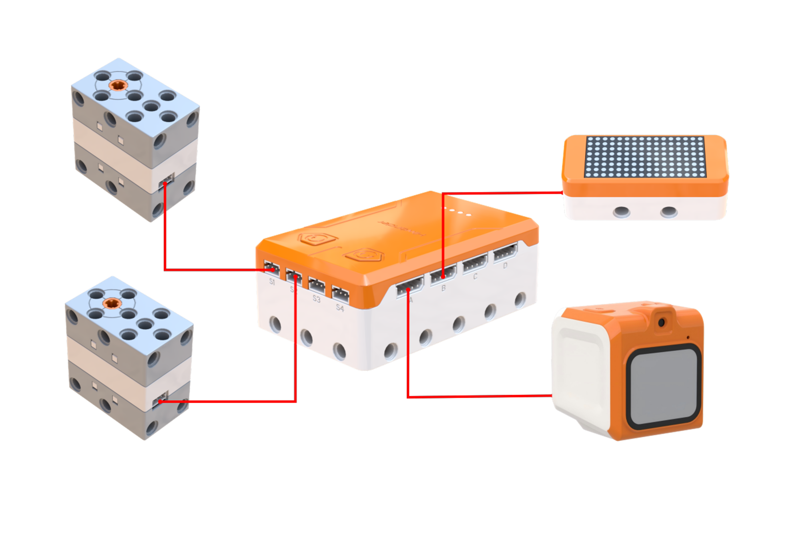
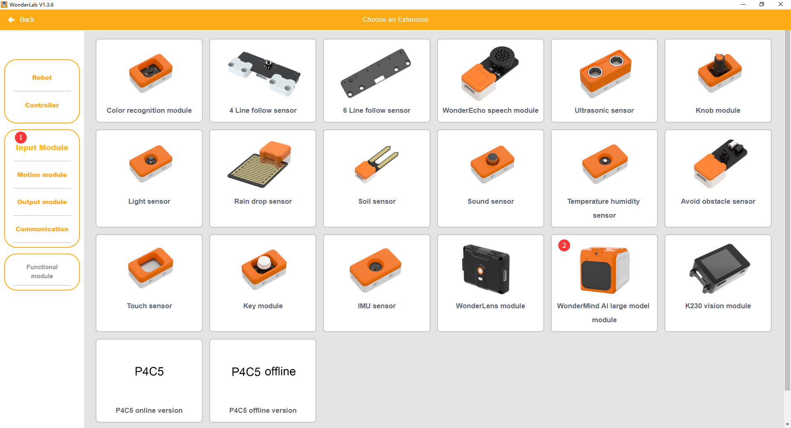
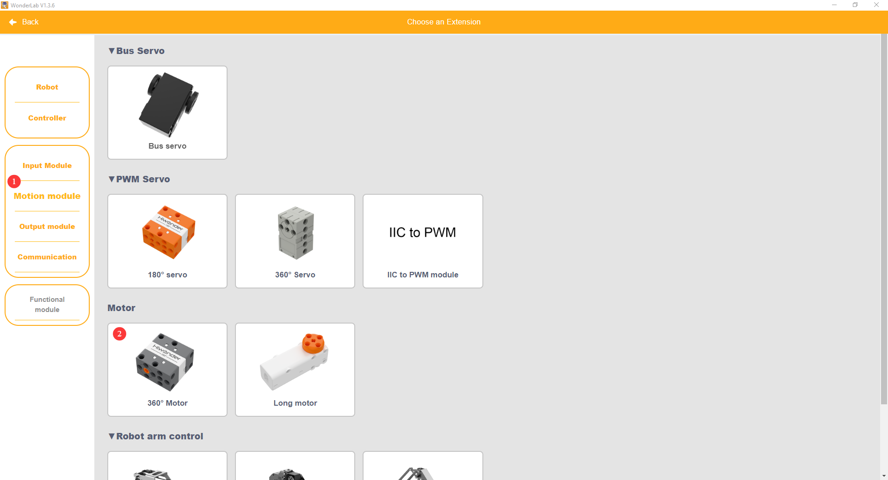
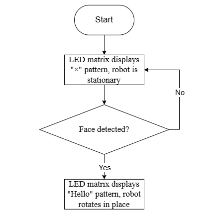
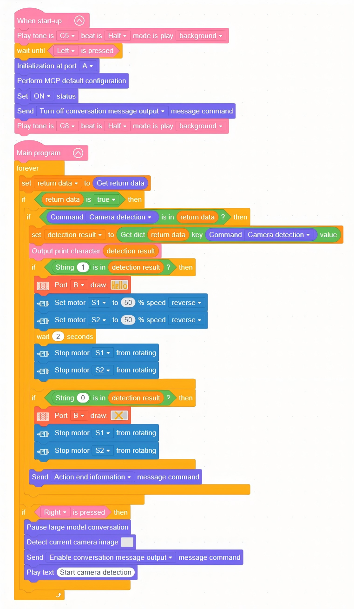

# 3.10 Facial Recognition Practice

## 3.10.1 Lesson Introduction

This lesson focuses on facial recognition technology within vision large models. The lesson studies the basic facial recognition workflow: detecting faces, extracting features, and matching identities. WonderMind is used to achieve "recognize face → trigger action." The program integrates with the dot matrix module. When a face is detected, the dot matrix displays "Hello" and the chassis rotates one full turn. When no face is detected, the display shows "X." This lesson integrates vision, display, and motion control to advance comprehensive programming skills.

##  3.10.2 Learning Objectives

1. **Knowledge Objectives**: Understand the core steps of face recognition, namely detection, feature extraction, and comparison. Understand the working principles of dot matrix modules.

2. **Skill Objectives**: Program facial detection and control the dot matrix display pattern. Combine with motors to achieve action response.

3. **Thinking Objectives**: Establish "conditional trigger" logic: detection results determine subsequent behavior.

4. **Application Objectives**: Connect to real-world applications such as mobile face unlock and attendance check-in systems.

## 3.10.3 Preparation

###  (1) Hardware Preparation

- AiBlock controller
- WonderMind large model module
- 360° block motor
- Dot matrix module
- Building block parts
- Module cable
- Type-C data cable

### (2) Software Preparation

- WonderLab programming software

## 3.10.4 Hands-On Project

###  (1) Project Analysis

The program cyclically detects camera frames. If the return contains "face detected," the dot matrix displays "Hello" and the chassis rotates in place one full turn. Otherwise, the display shows "X" and the chassis halts. Additionally, button-triggered detection can be added.

###  **(2) Assembly Guide**

<pdf src="../../_static/shared/pdf/chapter_3/2.pdf" />

###  (3) Hardware Wiring

- Connect the left wheel 360° block motor to port **S1** of the controller using a 3-pin servo cable.
- Connect the right wheel 360° block motor to port **S2** of the controller using a 3-pin servo cable.
- Connect the WonderMind module to port **A** of the controller using a 4-pin module cable.
- Connect the dot matrix module to port **B** of the controller using a 4-pin module cable.

### (4) Adding Extensions

- Select **WonderMind AI** **large model module** under the **Input Module** category.

- Select **360° Motor** under the **Motion module** category.

- Select **Dot matrix module** under the **Output module** category.

### (5) Core Blocks

| Block                                                        | Category                                                     | Function                                                     |
| :----------------------------------------------------------- | :----------------------------------------------------------- | :----------------------------------------------------------- |
|  |  | Drives the buzzer to play notes at specified pitch and beat duration, runs in background mode without blocking subsequent program execution. |
|  |  | Prints custom text strings to the computer via serial port for debugging and information display. |
|  |  | Real-time detection of specified button current level state, returns boolean value indicating whether button is pressed. |
|  |  | Initializes the hardware interface of the WonderMind AI large model module. |
|  |  | Loads default MCP protocol parameter configuration to complete basic large model interaction channel setup. |
|  |  | Activates the MCP conversation channel to enable large model interaction functions. |
|  |  | Outputs the entered text content through voice broadcast.    |
|  |  | Temporarily interrupts current large model conversation flow and pauses message transmission and reception. |
|  |  | Calls the camera to capture real-time frames for visual recognition and image reasoning tasks. |
|  |  | Pushes action completion command to the large model to notify that current robot action execution is finished. |
|  |  | Reads reply commands and text data issued by the large model for subsequent program calls. |
|  |  | Issues motion control commands to the robot, dropdown menu provides multiple robot actions and device control commands. |
|  |  | Controls the specified port 360° block motor with custom running speed, select forward or reverse rotation direction for continuous operation. |
|  |  | Cuts output to the specified port 360° block motor, causing the motor to stop rotating immediately. |
|  |  | Controls the specified port dot matrix display to load and show preset graphic patterns. |

### (6) Program Description and Upload

- Program Schematic

- Complete Program

  1. After the controller powers on, a startup sound plays. When the WonderMind interface displays MCP configuration, press the left button on the controller. The buzzer then plays a ready sound.

  2. Press the right button on the controller to pause large model conversation, actively call the camera to capture frames, activate conversation message output, and voice broadcast the detection prompt. Continuously cycle to retrieve return data transmitted from WonderMind and search frame detection results.

  3. If the detection result contains character "1," the dot matrix module displays the "Hello" pattern and controls the chassis to rotate in place. If the detection result contains character "0," the dot matrix module displays the "❌️" pattern and motors remain stopped. After action execution completes, uniformly send action completion information.

> [!NOTE]
>
> **The source files are available for download under [Program Files](https://drive.google.com/drive/folders/1cIZD1yG0hj_lme2SCWtL_KWlalJhd6ib?usp=sharing).**

- Program Upload: When uploading the program, **first power on the controller, then power on WonderMind** **switch**.

- Device Restart: After successful program upload, the large model module requires **restart** before program verification. **The power-on sequence must strictly follow controller first, then WonderMind. First, in the field ①,then in the field ②. Wait for WonderMind to enter the Waiting for MCP extension tool configuration, press Button A to skip interface, then press the left button on the controller to run the program normally**. If the uploaded program is unchanged, the WonderMind restart step is not required.

## 3.10.5 Expansion and Challenge

**(1) Face Attribute Recognition Linked Control**

Modify the detection prompt to "Detect whether there is a boy or girl in the image." Return values of 1 or 0 to execute different actions such as turning left or turning right, distinguishing the gender of faces in the frame and matching differentiated chassis movements to different recognition results. This relies on facial keypoint feature classification algorithms to achieve attribute determination, and can be extended to campus face greeting robots that distinguish between visitors and staff to perform different interactive actions.

**(2) Multi-Face Counting Interaction Program**

Cyclically tally the total number of faces in the frame. Pass the numerical value to the dot matrix display for dynamic display. Simultaneously adjust light brightness based on person count. Relies on multi-person feature independent matching logic. Applicable to exhibition hall visitor flow counting robots.

## 3.10.6 Q&A

**Question 1: What is the general workflow of facial recognition?**

Answer: First detect the face position, then extract facial features such as keypoints, and finally compare them with features in the database to output identity or verification results. This lesson simplifies the process to detection only.

**Question 2: What states do Hello and X on the dot matrix display represent?** 

Answer: "Hello" indicates successful face detection. "X" indicates no face detected. The two states form intuitive visual feedback for understanding program operation.

##  3.10.7 Technical Support and Product Discussion

If creative ideas emerge after using the product, sharing in the [Hiwonder community](https://forum.hiwonder.com) is welcome:

