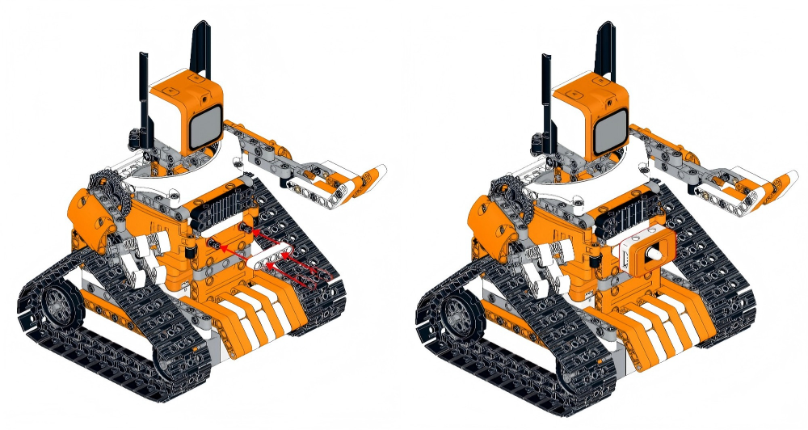
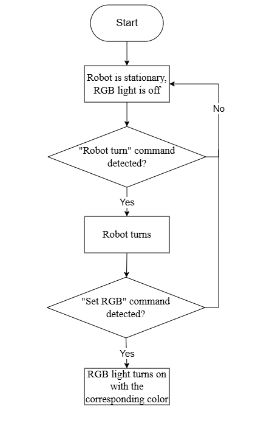
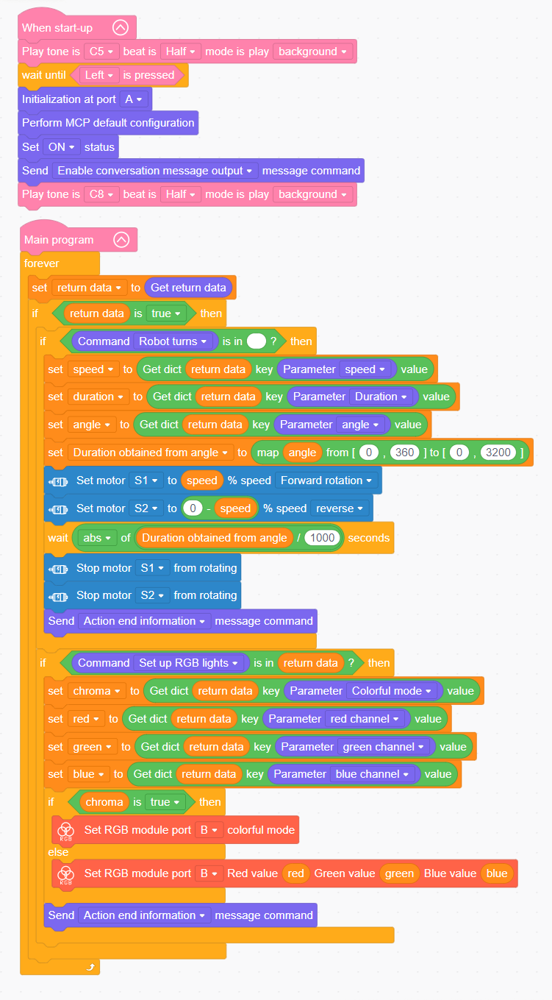

# 3.11  Color Recognition Application

## 3.11.1 Lesson Introduction

This lesson uses vision large models to achieve color recognition and links with the RGB light module to synchronously display detected colors. The lesson covers RGB color mixing principles and RGB light control commands. The program detects color cards through the WonderMind camera, returns color information, then controls the RGB light to display the corresponding color. Simultaneously the chassis can turn or stop. This lesson combines visual perception with light feedback to demonstrate the "perception-feedback" closed loop.

## 3.11.2 Learning Objectives

1. **Knowledge Objectives**: Understand the RGB color model based on the mixing of red, green, and blue as the three primary colors. Understand the technical principles of color recognition, which involve mapping pixels to a color gamut.

2. **Skill Objectives**: Program color detection and control the RGB light display. Combine vision, light, and motion control systems.

3. **Thinking Objectives**: Establish "feature encoding" thinking: encoding color information as RGB numerical values.

4. **Application Objectives**: Connect to smart home lighting adjustment, autonomous driving traffic light recognition, and related applications.

## 3.11.3 Preparation

### (1) Hardware Preparation

- AiBlock controller
- WonderMind large model module
- 360° block motor
- RGB light module
- Building block parts
- Module cable
- Type-C data cable

### (2) Software Preparation

- WonderLab programming software

## 3.11.4 Hands-On Project

### (1) Project Analysis

The program initializes each module, then cyclically detects the camera feed to identify colors such as red, green, and blue. Based on the recognition results, it sets the R, G, and B values of the RGB light, for example, red corresponds to (255, 0, 0) and commands the chassis to execute corresponding actions, such as stopping upon recognizing red or moving forward upon recognizing green.

### **(2) Assembly Guide**

<pdf src="../../_static/shared/pdf/chapter_3/2.pdf" />

### (3) Module Installation

First remove the dot matrix module, then complete RGB light module installation according to the following diagram.

### (4) Hardware Wiring

- Connect the left wheel 360° block motor to port **S1** of the controller using a 3-pin servo cable.
- Connect the right wheel 360° block motor to port **S2** of the controller using a 3-pin servo cable.
- Connect the WonderMind module to port **A** of the controller using a 4-pin module cable.
- Connect the RGB light module to port **B** of the controller using a 4-pin module cable.

### (5) Adding Extensions

- Select **WonderMind AI** **large model module** under the **Input Module** category.

- Select **360° Motor** under the **Motion module** category.

- Select **RGB module** under the **Output module** category.

###  (6) Core Blocks

| Block                                                        | Category                                                     | Function                                                     |
| :----------------------------------------------------------- | :----------------------------------------------------------- | :----------------------------------------------------------- |
|  |  | Drives the buzzer to play notes at specified pitch and beat duration, runs in background mode without blocking subsequent program execution. |
|  |  | Real-time detection of specified button current level state, returns boolean value indicating whether button is pressed. |
|  |  | Initializes the hardware interface of the WonderMind AI large model module. |
|  |  | Loads default MCP protocol parameter configuration to complete basic large model interaction channel setup. |
|  |  | Activates the MCP conversation channel to enable large model interaction functions. |
|  |  | Pushes action completion command to the large model to notify that current robot action execution is finished. |
|  |  | Reads reply commands and text data issued by the large model for subsequent program calls. |
|  |  | Issues motion control commands to the robot, dropdown menu provides multiple robot actions and device control commands. |
|  |  | Reads corresponding parameter values from large model issued commands, dropdown selection provides various parameters for acquiring action speed, running duration, light color, servo angle, ranging distance, and other data for program logic calls. |
|  |  | Controls the specified port 360° block motor with custom running speed, select forward or reverse rotation direction for continuous operation. |
|  |  | Cuts output to the specified port 360° block motor, causing the motor to stop rotating immediately. |
|  |  | Customizes light color through RGB three-channel numerical values, separately sets red, green, and blue brightness parameters to achieve any solid color light effect. |
|  |  | Activates preset colorful dynamic light effects on the specified port RGB light, automatically cycles color changes. |

###  (7) Program Description and Upload

- Program Schematic

- Complete Program

  1. After the controller powers on, a startup sound plays. When the WonderMind interface displays MCP configuration, press the left button on the controller. The buzzer then plays a ready sound.

  2. Continuously cycle to retrieve data sent from WonderMind to the controller, store as "return data," and separately identify chassis motion commands and RGB light control commands.

  3. When a turn command is identified, parse speed, duration, and angle parameters, map to motor running time, drive S1 and S2 differential motors to rotate, delay stop, then push action completion information. When a light command is identified, read RGB three-color values and colorful mode switch, switch to corresponding light effect, and push action completion information after execution.

> [!NOTE]
>
> **The source files are available for download under [Program Files](https://drive.google.com/drive/folders/1cIZD1yG0hj_lme2SCWtL_KWlalJhd6ib?usp=sharing).**

- Program Upload: When uploading the program, **first power on the controller, then power on WonderMind** **switch**.

- Device Restart: After successful program upload, the large model module requires **restart** before program verification. **The power-on sequence must strictly follow controller first, then WonderMind. First in the field ①, then in the field ②. Wait for WonderMind to enter the Waiting for MCP extension tool configuration, press Button A to skip interface, then press the left button on the controller to run the program normally**. If the uploaded program is unchanged, the WonderMind restart step is not required.

## 3.11.5 Expansion and Challenge

 **(1) Dynamic Color Target Tracking Program**

Real-time reading of frame color coordinate offset dynamically adjusts left and right motor differential speed, enabling the chassis to continuously follow colored target movement. This method relies on pixel color gamut positioning. The application extends to assembly line colored material following transport vehicles.

**(2) Multi-Color Material Automatic Sorting Logic**

Set up three color determination branches for red, blue, and green respectively. After identifying the corresponding color blocks, drive the chassis to move to the designated storage area. Based on the principle of RGB threshold range differentiation, simulate the operational workflow of an automated factory sorting robot.

## 3.11.6 Q&A

**Question 1: How does the RGB light mix multiple colors?**

Answer: The RGB light consists of three independent LEDs in red, green, and blue. By individually controlling the brightness ratio of each through PWM from 0 to 255, it can theoretically produce approximately 16.7 million colors, calculated as 16,777,216 colors, 256^3.

**Question 2:** **What applications does color recognition have in autonomous driving?**

Answer: Autonomous driving requires recognizing traffic signals such as red and green lights, as well as lane markings in white or yellow. Color information serves as a critical basis for decision-making — for instance, stopping at red lights and proceeding at green lights.

## 3.11.7 Technical Support and Product Discussion

If creative ideas emerge after using the product, sharing in the [Hiwonder community](https://forum.hiwonder.com) is welcome:

