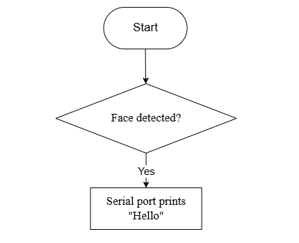
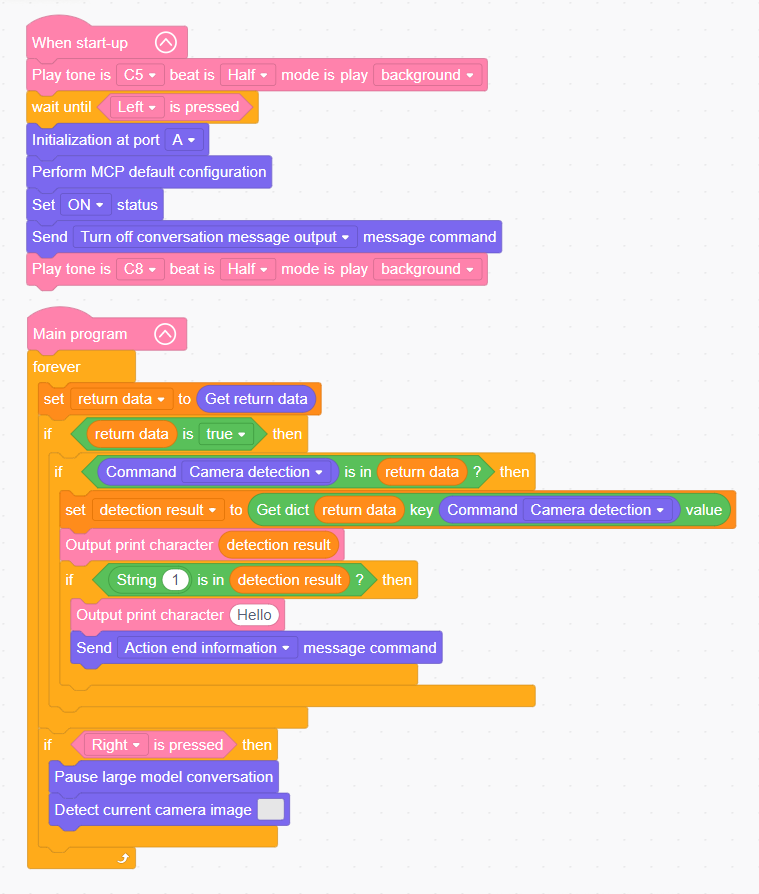

# 3.12 Text Interaction Control

## 3.12.1 Lesson Introduction

This lesson uses the optical character recognition, also known as OCR, function of vision large models to enable robots to "read" text in scenes and trigger actions based on text content. For example, print information when "Hello" is detected, and stop when "STOP" is detected. The lesson covers configuring the vision module for text detection and writing conditional judgment programs. This lesson expands the robot's information acquisition dimension from image to semantics, adding new capability to multimodal interaction.

## 3.12.2 Learning Objectives

1. **Knowledge Objectives**: Understand the basic principles of optical character recognition, commonly known as OCR, and know how large vision models convert image text into readable text.

2. **Skill Objectives**: Program text detection and extract text. Control robot actions based on specific keywords.

3. **Thinking Objectives**: Establish "semantic trigger" thinking: text content serves as control commands.

4. **Application Objectives**: Understand applications such as license plate recognition, package sorting, and document scanning.

## 3.12.3 Preparation

### (1) Hardware Preparation

- AiBlock controller
- WonderMind large model module
- 360° block motor
- Building block parts
- Module cable
- Type-C data cable

### (2) Software Preparation

- WonderLab programming software

## 3.12.4 Hands-On Project

### (1) Project Analysis

This lesson focuses primarily on assembly and conceptual understanding, with the programming portion reserved for subsequent courses. Robotic arm assembly and servo rotation verification are required and test the servo rotation range to prepare for future object grasping tasks. Basic actions such as servo homing and arm lifting can be programmed and implemented.

### (2) Assembly Guide

<pdf src="../../_static/shared/pdf/chapter_3/2.pdf" />

###  (3) Hardware Wiring

- Connect the left wheel 360° block motor to port **S1** of the controller using a 3-pin servo cable.
- Connect the right wheel 360° block motor to port **S2** of the controller using a 3-pin servo cable.
- Connect the WonderMind module to port **A** of the controller using a 4-pin module cable.

### (4) Adding Extensions

- Select **WonderMind AI** **large model module** under the **Input Module** category.

- Select **360° Motor** under the **Motion module** category.

### (5) Core Blocks

| Block                                                        | Category                                                     | Function                                                     |
| :----------------------------------------------------------- | :----------------------------------------------------------- | :----------------------------------------------------------- |
|  |  | Drives the buzzer to play notes at specified pitch and beat duration, runs in background mode without blocking subsequent program execution. |
|  |  | Prints custom text strings to the computer via serial port for debugging and information display. |
|  |  | Real-time detection of specified button current level state, returns boolean value indicating whether button is pressed. |
|  |  | Initializes the hardware interface of the WonderMind AI large model module. |
|  |  | Loads default MCP protocol parameter configuration to complete basic large model interaction channel setup. |
|  |  | Activates the MCP conversation channel to enable large model interaction functions. |
|  |  | Temporarily interrupts current large model conversation flow and pauses message transmission and reception. |
|  |  | Calls the camera to capture real-time frames for visual recognition and image reasoning tasks. |
|  |  | Pushes action completion command to the large model to notify that current robot action execution is finished. |
|  |  | Reads reply commands and text data issued by the large model for subsequent program calls. |
|  |  | Issues motion control commands to the robot, dropdown menu provides multiple robot actions and device control commands. |

### (6) Program Description and Upload

- Program Schematic

- Complete Program

  1. After the controller powers on, a startup sound plays. When the WonderMind interface displays MCP configuration, press the left button on the controller. The buzzer then plays a ready sound.

  2. Press the right button on the controller to pause large model conversation, call the camera to capture frames. Continuously cycle to retrieve return data transmitted from WonderMind and read frame text detection results.

  3. If the detection result contains character "1," print debug text in the lower right corner black box of the software. Push action completion information after finishing.

> [!NOTE]
>
> **The source files are available for download under [Program Files](https://drive.google.com/drive/folders/1cIZD1yG0hj_lme2SCWtL_KWlalJhd6ib?usp=sharing).**

- Program Upload: When uploading the program, **first power on the controller, then power on WonderMind switch**.

- Device Restart: After successful program upload, the large model module requires **restart** before program verification. **The power-on sequence must strictly follow controller first, then WonderMind. First, in the field  ①, then in the field ②. Wait for WonderMind to enter the Waiting for MCP extension tool configuration, press Button A to skip interface, then press the left button on the controller to run the program normally**. If the uploaded program is unchanged, the WonderMind restart step is not required.

## 3.12.5 Expansion and Challenge

**(1) Long Text Keyword Extraction Command Parsing**

Recognize and retrieve keywords such as "forward," "stop," and "turn left" from complete paragraphs, ignoring unrelated text to extract control commands. Relies on string search logic. Adapts to outdoor visual navigation robots for road signs and marker recognition.

**(2) Chinese-English Bilingual Text Compatible Recognition**

Switch OCR model language parameters to respectively adapt to English keywords and Chinese control vocabulary, setting up two determination branches. Optimize underlying text label library. Adapts to multilingual guide service robots.

## 3.12.6 Q&A

**Question 1:** **Why must text detection command descriptions in this lesson use English?**

Answer: As with previous lessons, the underlying vision model is pretrained on English datasets. English keywords ensure accurate command matching. Chinese requires a dedicated Chinese OCR model.

**Question 2:** **If the recognized text contains multiple words, how is key information extracted?**

Answer: String search or regular expression matching can be used for specific terms. For example, the program can search for the keyword "STOP" to trigger braking routines.

## 3.12.7 Technical Support and Product Discussion

If creative ideas emerge after using the product, sharing in the [Hiwonder community](https://forum.hiwonder.com) is welcome:

