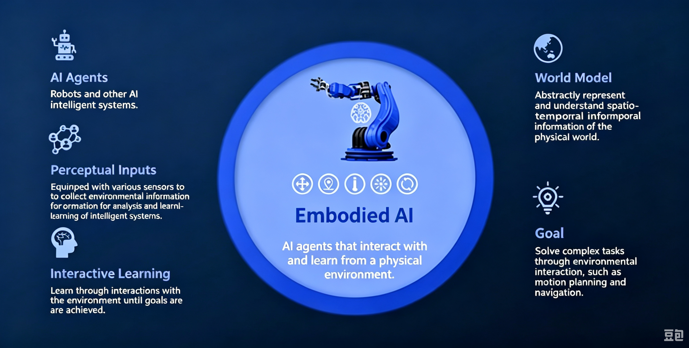
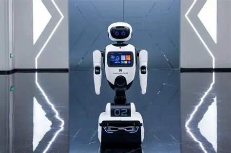
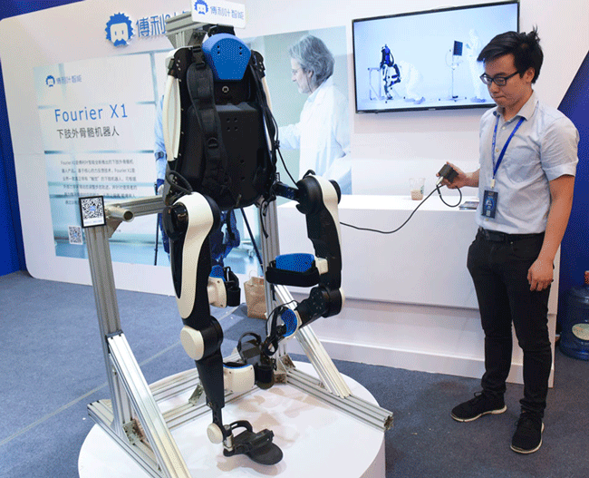

# 3.13 Initial Acquaintance with Embodied Intelligence

## 3.13.1 Lesson Introduction

This lesson integrates the large language, voice, and vision models from the previous 12 lessons, introducing the concept of "embodied intelligence." AI possesses not only a "brain" but also a "body," capable of perceiving, interacting, and executing in the physical world. The lesson reviews each model's functions, poses the question of "how to bring AI from virtual to reality," and then introduces the significance of multimodal integration. The lesson guides through building a robotic arm robot to experience the basic form of embodied intelligence, laying foundation for subsequent integrated projects in object recognition and environmental perception.

## 3.13.2 Learning Objectives

1. **Knowledge Objectives**: Understand the definition of embodied intelligence: intelligent agents achieve perception, learning, and adaptation through physical form interaction with the environment. Learn the necessity of multimodal fusion.

2. **Skill Objectives**: Capable of completing the construction of a robotic arm robot, able to describe the typical architecture of an embodied intelligence system, encompassing perception, decision-making, and execution. 

3. **Thinking Objectives**: Establish "system integration" thinking: combining multiple modules into a complete robot system.

4. **Application Objectives**: Understand the value of embodied intelligence applications such as service robots and industrial robotic arms.

## 3.13.3 Understanding Embodied Intelligence

### (1) Basic Definition of Embodied Intelligence

Embodied intelligence is an artificial intelligence system equipped with physical hardware, integrating multimodal perception modules for auditory and visual sensing, a decision-making main controller, and motion execution mechanisms. It relies on sensors to collect real-world environmental information, plans actions through model computation, and then operates on the physical world via components such as motors and servo motors, enabling autonomous learning and scene adaptation through continuous interaction with the real environment.

It can be simply understood as: AI possesses a brain, sensory organs, and limbs, the brain handles thinking, the sensory organs comprising microphones and cameras handle perception, and the limbs including robotic arms and tracked chassis handle action.

Core Characteristics:

- Fuses multimodal capabilities: simultaneously possesses listening, speaking, seeing, and text understanding functions.
- Possesses physical entity carrier, capable of touching and manipulating real objects.
- Follows "perception input → model decision → physical execution" closed-loop operation logic.
- Continuously optimizes actions and judgments through real-world interaction.

### (2) Life Interaction Scenarios

Home cleaning humanoid robot: Equipped with camera and voice module, autonomously avoids obstacles and cleans floors, supports voice call for start and stop.

Exhibition guide service robot: Visually recognizes crowds, conducts voice dialogue Q&A, navigates autonomously.

Medical rehabilitation exoskeleton Robot: Senses human body movements, assists mobility-impaired individuals with walking.

### (3) Embodied Intelligence Three-Layer System Architecture Breakdown

- **Perception layer refers to sensory organs:** Handled by the WonderMind module. Microphone collects voice. Camera collects images. Completes auditory and visual environmental information input.
- **Decision layer refers to brain:** Controller + multimodal large model. Receives perception data, analyzes scenarios, plans action sequences, and issues motion commands.
- **Execution layer refers to limbs:** Tracked drive motors, robotic arm servos. Receives controller commands and completes physical actions including movement, grasping, lifting, and rotation.

## 3.13.4 Hands-On Project

### (1) Hardware Preparation

- AiBlock controller  
- WonderMind large model module
- 360° block motor
- 180° block servo
- Ultrasonic sensor
- Dot matrix module
- Building block parts
- Module cable
- Type-C data cable

### (2) Assembly Guide

<pdf src="../../_static/shared/pdf/chapter_3/3.pdf" />

### (3) Hardware Wiring

- Connect the left wheel 360° block motor to port **S1** of the controller using a 3-pin servo cable.
- Connect the right wheel 360° block motor to port **S2** of the controller using a 3-pin servo cable.
- Connect the robotic arm control 180° block servo to port **S3** of the controller using a 3-pin servo cable.
- Connect the gripper control 180° block servo to port **S4** of the controller using a 3-pin servo cable.
- Connect the WonderMind module to port **A** of the controller using a 4-pin module cable.

## 3.13.5 Expansion and Challenge

**(1) Significance of Multimodal Fusion for Embodied Intelligence**

Single voice or vision models can only receive one type of information, with limited scene recognition capability. After multimodal fusion, robots can simultaneously "hear commands and see objects," combining both information types for comprehensive judgment. Action planning becomes more precise. Interaction becomes more aligned with real-life needs. This is the core foundation enabling embodied intelligence to achieve practical deployment.

**(2) Current Technical Limitations of Embodied Intelligence**

Embodied intelligence currently has three main technical limitations. First, visual recognition accuracy decreases in complex occlusion environments, leading to grasping failures. Second, long-sequence continuous actions are prone to motion stuttering and positioning deviation. Third, autonomous path planning capability in completely unfamiliar environments is limited and requires continuous training optimization.

##  3.13.6 Q&A

**Question 1: What is embodied intelligence? How does it differ from pure software AI?**

Answer: Embodied intelligence refers to intelligent agents that possess physical bodies, perceive the environment through sensors, and influence the environment through actuators. The key difference is that embodied intelligence emphasizes interaction with the real world, while pure software AI only processes information in digital space.

**Question 2: What perception and action components are integrated in the robotic arm robot built in this lesson?**

Answer: ① Perception components: The perception components include the WonderMind module for vision and speech. ② The action components comprise motors for chassis propulsion and servos for robotic arm and gripper control. ③ The controller is responsible for decision-making.

## 3.13.7 Technical Support and Product Discussion

If creative ideas emerge after using the product, sharing in the [Hiwonder community](https://forum.hiwonder.com) is welcome:

