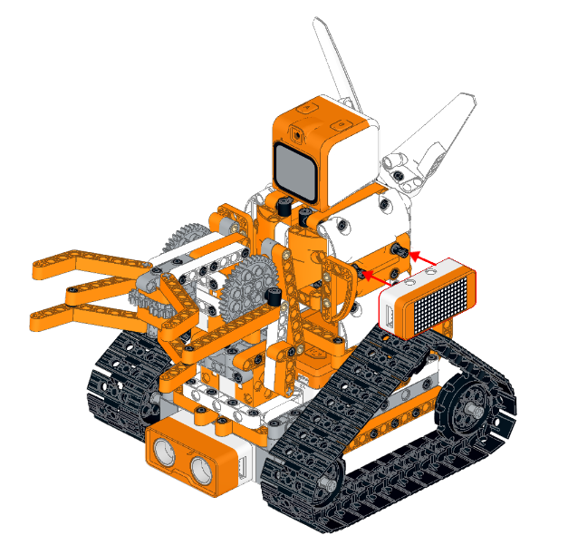
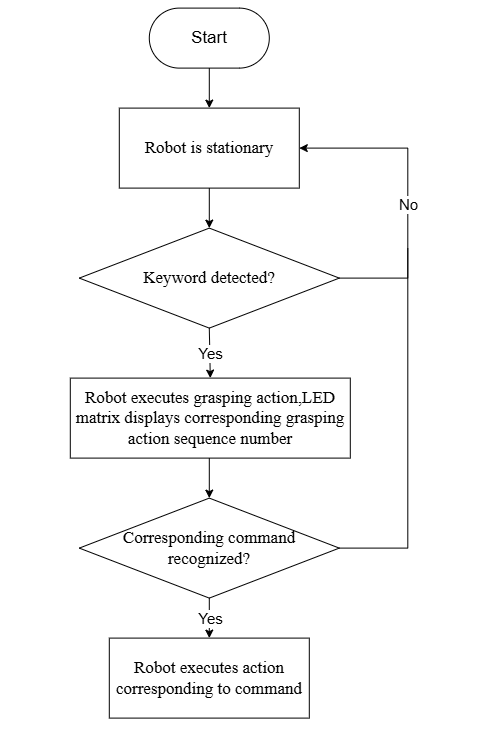
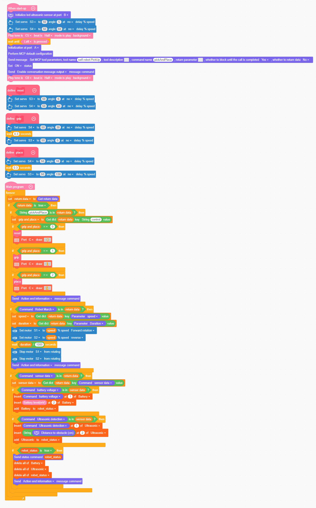

# 3.14 Object Recognition Interaction

## 3.14.1 Lesson Introduction

This lesson implements object recognition and autonomous grasping with a robotic arm under the embodied intelligence framework. A vision large model identifies obstacle positions, combined with ultrasonic sensor distance measurement. When an object enters a designated zone, the robotic arm automatically clamps and transports it. The dot matrix display shows distance information. This lesson integrates vision, distance measurement, servos, motors, and display modules into a highly comprehensive hands-on project.

## 3.14.2 Learning Objectives

1. **Knowledge Objectives**: Understand the working principle of the ultrasonic sensor, which measures distance through sound wave reflection, and master the programming method for the servo-driven clamping action.

2. **Skill Objectives**: Program the complete workflow of object detection, distance measurement, clamping, and placement. Encapsulate functions to simplify code.

3. **Thinking Objectives**: Build multi-sensor fusion logic by combining visual perception with distance measurement to improve environmental awareness accuracy.

4. **Application Objectives**: understand the core technologies of intelligent warehousing and sorting robots.

## 3.14.3 Preparation

###  (1) Hardware Preparation

- AiBlock controller
- WonderMind large model module
- 360° block motor
- 180° block servo
- Ultrasonic sensor
- Dot matrix module
- Building block parts
- Module cables
- Type-C data cable

###  (2) Software Preparation

- WonderLab programming software

## 3.14.4 Hands-On Project

###  (1) Project Analysis

The program needs to achieve continuous ultrasonic distance measurement. When the distance falls below a threshold such as 15 cm, and vision detects an obstacle, it triggers the robotic arm clamping action driven by a servo rotating the gripper, then places the object in a designated area through a servo rotating the arm. The dot matrix display shows distance values in real time.

###  (2) Assembly Guide

<pdf src="../../_static/shared/pdf/chapter_3/3.pdf" />

###  (3) Module Installation

Complete the installation of the dot matrix module according to the figure below.

###  (4) Hardware Wiring

- Connect the left wheel 360° block motor to port **S1** of the controller using a 3-pin servo cable.
- Connect the right wheel 360° block motor to port **S2** of the controller using a 3-pin servo cable.
- Connect the robotic arm control 180° block servo to port **S3** of the controller using a 3-pin servo cable.
- Connect the gripper control 180° block servo to port **S4** of the controller using a 3-pin servo cable.
- Connect the WonderMind module to port **A** of the controller using a 4-pin module cable.
- Connect the ultrasonic sensor to port **B** of the controller using a 4-pin module cable.
- Connect the dot matrix module to port **C** of the controller using a 4-pin module cable.

### (5) Adding Extensions

- Select **Ultrasonic sensor** and **WonderMind AI large model module** under the **Input Module** category.

- Select **180° Servo** and  **360° Motor** under the **Motion module** category.

- Select **Dot matrix module** in the **Output module** category.

###  (6) Core Blocks

| Block                                                        | Category                                                     | Function                                                     |
| :----------------------------------------------------------- | :----------------------------------------------------------- | :----------------------------------------------------------- |
|  |  | Drives the buzzer to play a note with specified pitch and beat in background mode without blocking subsequent program execution. |
|  |  | Reads the current battery voltage in millivolts for power monitoring and judgment. |
|  |  | Real-time detection of the specified button's current level state, returning a boolean value to determine whether the button is pressed. |
|  |  | Creates a custom function with no input parameters, encapsulating a segment of reusable program logic internally. |
|  |  | Calls a defined parameter-free function, executing all program logic encapsulated within the function. |
|  |  | Generates an empty list container that can store multiple data types such as numbers and text for subsequent add, delete, modify, and query operations. |
|  |  | Appends a new element at the end of the list to expand list content. |
|  |  | Clears all stored elements in the target list, resetting the list to empty. |
|  |  | Inserts custom content before the element at the specified index in the list. |
|  |  | Initializes the hardware interface of the WonderMind AI large model module. |
|  |  | Loads default MCP protocol parameter configuration to complete the basic setup of the large model interaction channel. |
|  |  | Opens the MCP dialogue channel to activate large model interaction functionality. |
|  |  | Pushes an action completion command to the large model to notify that the current robot action execution is finished. |
|  |  | Pushes custom status information to the MCP large model channel, uploading the text in the block as a status command to inform the large model of the robot's current operating status for decision-making. |
|  |  | Reads the reply commands and text data issued by the large model for subsequent program calls. |
|  |  | Issues motion control commands to the robot, with dropdown selection of multiple robot actions and device control commands. |
|  |  | Reads the parameter value corresponding to the command issued by the large model, with dropdown selection of various parameters for obtaining action speed, runtime duration, light color, servo angle, measured distance, and other data for program logic calls. |
|  |  | Initializes the hardware interface of the ultrasonic sensor. |
|  |  | Obtains the obstacle distance data measured by the ultrasonic sensor, unit: centimeter or cm. |
|  |  | Controls the 360° block motor at the specified port to run continuously at a custom speed, selecting forward / reverse rotation direction. |
|  |  | Cuts off the output of the 360° block motor at the specified port, causing the motor to stop rotating immediately. |
|  |  | Controls the 180° block servo at the specified port to run at a custom speed for a specified duration, selecting no-delay mode allows the program to continue executing subsequent blocks without waiting for the motor motion to finish. |
|  |  | Controls the dot matrix display at the specified port to load and display a preset graphic pattern. |

###  (7) Program Description and Upload

- Program Schematic

- Complete Program

  1. Upon powering on, the controller initializes the ultrasonic sensor connected to port **B**, resets servos **S3** and **S4** to their initial angles, and plays the startup sound. Once the WonderMind interface displays the MCP configuration, press the left button on the controller; the buzzer will then sound to indicate it is ready.
  2. Pre-define three motion functions for homing, gripping, and placing. These functions control the timed servo movements of the robotic arm and gripper. In the main loop, continuously read the data returned by WonderMind and classify it into grasp, chassis movement, or sensor reading commands.
  3. For grasp commands, the system executes the corresponding motion based on parameter 0, 1, or 2, simultaneously displays an icon on the dot-matrix screen, and sends an action completion message. For motion commands, it parses the speed and duration parameters to drive motors **S1** and **S2** for the specified duration before stopping them. For sensor commands, it reads the voltage and ranging data into a list, reports the device status, and then clears the buffer.

> [!NOTE]
>
> **The source files are available for download under [Program Files](https://drive.google.com/drive/folders/1cIZD1yG0hj_lme2SCWtL_KWlalJhd6ib?usp=sharing).**

- Program Upload: When uploading the program, **turn on the controller switch first, then turn on the WonderMind switch**.

- Device restart: After successful program upload, the large model module needs to be **restarted** before program verification. **The power-on sequence must strictly follow controller first, then WonderMind, first in the field ①, then in the field ②. Wait until WonderMind enters the Waiting for MCP extension tool configuration, press A key to skip interface, then press the left button on the controller for normal program operation.** If the uploaded program has not been modified, no WonderMind restart is needed.

## 3.14.5 Expansion and Challenge

**(1) Color + Distance Dual-Fusion Sorting Program**

Simultaneously read ultrasonic distance and visual color information, executing corresponding grasping and transport actions after dual verification. Multi-sensor fusion reduces the misjudgment probability of single recognition, applicable to material classification warehousing robots.

 **(2) Voice-Triggered Automatic Grasping Workflow**

Add a voice wake-up grasping switch, activating distance measurement and visual detection only after receiving the "grasp" command. Rely on multi-round dialogue context memory to prevent the robot from falsely triggering clamping actions.

 

## 3.14.6 Q&A

**Question 1: Why can ultrasonic sensors measure distance? What factors affect their measurement range?**

Answer: It emits ultrasonic waves and receives the echo, calculating the distance by multiplying the time difference by the speed of sound. The measurement range is affected by environmental noise and object material, such as sound-absorbing materials.

**Question 2: Why does this lesson encapsulate functions such as clamping and placement?**

Answer: Encapsulating functions makes the main program more concise, facilitating repeated calls and debugging. It also improves code readability and maintainability, representing good programming practice.

##  3.14.7 Technical Support and Product Discussion

If creative ideas emerge after using the product, sharing in the [Hiwonder community](https://forum.hiwonder.com) is welcome:

