# 3.15 Environmental Perception Applications

## 3.15.1 Lesson Introduction

This lesson introduces the light sensor, the temperature and humidity sensor, enabling the robot to perceive its environment and implement "a smart potted plant care scenario." The robot can detect light intensity and temperature and humidity data, provide care recommendations through WonderMind such as "sufficient light" or "needs watering", and simulate automatic watering actions through robotic arm swinging. This lesson emphasizes the complete intelligent closed loop from data to decision to action, cultivating the ability to solve practical problems.

## 3.15.2 Learning Objectives

- **Knowledge Objectives**: Understand the working principles of the light sensor and the temperature and humidity sensor, learn how environmental data is converted into digital signals.
- **Skill Objectives**: Program the robot to read sensor data and determine environmental states based on thresholds, control a servo to simulate the watering action.
- **Thinking Objectives**: Establish "threshold-based decision-making" thinking — making decisions by comparing measured values against preset thresholds.
- **Application Objectives**: Connect to applications such as smart agricultural greenhouses and smart home environmental control.

## 3.15.3 Preparation

### (1) Hardware Preparation

- AiBlock controller
- WonderMind large model module
- 360° block motor
- 180° block servo
- Ultrasonic sensor
- Temperature and humidity sensor
- Light sensor
- Building block parts
- Module cables
- Type-C data cable

### (2) Software Preparation

- WonderLab programming software

## 3.15.4 Hands-On Project

###  (1) Project Analysis

The program cyclically reads light intensity values ranging from 0 to 100 and temperature and humidity values. Based on predefined thresholds, it determines that light intensity greater than 70 is considered strong light, while less than 30 is considered weak light. Humidity below 40% indicates dry conditions requiring watering. WonderMind broadcasts recommendations accordingly and executes watering actions by rotating a servo motor to simulate sprinkling.

### (2) Assembly Guide

<pdf src="../../_static/shared/pdf/chapter_3/3.pdf" />

### (3) Module Installation

First remove the dot matrix module, then complete the installation of the light sensor according to the figure below.

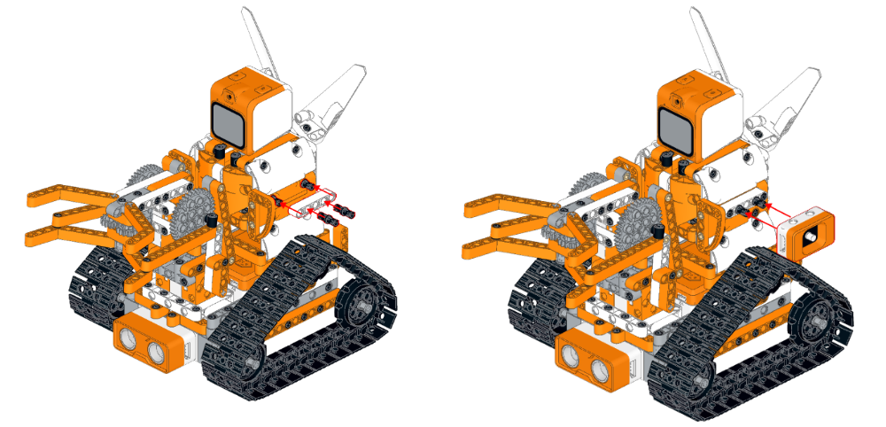

Then complete the installation of the temperature and humidity sensor according to the figure below.

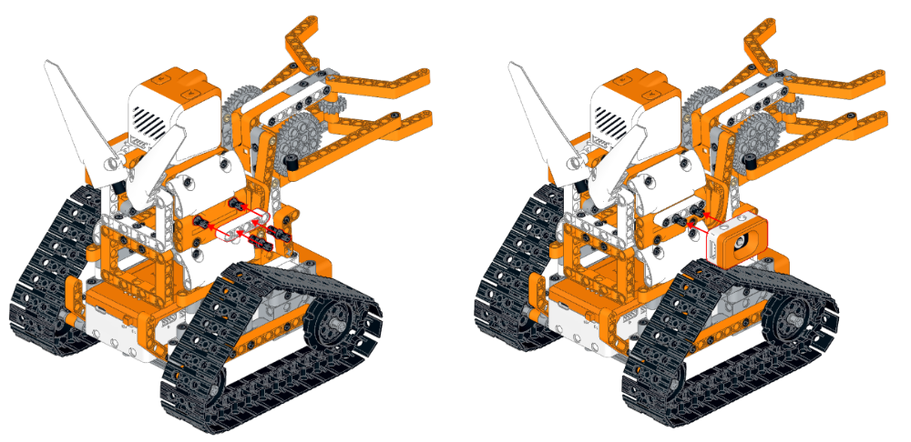

###  (4) Hardware Wiring

- Connect the left-wheel 360° block motor to port **S1** of the controller using a 3-pin servo cable.
- Connect the right-wheel 360° block motor to port **S2** of the controller using a 3-pin servo cable.
- Connect the 180° block servo controlling the robotic arm to port **S3** of the controller using a 3-pin servo cable.
- Connect the 180° block servo controlling the gripper to port **S4** of the controller using a 3-pin servo cable.
- Connect the WonderMind module to port **A** of the controller using a 4-pin module cable.
- Connect the light sensor to port **B** of the controller using a 4-pin module cable.
- Connect the dot matrix module to port **C** of the controller using a 4-pin module cable.

###  (5) Adding Extensions

- Select **Light sensor**, **Temperature humidity sensor**, **WonderMind AI**  **large model module** under the **Input Module** category.  

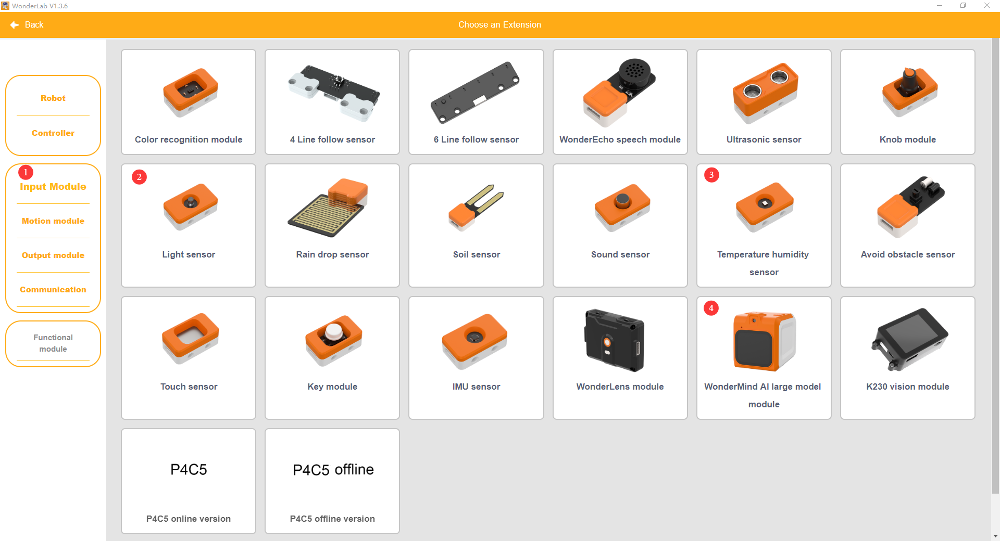

- Select **180° servo** and **360° Motor** under the **Motion module** category.

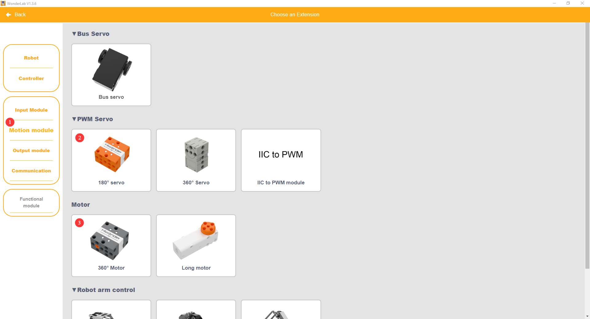

### (6) Core Blocks

| Block                                                        | Category                                                     | Function                                                     |
| :----------------------------------------------------------- | :----------------------------------------------------------- | :----------------------------------------------------------- |
|  |  | Drives the buzzer to play notes at specified pitch and beat in background mode without blocking subsequent program execution. |
|  |  | Prints custom text strings to the computer via serial port for debugging and information viewing. |
| 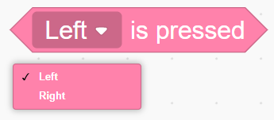 |  | Real-time detection of the current electrical level state of the specified button, returning a Boolean value to determine whether the button is pressed. |
|  |  | Creates a custom function with no input parameters, encapsulating a segment of reusable program logic internally. |
|  |  | Calls a defined parameter-free function and executes all program logic encapsulated within the function. |
|  |  | Generates an empty list container that can store multiple data types including numbers and text for subsequent add, delete, modify, and query operations. |
|  |  | Clears all stored elements in the target list and resets the list to empty. |
|  |  | Inserts custom content before the element at the specified index in the list. |
|  |  | Initializes the hardware interface of the WonderMind AI large model module. |
|  |  | Loads default MCP protocol parameter configuration to complete the basic setup of the large model interaction channel. |
|  |  | Activates the MCP dialogue channel to enable large model interaction functionality. |
| 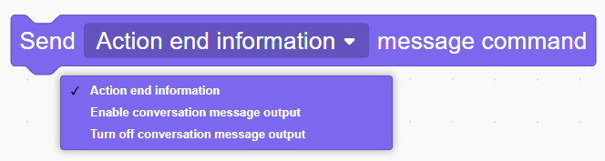 |  | Pushes an action completion command to the large model to notify that the current robot action has been executed. |
|  |  | Pushes custom text information to the MCP large model channel to achieve device interaction communication. |
|  |  | Configures MCP tool invocation related parameters, defining tool identifier, function description, trigger command, and return data format, and setting whether to block and wait for tool execution completion, used to build robot tool interfaces callable by the large model. |
|  |  | Pushes custom status information to the MCP large model channel, uploading the text in the block as a status command to inform the robot's current operating status for large model decision-making. |
|  |  | Reads reply commands and text data issued by the large model for subsequent program invocation. |
|  |  | Initializes the hardware interface of the temperature and humidity sensor. |
|  |  | Real-time reading of temperature or humidity values.         |
| 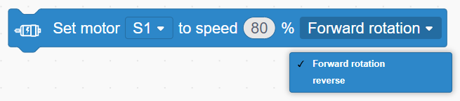 |  | Controls the specified port 360° block motor to run continuously at a custom speed, selecting forward / reverse direction. |
|  |  | Cuts off the output of the specified port 360° block motor, causing the motor to stop rotating immediately. |
|  |  | Controls the specified port 180° block servo to run for a specified duration at a custom speed, in non-delay mode, the program does not wait for the motor to finish running and continues executing subsequent blocks directly. |

### (7) Program Description and Upload

- Program Schematic

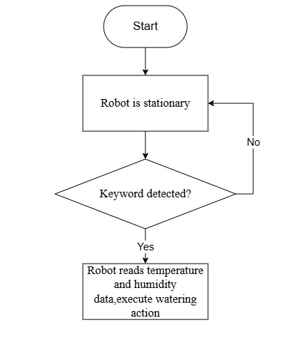

- Complete Program

  1. After the controller powers on, initialize the temperature and humidity sensor at port **C**, reset servos **S3** and **S4** to initial angles, and play the startup sound effect. Wait until the WonderMind interface displays the MCP configuration, then press the left button on the controller, and the buzzer plays the ready sound effect.

  2. Define a custom watering function that controls servo **S4** to rotate to the watering position, automatically resetting after a 3-second delay. Continuously loop to obtain return data from WonderMind, distinguishing between environmental collection commands and mechanical control commands.

  3. Identify temperature and humidity collection commands and store the values in a data list. Identify watering control commands, drive the chassis to run for 1 second and stop when conditions are met, call the watering function, and push action completion information. When the list contains valid environmental data, push device status information outward, then clear the list and wait for the next round of collection.

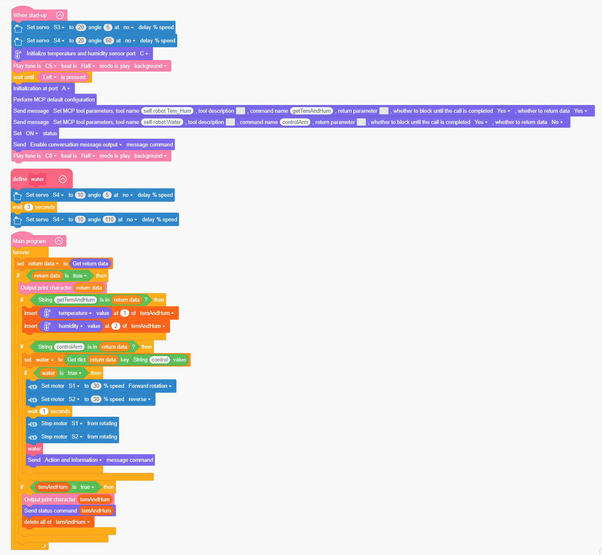

> [!NOTE]
>
> **The source files are available for download under [Program Files](https://drive.google.com/drive/folders/1cIZD1yG0hj_lme2SCWtL_KWlalJhd6ib?usp=sharing).**

* Program Upload: When uploading the program, **turn on the controller switch first, then turn on the WonderMind switch**.

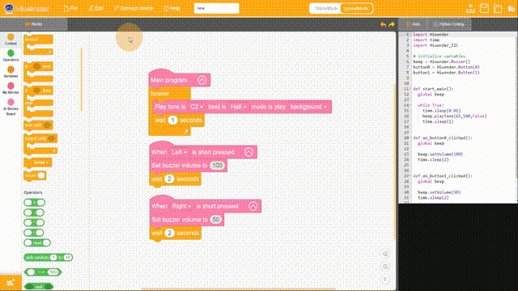

- Restart the device: After successful program upload, the large model module needs to **restart** before program verification. **The power-on sequence must strictly follow controller first, then WonderMind, first in the field ①, then in the field ②. Wait until WonderMind enters the Waiting for MCP extension tool configuration, click Button A to skip interface, then press the left button on the controller to run the program normally**. If the uploaded program has not been modified, no restart of WonderMind is required.

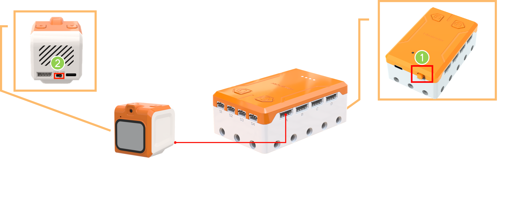

## 3.15.5 Expansion and Challenge

**(1) Multi-Point Plant Zone Inspection**

The chassis carries the sensor module and cycles to multiple detection points to collect temperature, humidity, and light data respectively. Relying on cyclic motion logic, differentiated care judgment for multiple potted plants is achieved, applicable to smart greenhouse inspection equipment.

**(2) Environmental Data Storage and Trend Judgment**

Use the list container to store environmental values collected at timed intervals for long-term storage, and predict dry and wet and light changes through comparison of before-and-after values. This can be expanded to agricultural monitoring robots that push care warning information in advance.

## 3.15.6 Q&A

**Question 1: What physical quantities do the light sensor and the temperature and humidity sensor convert into electrical signals respectively?**

Answer: The light sensor converts light intensity into resistance changes, which are then converted into voltage values. The temperature and humidity sensor converts temperature and humidity into digital signals such as via the I2C interface, which the controller reads directly.

**Question 2: In this lesson, the watering decision threshold is humidity below 40%. How is this threshold determined?**

Answer: The threshold needs to be set according to different plants' water requirements and can be determined through experiments or reference materials. In teaching, it can be set as an adjustable parameter to let students experience how parameter tuning affects decision-making.

## 3.15.7 Technical Support and Product Discussion

If creative ideas emerge after using the product, sharing in the [Hiwonder community](https://forum.hiwonder.com) is welcome:

