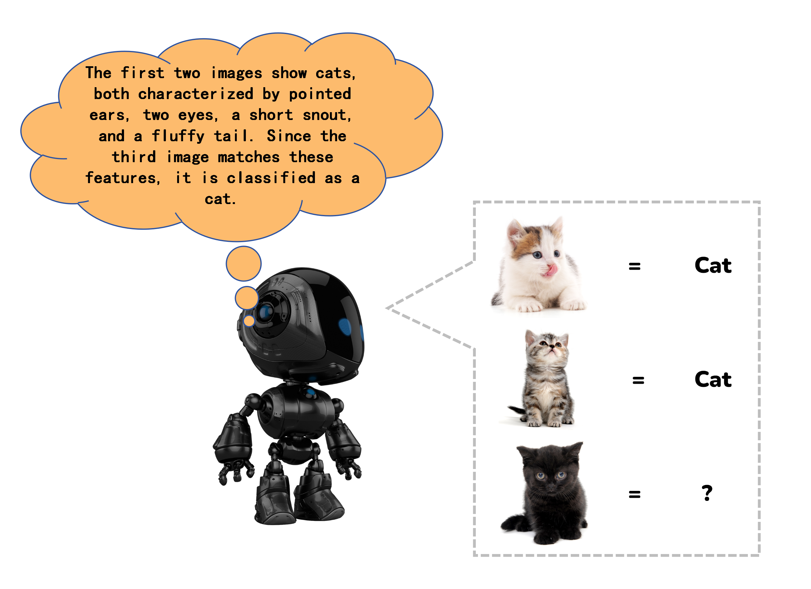
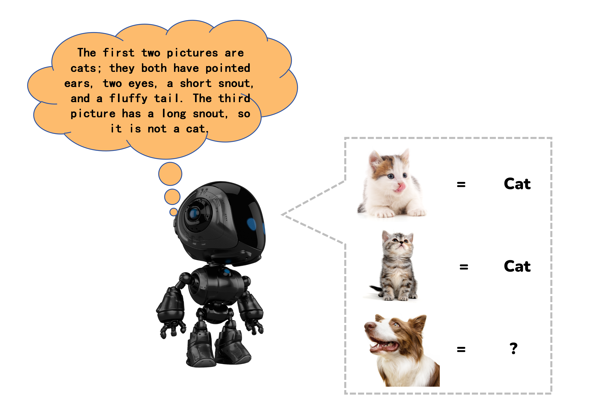
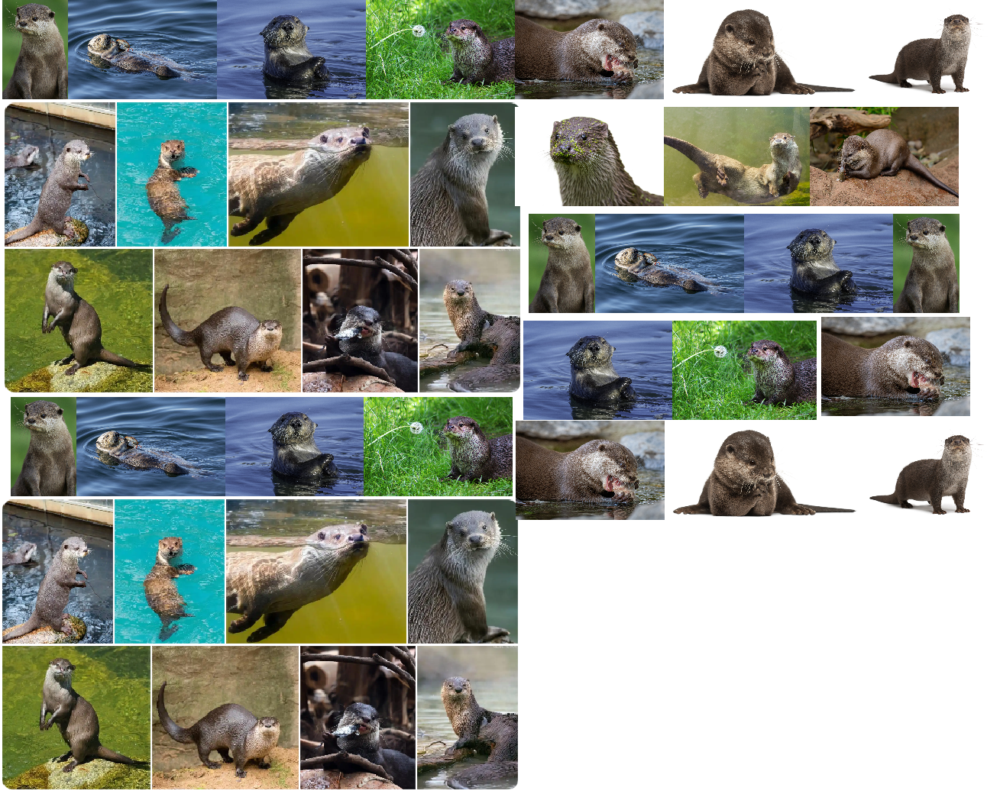
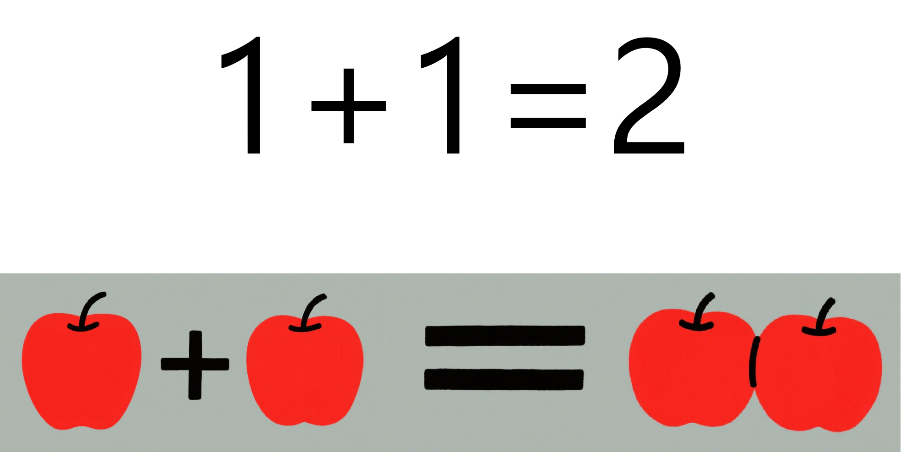
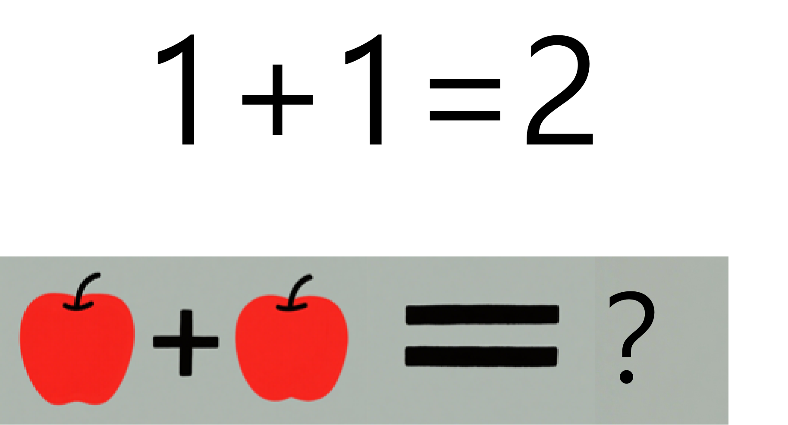

# 3.2 Implementation Methods of Artificial Intelligence

## 3.2.1 Lesson Introduction

This lesson lifts the veil on artificial intelligence. It focuses on the core implementation technology of AI: machine learning. Through accessible analogies and real-life cases, this lesson explores three mainstream training approaches: supervised learning, unsupervised learning, and reinforcement learning. It compares the similarities and differences between human learning and machine learning.

Through this lesson, learners will understand the technical principles behind various AI products and establish foundational knowledge of AI underlying logic.

## 3.2.2 Learning Objectives

1. **Knowledge Objectives**: Review basic AI evaluation criteria. Memorize the definition of machine learning and its three training modes. Distinguish the commonalities and core differences between human and machine learning. Master foundational theoretical knowledge of AI technology.

2. **Skill Objectives**: Independently identify whether devices in daily life qualify as AI. Accurately distinguish between supervised, unsupervised, and reinforcement learning. Comprehend basic AI training cases and complete simple classification exercises.

3. **Thinking Objectives**: Establish hierarchical logical thinking. Learn to observe intelligent devices from an underlying technical perspective. View the strengths and weaknesses of human and machine learning dialectically. Cultivate objective and rational technological critical thinking.

4. **Application Objectives**: Analyze the machine learning principles behind smart home appliances and robots in the surrounding environment. After class, actively observe AI products in daily life. Apply classroom knowledge to explain the intelligent behaviors of devices.

## 3.2.3 Understanding Machine Learning

### **(1) Basic Definition of Machine Learning**

- Core Principle: Massive raw data is fed into machines. Through repeated algorithmic training, intelligent models capable of recognition, judgment, and prediction tasks are generated.
- Three Categories: Based on training data formats and learning logic, machine learning divides into three types: supervised learning, unsupervised learning, and reinforcement learning. All AI products are developed upon these three modes.

### **(2) Supervised Learning**

- Basic Concept: Every piece of training data has a corresponding correct answer.
- Accessible Analogy: Multiple images labeled as cats are fed to AI. The AI memorizes core feline features: pointed ears, round eyes, a short muzzle, and a fluffy tail.

- Real-Life Applications: Face recognition, AI-powered waste sorting, automated exam grading, and animal image recognition all belong to supervised learning.

### **(3) Unsupervised Learning**

- Basic Concept: The training data lacks corresponding "correct answers." The machine must train and analyze based on relationships within the data itself to derive a "correct answer."
- Accessible Analogy: This resembles a teacher handing students a pile of mixed books and asking them to observe, find patterns, and group the books independently. Throughout this process, no teacher guidance is provided. The students complete the task entirely on their own.

- Real-Life Applications: Personalized recommendations on short video and shopping platforms, automatic categorization of massive image collections, and consumer group segmentation. 

### **(4) Reinforcement Learning**

- Basic Concept: No "correct answer" is directly provided. The answer must be found through continuous trial and error.
- Accessible Analogy: This resembles training a puppy to sit. The puppy attempts different actions. If the action is correct, "sitting," it receives a reward. If incorrect, no reward is given or a mild penalty is applied. After repeated attempts, the puppy gradually learns that "sitting" is the optimal action that yields rewards.

- Real-Life Applications: Autonomous driving obstacle avoidance, game AI, warehouse handling robots, and patrol robotic dogs.

## 3.2.4 Human Learning VS Machine Learning

1. Common Ground: The essence of both human learning and machine learning is memorizing the features of something. When encountering similar things again, the memorized features are used for comparison to identify the object.

2. Differences:

- **Vast gap in required data volume:**

① Human learning: Only 1-2 images are needed to remember an animal. Mastery of features requires minimal samples.

② Machine learning: Thousands or tens of thousands of otter images from different angles, environments, and poses are required for training. Insufficient samples lead to recognition errors.

- **Ability to draw inferences and adapt flexibly differs:**

① Human learning: Underlying logic is understood. Knowledge can be flexibly transferred across scenarios.

② Machine learning: Only memorizes fixed trained correspondences. New knowledge cannot be autonomously derived.

3. Complementary Summary:

- Human strengths: Fast learning speed, strong logical reasoning, capacity for innovation, and emotional understanding.
- Machine strengths: Memorizing massive datasets, high-speed computation, and stable 24-hour operation.
- All current intelligent products result from collaborative work: **humans provide data and ideas, while machines complete massive computation and recognition**.

## 3.2.5 Extended Knowledge

 **(1) Current Mainstream Application Scenarios**

- Life Services: Voice assistants, smart door lock recognition, and robot vacuum navigation.
- Transportation: Autonomous driving and AI traffic inspection robots.
- Medical Industry: AI imaging lesion recognition and guidance robots.
- Education: AI exercise grading and VR immersive teaching recognition.
- Entertainment: Short video intelligent recommendations, AI painting, and intelligent game NPCs.

   **(2) Future Development Trends**

- Lightweight Training: Future AI will not require tens of millions of images. Learning can be completed with small data volumes. This narrows the efficiency gap between human and machine learning.
- Multi-Modal Fusion: Supervised, unsupervised, and reinforcement learning will be combined simultaneously. A single AI system will complete recognition, classification, and autonomous action concurrently.
- Deep Human-Robot Collaboration: Machine learning handles repetitive recognition and computation. Humans handle creativity, decision-making, and emotional judgment.
- Popularization of Large Language Models (LLMs): Built upon the underlying logic of machine learning, large language models achieve complex intelligent behaviors including dialogue, writing, and creation.

## **3.2.6 Q&A**

**Question 1: What are the three machine learning modes and their mutual distinctions?**

Answer: ① Supervised learning: uses standard answers. Applied to image and face recognition. ② Unsupervised learning: autonomous grouping. Applied to recommendations and data categorization.③ Reinforcement learning: trial and error with rewards. Applied to robots and autonomous driving.

**Question 2: What are the commonalities between human and machine learning?**

Answer: ① Both human and machine learning rely on identifying distinguishing features to categorize objects. ② The primary distinction lies in sample efficiency: humans generalize concepts from a few examples, whereas current machine models require large datasets. ③ All intelligent devices in daily life operate on underlying machine learning technology.

##  3.2.7 Technical Support and Product Discussion

If creative ideas emerge after using the product, sharing them in the [Hiwonder community](https://forum.hiwonder.com) is welcome:

