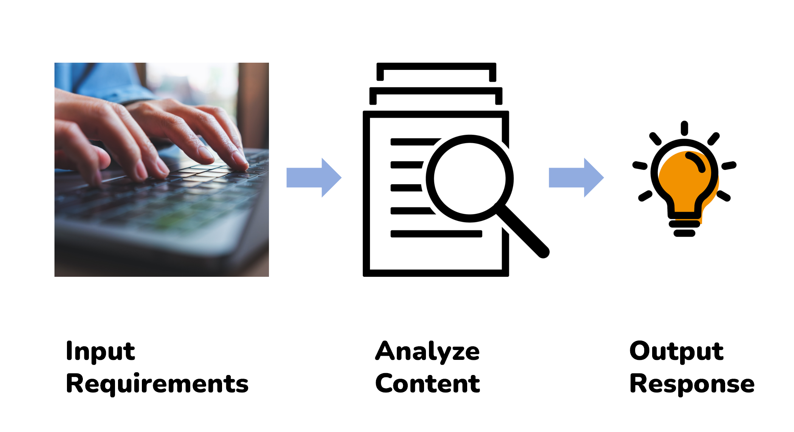
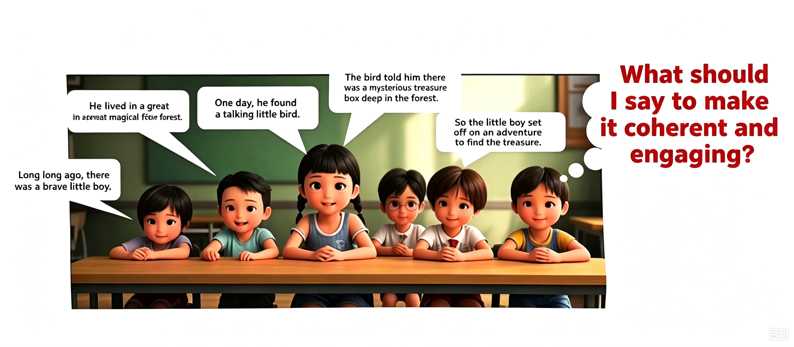
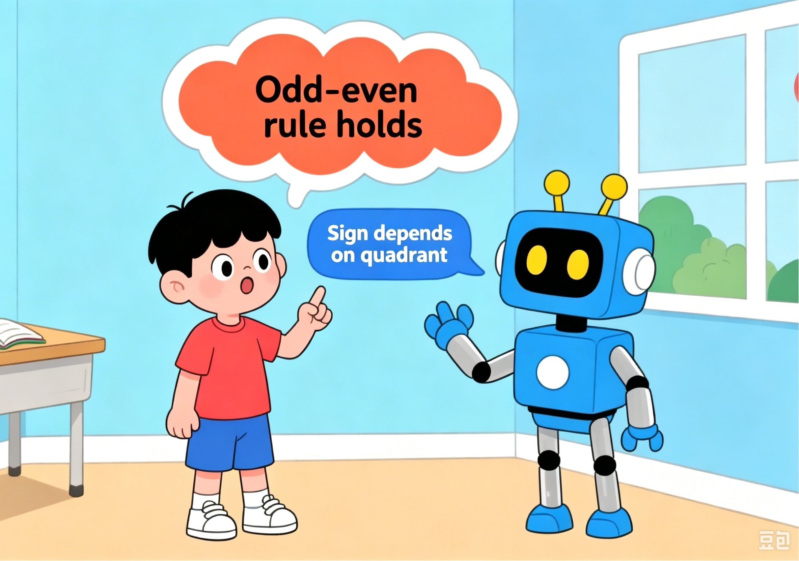
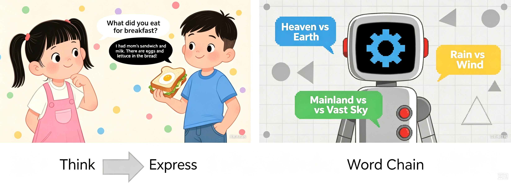
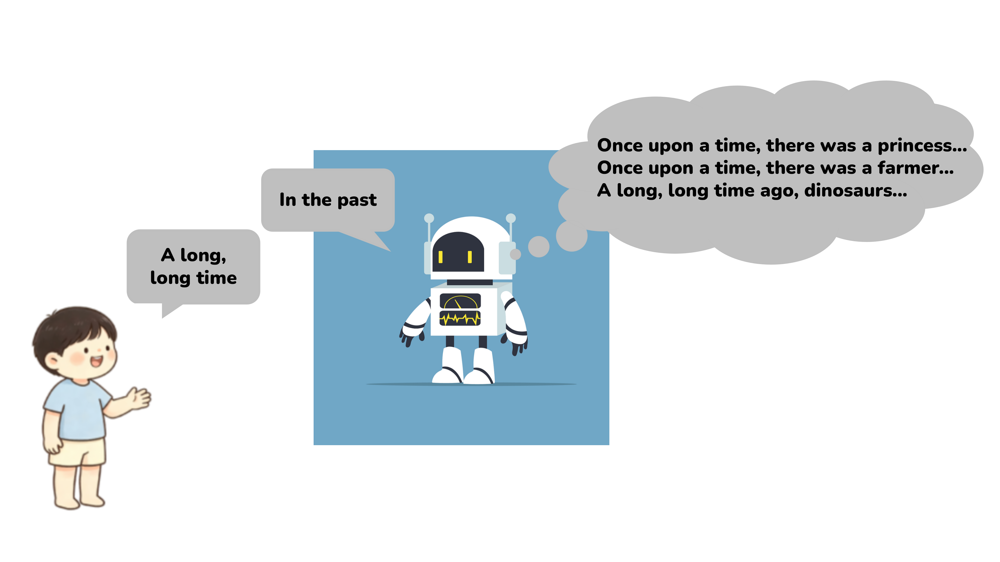
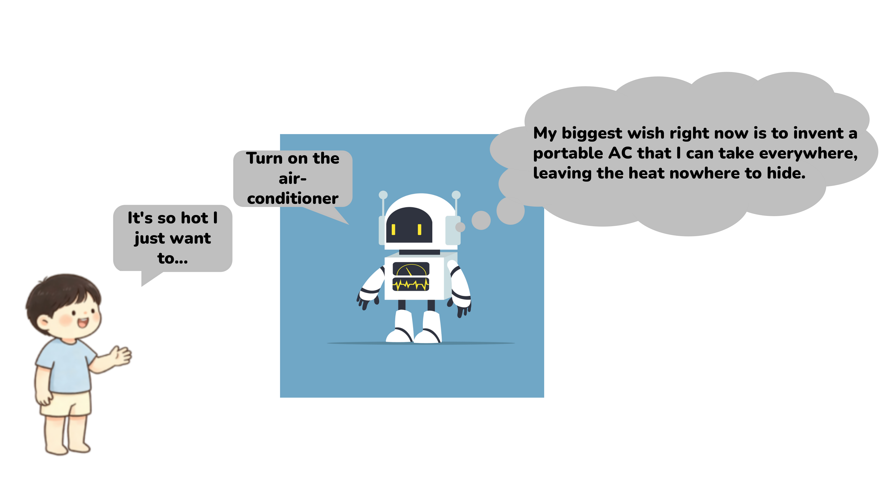

# 3.3 Initial Introduction to Large Language Models

## 3.3.1 Lesson Introduction

This lesson focuses on the hottest AI product today: large language models. Through a classroom word-chain game analogy, this lesson explains the model operating logic. It covers the definition of large language models, the complete workflow, and hands-on practice with the XiaoZhi AI platform. Learners will experience text generation functions including story continuation and Q&A dialogue. This provides direct understanding of the core AI principle of "generating subsequent text based on preceding context."

## 3.3.2 Learning Objectives

1. **Knowledge Objectives**: Understand the definition of large language models. Comprehend the complete input-analysis-output workflow. Distinguish the differences between human expression and AI text generation.

2. **Skill Objectives**: Log in to the XiaoZhi AI platform. Master basic operations for inputting questions and continuing stories. Learn simple instruction input methods for dialogue with large models.

3. **Thinking Objectives**: Establish logical correspondence thinking through the word-chain analogy. Understand dialectically the generation limitations of large models in "word continuation." View AI text creation capabilities objectively.

4. **Application Objectives**: After class, use large models independently to complete story creation and simple Q&A. Learn to use AI to assist reading and writing. Develop habits of using AI tools reasonably.

## 3.3.3 Understanding Large Language Models

### **(1) Basic Definition of Large Language Models**

Large language models are large-scale language processing models trained on massive text data based on artificial intelligence technology. The core capability is understanding the semantics, logic, and context of human language, and generating text that conforms to natural language rules.

In simple terms, a large language model is an intelligent system where AI learns the patterns of language and uses these patterns to solve language problems.

### **(2) Complete Processing Workflow of Large Language Models**

A complete interaction consists of three steps:

① Input requirements: Humans type in questions, story beginnings, or demand instructions.

② Content analysis: The model reads the text, organizes the context, and understands the requirements.

③ Output response: Coherent text is generated according to language logic and fed back to them.

### (3) Operating Principle of Large Language Models

Simply put, this resembles classmates passing notes in sequence. The first student writes the story beginning "Once upon a time, there was." Each subsequent student can only continue with one sentence. Everyone must continue the plot coherently based on preceding content.

The work of large language models is completely identical to the chain game. The model reads all preceding text. According to language patterns learned from massive text, it continues the subsequent text word by word and phrase by phrase.

### (4) Human Expression VS Text Generation by Large Language Models

Large models differ significantly from human speaking patterns. Human speech combines life experiences and genuine emotions with free association. Large models lack real-life experience. They rely solely on word collocations and sentence patterns from massive text to continue text. No genuine emotions exist. Only text association relationships are matched.

Large model "speech" is essentially playing word relay. It continuously predicts and generates text based on preceding context.

## 3.3.4 Extended Knowledge

 **(1) From Word Chain to Intelligent Understanding**

The essence of large language models is a "probability predictor," not genuine language understanding. Inputting "The weather is very hot, I turned on the..." causes the model to calculate from training data that "air conditioner" has the highest probability and append it. However, the model does not know what "hot" feels like. Its "understanding" is statistical pattern matching, rather than genuine "comprehension" in human terms. Only when the scale is sufficiently large does word guessing become astonishingly accurate. 

**(2) The Three-Step Training Method of Large Language Models**

Transforming large models from "illiterate" to "top student" requires three steps. Pre-training: self-learning language patterns from massive text. Supervised fine-tuning: humans provide Q&A examples to teach correct responses. Reinforcement learning: adjusting output strategy based on response quality scoring. After these three steps, the "word chain" machine becomes an intelligent assistant capable of solving problems.

##  3.3.5 Q & A

**Question 1: What are the operational differences between large language models and search engines?**

Answer: Search engines retrieve existing web pages and present them. They do not produce new content themselves. Large language models understand questions and generate entirely new responses word by word. The former resembles a librarian helping find books. The latter resembles a knowledgeable friend explaining in their own words. The essential distinction: search engines retrieve information, while large language models generate information.

**Question 2: Why can large language models guess subsequent text based on preceding context?**

Answer: Similar to the classroom "word chain" game, the model learns word collocations and sentence organization patterns from massive text. After inputting preceding text, it calculates the probability of each word appearing, selects the highest probability word to append, and repeats this prediction cycle until the response is complete. It is a super-sized "word chain expert."

## 3.3.6 Technical Support and Product Discussion

If creative ideas emerge after using the product, sharing them in the [Hiwonder community](https://forum.hiwonder.com) is welcome:

