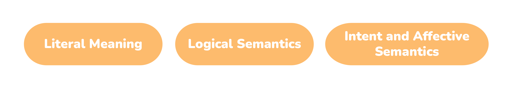
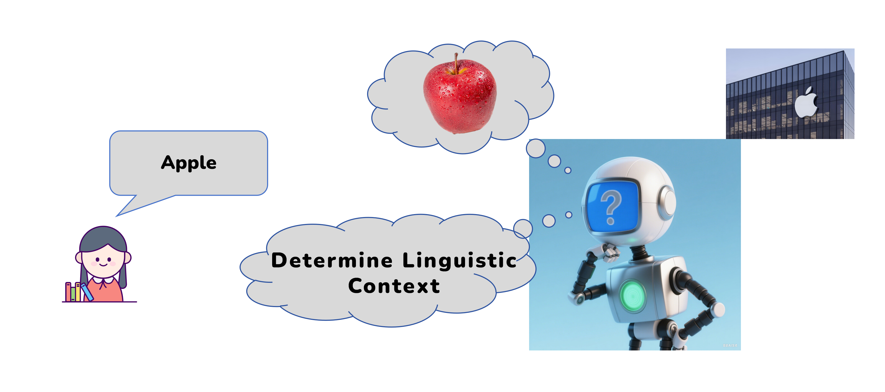
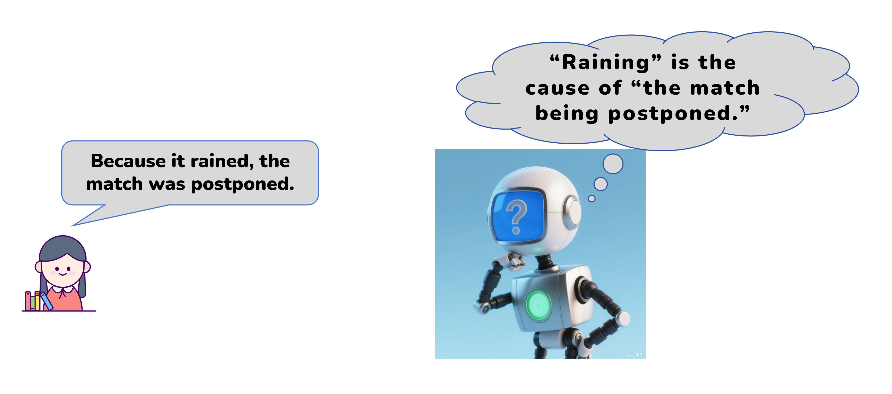
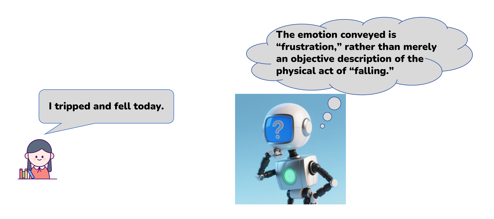

# 3.4 Large Language Model - Semantic Understanding 

## 3.4.1 Lesson Introduction

This lesson explains three layers of semantics: literal, logical, and emotional. It pairs with hands-on practice on the XiaoZhi AI platform. Combined with real-world examples from home and medical devices, this lesson demonstrates landing scenarios of semantic understanding in daily life and industry. A complete cognitive framework for large language model capabilities is established.

## 3.4.2 Learning Objectives

1. **Knowledge Objectives**: Memorize the definition of semantic understanding. Distinguish three semantic layers: literal, logical, and intent-emotion. Master the interpretive function and typical cases for each semantic layer.

2. **Skill Objectives**: Design different question formats on the XiaoZhi AI platform. Observe AI semantic understanding performance in distinguishing word meanings, organizing logic, and recognizing emotions.

3. **Thinking Objectives**: Establish hierarchical logical thinking for text interpretation. Learn to distinguish surface text from hidden underlying meaning. Understand the complete approach of AI language interpretation.

4. **Application Objectives**: List intelligent devices in daily life and healthcare that rely on semantic understanding. Learn precise questioning to help AI comprehend genuine needs.

## 3.4.3 Learning Semantic Understanding

### (1) Basic Definition of Semantic Understanding

Semantic understanding refers to the capability of models to learn patterns of human language and accurately capture true meaning, logical relationships, emotional tendencies, and intent purposes contained in text or dialogue. This goes beyond mere recognition of surface-level text, such as grammar and spelling.

In simple terms, humans can "read between the lines" when understanding language, and semantic understanding in large language models aims to bring models as close as possible to this human-level "comprehension" capability.

### (2) Three Progressive Goals of Semantic Understanding

AI text interpretation divides into three levels from shallow to deep. Each level approaches authentic human expression more closely:

1. Literal semantics: The core function is understanding words themselves. This involves recognizing basic meanings of vocabulary, phrases, and sentences. It resolves foundational interpretation of polysemous words and ambiguous sentences.

2. Logical semantics: The core function is understanding relationships between sentences. This involves analyzing causal, contrastive, coordinate, and conditional logical relationships in text, as well as associations between entities.

3. Intent and emotional semantics: The core function is understanding the speaker's purpose and mood. This involves capturing the speaker's underlying purpose and subjective emotional stance.

## 3.4.4 Application Scenarios of Semantic Understanding

### (1) Personal Home Living Scenario

In everyday life, semantic understanding powers smartphone voice assistants and smart home devices.

###  (2) Medical Industry Scenario

In healthcare environments, semantic understanding is integrated into intelligent triage robots and automated medicine-delivery robots.

## 3.4.5 Extended Knowledge

 **(1) From Understanding Speech to Reading Hearts**

Semantic understanding divides into three levels. Literal semantics: recognizing basic word and sentence meanings, such as "apple" referring to fruit. Logical semantics: analyzing causal, contrastive, and other logical relationships. Intent and emotional semantics: capturing speaking purpose and emotion. "I fell down" may implicitly convey "seeking comfort." The advancement of large models lies not merely in "seeing words" but in striving to "read hearts."

 **(2) Language Traps That Cause AI to Fail**

Language is full of traps. Ambiguity problems: does "apple is delicious" refer to fruit or phones? Reference resolution: in "he couldn't find XiaoGang, because he was too short," who is short? Also irony and sarcasm: "you are so amazing" may be praise or mockery. These are simple for humans but enormous challenges for AI, requiring world knowledge and commonsense reasoning.

## 3.4.6 Q & A

**Question 1: What is the difference between speech recognition and semantic understanding?**

Answer: Speech recognition addresses "transcribing words accurately" by converting audio into text. Semantic understanding solves "understanding what meaning," analyzing intent and emotion behind text. The former is the "ear." The latter is the "brain." Hearing every word clearly does not equal comprehending every sentence.

**Question 2: How does the statement "It is really cold today" illustrate the three levels of semantic understanding?**

Answer: Literal semantics: recognizing word meanings, knowing this describes low temperature. Logical semantics: judging that "cold" describes today's weather. Intent and emotion: if the speaker enters rubbing hands, the intent is "requesting heat" or "complaining." If seeing someone underdressed, the intent is "reminding to wear more clothes." The three levels progress from shallow to deep.

## 3.4.7 Technical Support and Product Discussion

If creative ideas emerge after using the product, sharing in the [Hiwonder community](https://forum.hiwonder.com) is welcome:

