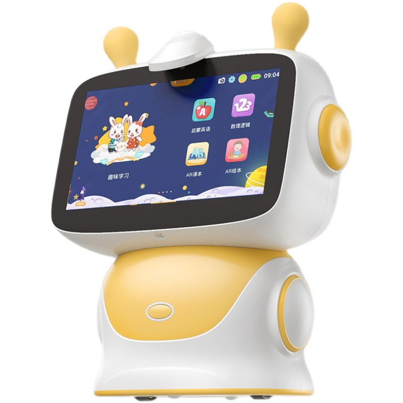
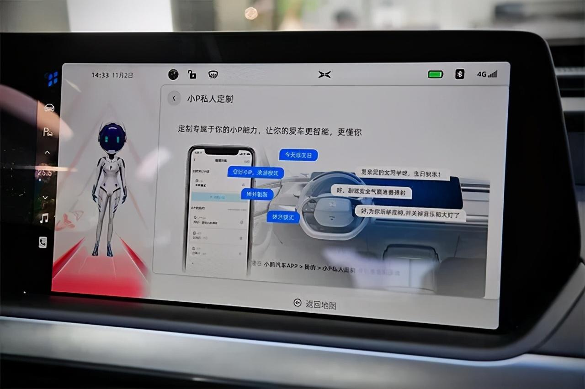
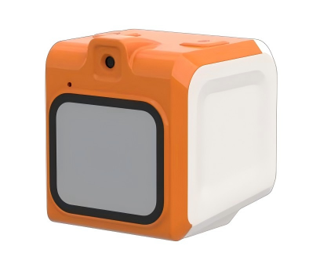
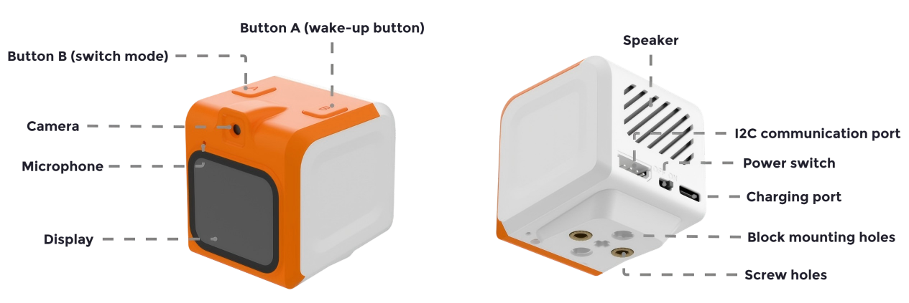

# 3.5 Initial Introduction to Speech Large Language Model

## 3.5.1  Lesson Introduction

This lesson upgrades the interaction method to explore speech modeling. Communicate with AI directly through speech instead of typing. The lesson first introduces the definition of speech modeling and their applications in everyday devices, then examines the complete structure of the hands-on hardware WonderMind. Step-by-step instructions guide learners through device network configuration and speech conversation practice.

## 3.5.2 Learning Objectives

1. **Knowledge Objectives**: Memorize the core definition of speech modeling. Master the three foundational capabilities of "speech recognition + semantic understanding + speech synthesis." Remember three typical application scenarios in smart home, office, and health contexts.

2. **Skill Objectives**: Proficiently identify all functional ports on the WonderMind hardware. Independently complete device power-on and WiFi network configuration procedures. Use the wake word to initiate voice conversations.

3. **Thinking Objectives**: Distinguish similarities and differences between text-based large models and speech modeling. Understand the complete technical pipeline of "speech-to-text → AI reasoning → text-to-speech." Establish multimodal AI logical thinking.

4. **Application Objectives**: Independently list voice-enabled smart devices in daily life. Complete hands-on speech tasks including Q&A, storytelling, and translation using the hardware after class. Appropriately utilize voice AI to assist learning.

## 3.5.3 Understanding Speech Modeling

### (1) Basic Definition of Speech Modeling

An AI system that can understand human speech and respond verbally is a large speech model. It possesses "super ears" to receive audio input and a "super mouth" to output spoken responses. The system supports continuous multi-turn natural conversation. This lesson provides systematic study and hands-on operation with speech AI hardware.

Core Characteristics:

- Processes text and language
- Understands speech and generates speech

###  (2) Life Interaction Scenarios

1. Smart Home Speakers: Voice-controlled music playback, weather queries, alarm setting, and idiom games. Built-in speech modeling recognizes voice commands.


2. Children's Early Education Devices: Voice-based storytelling, English reading practice, and science Q&A. Through voice interaction to deliver an immersive learning experience.



3. In-Vehicle Voice Systems: Voice navigation, music switching, and traffic condition queries. Eliminates manual operation while driving to ensure travel safety.



4. Mobile Voice Assistants: Cover extensive voice functions including weather checks, arithmetic, poetry recitation, translation, jokes, and schedule management.


## 3.5.4 Understanding the WonderMind Large Model Module

WonderMind is an AI large model module featuring a high-performance chip. It integrates a high-definition camera, microphone, high-definition display, speaker, and voice recognition chip. The module deeply fuses text, voice, and vision models.



###  (1) WonderMind Component Diagram



| Component | Function |
|:--:|:--:|
| Screen | Displays large model conversations and camera feedback images |
| Microphone | Audio input for the large model |
| Camera | Image capture for the large model |
| Button A | Activates the large model conversation function |
| Button B | Switches between conversation, expression, and feedback modes |
| Speaker | Plays large model voice responses |
| I2C communication port | Communication interface with the controller |
| Power switch | Device power control |
| Charging port | Device charging |
| Building block port | Mounting point for building block pins |

###  (2) Device Power-On

1. Toggle the switch on the back of the module. The screen illuminates to indicate successful power-on.


2. After power-on, the display shows **the device hotspot** **name** and **browser network configuration** URL with voice broadcast. Network configuration must be completed before initial use.


###  (3) Module Network Configuration

1. The module initiates network configuration immediately after power-on. The display shows **the device hotspot name** and **browser network configuration URL** with voice broadcast. The large model module activates its own hotspot for connection and configuration. Different devices have different hotspot names following the uniform format **WonderMind-xxxx**. The following instructions use hotspot WonderMind-7885 as an example.


2. Search for and connect to the corresponding hotspot using a computer or mobile phone. This hotspot requires no password.


3. Click the [Network Configuration](http://192.168.4.1/) hyperlink to directly access the device network configuration URL. Alternatively, copy the following URL and open any browser to access the network configuration page.

```py
http://192.168.4.1
```


4. In the interface shown below, enter the desired hotspot name for automatic connection at power-on in field ①. Enter the hotspot connection password in field ②. Finally, click **Connect** in field ③. The module attempts to locate and connect to the matching hotspot in the current environment using the provided connection information.


5. The interface displays a list of currently available hotspots scanned by the module. Clicking any item automatically populates the corresponding hotspot name into field ① for convenience.


6. If the following prompt appears, the hotspot cannot be found in the current environment or the connection password is incorrect. Please re-enter the information.


7. If the following prompt appears, the module has successfully located and connected to the corresponding hotspot. The module automatically restarts and connects to the specified hotspot.


> [!NOTE]
>
> * **Do not enter hotspots that cannot be detected in the current environment, have excessively weak signals, or lack internet connectivity.**
>
> * **If the module previously saved connection information for other hotspots, new hotspot connection information will coexist with existing entries. At next power-on, the module reads each saved connection entry in sequence to attempt matching and connection.**
>
> * **If the module displays Error: Version check failed, retrying in xx seconds after network configuration, the current hotspot may lack internet access or have poor network quality. Please attempt to switch networks.**

###  (4) XiaoZhi Platform Account Login and Authentication 

- #### XiaoZhi Platform Account Login

1. Click the [XiaoZhi AI Chatbot](https://xiaozhi.me/) hyperlink to directly access the device binding URL. Alternatively, copy the following URL and open any browser to access the device binding page.

```py
https://xiaozhi.me
```


2. Click **Console** to enter the XiaoZhi AI agent management platform.


3. Log in directly with an existing username and password. For first-time access, register a platform account first.


4. Complete the required information and click **Send Code** to obtain the verification code needed for account registration.


5. Check the agreement and privacy policy boxes, then click **Login**.


6. Complete the required information and click **Confirm** to finish registration and login.


- #### GitHub Platform Login

> [!NOTE]
>
> * **Refer to the diagram below for the main permission differences between standard accounts and GitHub-authenticated accounts.**
>
> 
>
> * **Skip GitHub authentication and proceed directly to [Device Binding](#section-3-5-4-5) after logging in, or follow the steps below to complete GitHub authentication.**

1. On the XiaoZhi platform, click the icon and select **GitHub Verification**. Wait for the interface to redirect to the authentication page, then click **Link GitHub**.


2. Wait for the interface to redirect to the GitHub account login page.


3. If a GitHub account already exists, log in directly with username and password and proceed to [【Binding XiaoZhi Platform with GitHub Platform】](#section-3-5-4-4-3). If no GitHub account exists, click **Create an account**.


4. In the popup interface, enter personal email, login password, username, and location information in sequence. Click **Create account** to submit registration information.


5. Click **Visual puzzle** on the page to begin image verification.


6. After completing image verification, the GitHub platform sends a verification email to the previously entered registration email. Copy the confirmation code sent to the registered email address and enter it into the page.


7. Once verified, the page redirects to login and confirms account creation.


<a id ="section-3-5-4-4-3"></a>

- ####  Binding XiaoZhi Platform with GitHub Platform

1. Click **Authorize tenclass** to complete binding between the XiaoZhi platform and GitHub platform.


2. Complete the binding to finish XiaoZhi platform authentication, return to the previous authentication page, and verify the confirmation message shown below.


<a id ="section-3-5-4-5"></a>

### (5) Device Binding

1. After completing XiaoZhi platform registration, login, and authentication, click **Agents** to enter the following interface.


2. Click the **∨** shaped button at the add device button location, then click **Create Agent**.


3. Enter the agent name, then click **Confirm** to complete agent addition.


4. Click **Configure** to access various function configurations for the agent.


5. Click **Role** to configure the agent role. Select the desired conversation language at the field ①, choose the desired character voice at the field ②, and configure voice settings at the field ③.


6. Click **Model & memory**. Select **DeepSeek V4 (Rich Personality)** for the language model. Disable the memory function. Keep all other settings at default.


7. Click **Extensions**. Check all Official Services. Keep all other settings at default. Finally, click **Save**.


8. Click **Devices** to enter the device management function.


9. Click **Link new device**. Enter the **6-digit device ID** in the popup and click **Link**.


10. If binding succeeds, the page displays **Device added successfully**. Then select **Open Source** and click **Start Using**.


11. After successful device binding, the module enters the MCP configuration waiting interface. The current mode waits for an external main controller to configure MCP for the large model. Since no external main controller is currently connected, simply short-press **Button A** to enter the large model expression mode normally.


12. When entering the large model expression mode, the module displays expressions. Network configuration and binding are now complete.


### （6） Free Conversation

After completing all module preparation steps, press **Button B twice** to switch to conversation mode. In conversation mode, speak the **wake word** **Hello Hiwonder** or **short-press Button A**  to activate the module's voice interaction mode.

The module includes special functions accessible through commands during human-machine conversation interaction. Issue voice commands to the WonderMind module using phrases such as ① **What can you do?** or ② **Introduce your features** to query all supported functions.&emsp;

Use the following commands to invoke corresponding features:

&emsp;&emsp;1.Weather query: **Check the weather in [location]**.


&emsp;&emsp;2. News Broadcast Function: **① Broadcast today's news ② Introduce today's hot events.**


&emsp;&emsp;3. Outfit recommendation: **Give an outfit recommendation for today.**


&emsp;&emsp;4. Joke telling:  **① Tell a joke. ② Tell a joke to lighten the mood.**


&emsp;&emsp;5. Almanac Query Function: **Check today's horoscope for [zodiac sign].**


&emsp;&emsp;6. Music Playback Function: **Play a random song.**

> [!NOTE]
>
> **Lower the module volume before using the music playback function.**


## 3.5.5 Extended Knowledge

(1) **The** **Homophone Trap** **in Speech Recognition**

When speech modeling recognizes speech, they do not simply convert sounds to words in isolation, but rather combine context to infer the most likely text. However, Chinese contains a large number of homophones. For instance, "明天要去市场调研" and "明天要去时常调研" sound identical, and the model must rely on surrounding context to determine which phrase is more reasonable. When contextual information is insufficient, the model is prone to errors. Furthermore, variations in accents, speech rates, and vocal habits all affect recognition results. Behind this lies the collaborative work of acoustic models and language models, the acoustic model is responsible for hearing pronunciation clearly, while the language model is responsible for guessing meaning correctly. The better these two work together, the more accurate the recognition becomes.

**(2) From Robot Voice to Human-like Quality**

Early text-to-speech synthesis produced rigid, flat intonation that immediately revealed a machine was speaking, commonly dubbed the "robot voice." Modern speech modeling can synthesizes highly natural speech, and the secret lies in their departure from simply concatenating individual phonemes. Instead, they learn from vast samples of human speech, mastering details such as tonal inflections, pause durations, and emotional variations. More importantly, contemporary speech synthesis can automatically adjust tone based on context, employing a light, lively intonation when telling jokes, or raising pitch at sentence endings to express questions. Making machines "speak" like real people is essentially teaching them "how to speak" rather than merely "what to say."

## 3.5.6 Q&A

**Question 1: Are speech recognition and voice large model identical concepts?**

Answer: These are concepts at different hierarchical levels.

- Automatic Speech Recognition, commonly abbreviated as ASR, is a specific technical task aimed at converting audio signals into corresponding text. It addresses the question of "what words were spoken" without involving semantic understanding. Traditional speech recognition systems rely on the collaboration of acoustic models, language models, and pronunciation dictionaries to accomplish this conversion.
- Voice large model is a broader system concept. It typically contains a speech recognition module but extends far beyond. A complete voice large model usually consists of three components: ① Speech front-end module: Contains speech recognition ASR, responsible for converting voice audio to text. Also performs audio preprocessing including noise reduction and echo cancellation. ② Large language model core: Receives text output from ASR, completes semantic understanding, logical reasoning, and dialogue generation. Comprehends the underlying intent and generates response text. ③ Speech synthesis TTS module: Converts response text output from the large model into natural, fluent voice audio for output. 

**Question 2: Voice large models enable multi-turn conversation. Compared to single-turn Q&A, what additional technical challenges does this present?**

Answer: Multi-turn conversation is a key capability distinguishing voice large models from traditional voice assistants, but it introduces significant technical challenges:

- From the "memory" perspective: The model must remember key information from previous conversation turns, such as locations, people, and preferences mentioned earlier. This technically depends on context window management. If conversation extends too long, the model may "forget" earlier information, causing contradictory responses.
- From the "understanding" perspective: Expressions in multi-turn conversation frequently contain referential ellipsis. For example, the first turn states "I want to listen to Jay Chou's songs," and the second turn states "Play another slow song by him." The model must recognize that "him" refers to Jay Chou, and "play another" indicates switching within the previously recommended song scope.

## 3.5.7 Technical Support and Product Discussion

If creative ideas emerge after using the product, sharing in the [Hiwonder community](https://forum.hiwonder.com) is welcome:

<a href="https://forum.hiwonder.com.cn/" target="_blank" rel="noopener noreferrer">


</a>

