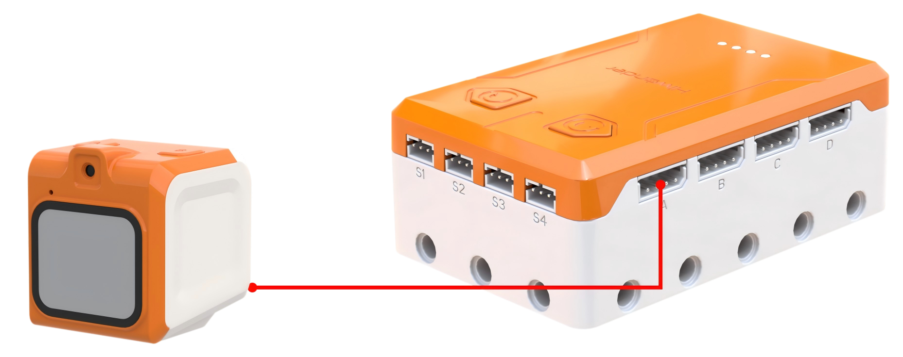
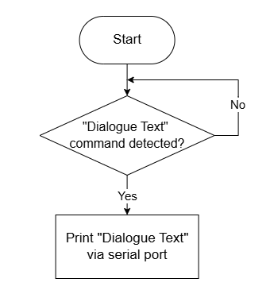
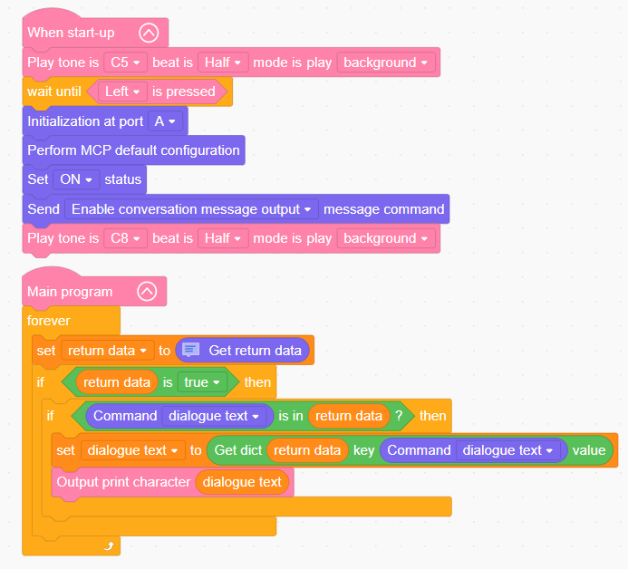

# 3.6 Voice Interaction Practice

## 3.6.1 Lesson Introduction

This lesson introduces the AiBlock controller as the device "command brain," paired with WonderMind voice hardware to complete a full voice interaction project. The lesson sequentially covers voice interaction concepts, hardware structures for both systems, standardized wiring and power-on procedures, complete WonderLab programming software operations, basic logic code, and voice interaction program writing. The final outcomes include button-triggered text output and voice conversation practice, achieving software-controlled hardware with human-robot voice interaction.

## 3.6.2 Learning Objectives

1. **Knowledge Objectives**: Clearly understand the complete definition of voice interaction. Memorize all port functions on the AiBlock controller and WonderMind hardware. Master the underlying logic of software-hardware integration. Distinguish between controller interaction and human-robot interaction modes.

2. **Skill Objectives**: Proficiently complete standardized hardware wiring and correct power-on sequence. Independently operate WonderLab software to create new projects, load the controller and voice extension modules. Write and execute basic programs for button-triggered printing and voice conversation.

3. **Thinking Objectives**: Establish a three-layer engineering mindset of "hardware platform + graphical code + AI voice model." Understand program loops, conditionals, and variable logic. Map the complete signal transmission chain.

4. **Application Objectives**: Independently build a simple voice interaction robot. Expand to voice-controlled buzzer, lights, and other peripherals after class. Use programming to modify voice interaction response logic.

## 3.6.3 Preparation Work

### (1) Hardware Preparation

- AiBlock controller
- WonderMind large model module
- Module cable 
- Type-C data cable
- Computer

### (2) Software Preparation

- WonderLab programming software

## 3.6.4 Hands-On Project

### (1) Project Analysis

This lesson contains two core tasks. Task one is controller interaction: press the left button on the controller, the buzzer plays a tone, and "Hello" is printed. Task two is human-robot interaction: initialize WonderMind, configure MCP, and achieve voice wake-up conversation. Final integration: pressing the button triggers WonderMind to start conversation while the controller buzzer responds.

### (2) Understanding the AiBlock Controller

AiBlock can connect to many components such as motors, servos, and sensors. It supports both graphical programming and Python programming. The controller has 4 servo ports, 4 motor ports, 4 sensor ports, 2 programmable buttons, and a buzzer for sound output.

The corresponding functions are shown below:

| Port                   | Description                                             |
| :--------------------- | :------------------------------------------------------ |
| Type-C port            | Program upload and power supply                         |
| Power switch           | OFF / ON two-position toggle                            |
| Power indicator        | Displays power status                                   |
| A to D (I2C ports)     | Sensor ports                                            |
| M1 to M4               | Long motor ports                                        |
| S1 to S4               | Block servo and block motor ports                       |
| 2 Programmable buttons | Customizable trigger functions                          |
| Buzzer                 | Plays tones and alert sounds                            |
| Building block ports   | Compatible with standard building block pin connections |

### (3) Understanding the WonderLab Programming Platform

- #### Platform Introduction

WonderLab is a dedicated Scratch-based programming software tool for Hiwonder products. The software supports automatic conversion between graphical instruction blocks and Python code. Programs are created through drag-and-drop block manipulation, making it highly suitable for beginner programming education.

- #### Software Download and Installation

1. Programming software installer download link: [WonderLab Software](https://k12.hiwonder.com.cn/download/pcSoftware?get_pc=1&os=windows)

2. Open the **WonderLab setup.exe** software installer.

3. Select language, then click **OK**.

4. Select installation location, then click **Next**.

5. Click **Next**.

6. Click **Install**.

7. After successful installation, click **Finish**.

- #### WonderLab Interface Introduction

The following diagram shows the functional area layout of the "WonderCode" software: ① Menu Bar, ② Instruction Area, ③ Script Area, ④ Code Display Area.

The corresponding functions are shown in the table below:

| Icon                                                         | Function                                                     | Icon                                                         | Function                                                     |
| :----------------------------------------------------------- | :----------------------------------------------------------- | :----------------------------------------------------------- | :----------------------------------------------------------- |
|  | Create, save, and open program files                         |  | Undo or redo operations during programming                   |
|  | For online mode, for reference only, no mastery required     |  | Edit mode toggle button, "Auto Transcode" converts block programs to Python form, switch to "Python Coding" to directly edit programs using Python |
|  | Determines device connection with software and confirms connection port |  | Saves program in Python code form                            |
|  | Used for finding help materials, checking updates, and installing drivers |  | Opens saved Python files                                     |
|  | Displays program file name, shows "Scratch Project" when programming has not started or file is unsaved |  | Performs device interaction and uploads program to the controller board |
|  | Interface toggle button, switches between "Online Mode" and "Upload Mode" |  | Used for adding device extension packages                    |
|  | Selects interface display language, switches between English, Simplified Chinese, and Traditional Chinese |  | From top to bottom: controls code editor zoom in, zoom out, and restore default size |

### (4) Hardware Wiring

- Connect the WonderMind module to port **A** of the controller using a 4-pin module cable.

### (5) Adding Extensions

- Select **WonderMind AI** **large model module** under the **Input Module** category. 

### (6) Core Blocks

| Icon                                                         | Category                                                     | Function                                                     |
| :----------------------------------------------------------- | :----------------------------------------------------------- | :----------------------------------------------------------- |
|  |  | Drives the buzzer to play notes at specified pitch and beat duration, runs in background mode without blocking subsequent program execution. |
|  |  | Prints custom text strings to the computer via serial port for debugging and information display. |
|  |  | Initializes the hardware interface of the WonderMind AI large model module. |
|  |  | Loads default MCP protocol parameter configuration to complete basic large model interaction channel setup. |
|  |  | Activates the MCP conversation channel to enable large model interaction functions. |
|  |  | Pushes action completion command to the large model to notify that the current robot action execution is finished. |
|  |  | Issues motion control commands to the robot, dropdown menu provides multiple robot actions and device control commands. |

### (7) Program Description and Upload

- Program Schematic

- Complete Program

  1. After the controller powers on, a startup sound plays. When the WonderMind interface displays MCP configuration, press the left button on the controller. The buzzer then plays a ready sound.

  2. Retrieve data sent from WonderMind to the controller, store as "return data," then check whether "return data" contains "conversation text" command.

  3. Extract the conversation text from "return data," store in the "conversation text" variable, and finally print the conversation text in the small black box at the lower right corner.

> [!NOTE]
>
> **The source files are available for download under [Program Files](https://drive.google.com/drive/folders/1cIZD1yG0hj_lme2SCWtL_KWlalJhd6ib?usp=sharing).**

- Program Upload: When uploading the program, **first power on the controller, then power on WonderMind** **switch**.

- Device restart: After successful program upload, the large model module requires **restart** before program verification. **The power-on sequence must strictly follow controller first, then WonderMind**. **First, in the field ①, then in the field ②**. **Wait for WonderMind to enter the Waiting for MCP extension tool configuration, press Button A to skip interface, then press the left button on the controller to run the program normally**. If the uploaded program is unchanged, the WonderMind restart step is not required.

## 3.6.5 Extended Knowledge

**(1) Voice Interaction Basic Definition and Complete Working Chain**

Voice interaction is a natural interaction method where machines understand human speech and respond verbally. The complete process contains three core modules: ASR speech recognition serves as the machine's ears, converting sound to text. NLP semantic understanding serves as the machine's brain, comprehending the meaning behind words. TTS speech synthesis serves as the machine's mouth, converting responses into human voice broadcast. No button presses or screen touches are needed throughout. This is the interaction form closest to human-to-human communication, widely covering smart home, in-vehicle, robot, and translation device applications. The voice module in this lesson is a compact implementation of this complete voice interaction system.

**（2） Voice Interaction Century-long Development History**

The evolution of voice interaction can be divided into three distinct phases: 1950–2000 incubation period, devices could only recognize fixed numbers and words with slow standard pronunciation required. 2000–2015 popularization period, mobile voice assistants and smart speakers emerged capable of executing short command sentences. 2015 to present large model era, supporting multi-turn conversation, dialect recognition, and emotional voice. From laboratory niche technology to everyday universal tool, comparing interaction differences across three generations directly demonstrates how AI technology enables machines to understand free-form spoken language.

## 3.6.6 Q&A

**Question 1: What roles do AI Blocks Board and WonderMind extensions serve in WonderLab?**

Answer: The AI Blocks Board extension opens the controller IO ports and basic hardware operation code blocks. This is the foundation for all peripheral control. The WonderMind extension provides dedicated commands for voice module network configuration, voice transmission and reception, and conversation parsing. Neither can be omitted to complete voice interaction.

**Question 2: What is the function of the Get Return Data command, and how is voice content parsed from it?**

Answer: This command receives JSON-format interaction data transmitted from WonderMind. The program uses conditional checking commands to search whether the data contains conversation text, extracts the speech text, and uses it for subsequent logic judgment and hardware control.

## 3.6.7 Technical Support and Product Discussion

If creative ideas emerge after using the product, sharing in the [Hiwonder community](https://forum.hiwonder.com) is welcome:

