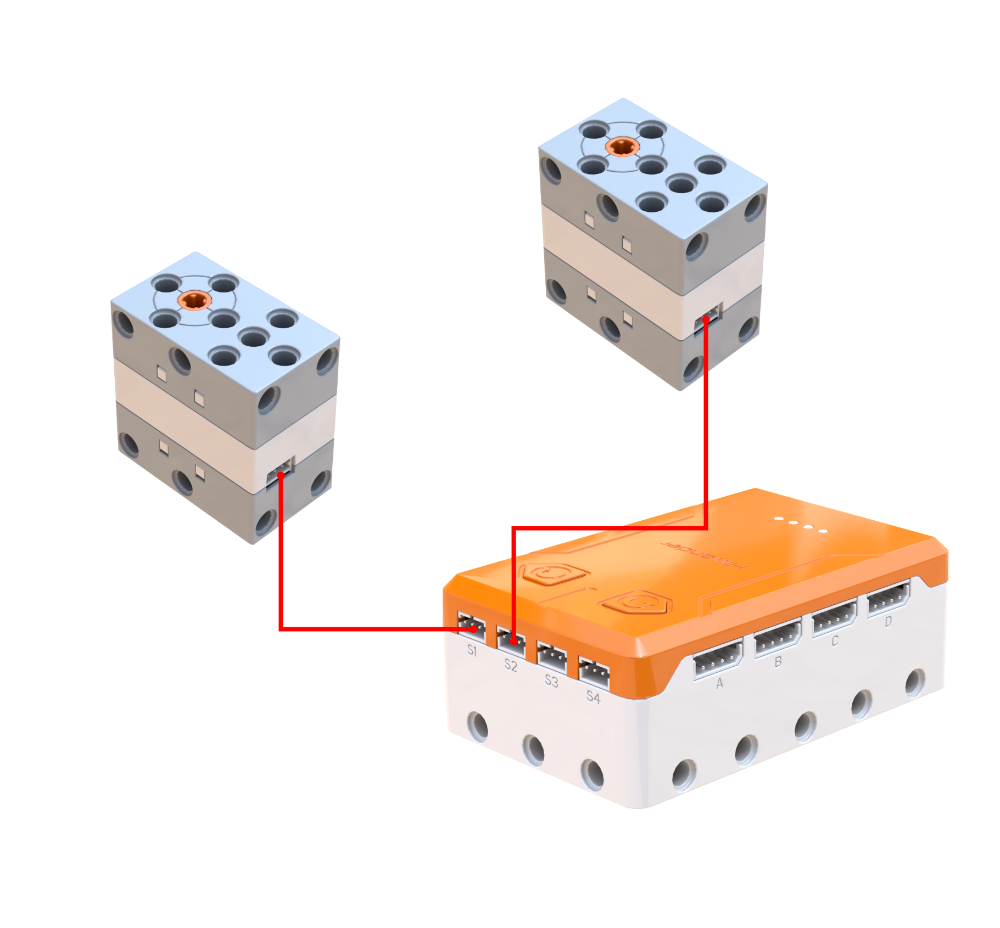
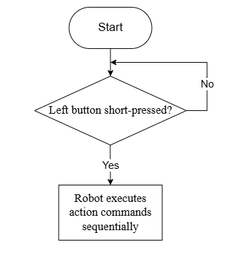
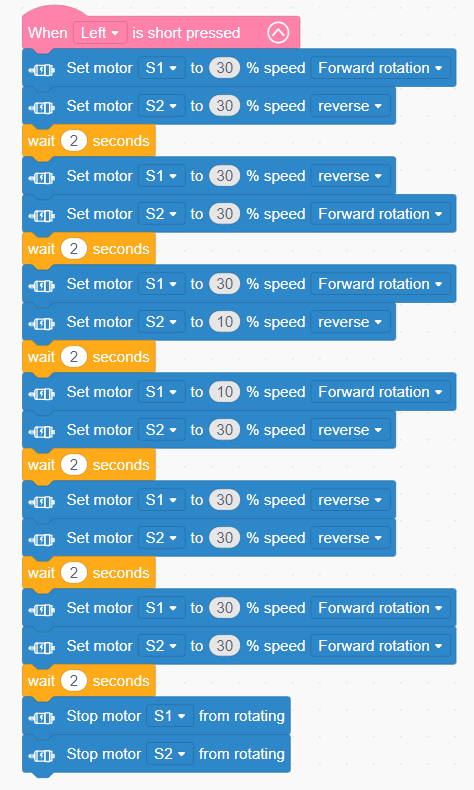

# 3.7 Hardware Chassis Control

## 3.7.1 Lesson Introduction

This lesson enters the robot "body" control phase: tracked chassis. The lesson explores the stability advantages of triangular track structures, studies motor drive principles, and programs the chassis to perform basic motions including forward movement, backward movement, turning, and in-place rotation. This lesson forms the foundation for robot motion control, providing mechanical and programming fundamentals for subsequent integrated projects such as voice control and vision navigation. Through chassis assembly and programming debugging, the lesson delivers direct experience of the energy conversion process from "electrical energy → rotational force → mechanical motion."

## 3.7.2 Learning Objectives

1. **Knowledge Objectives**: Understand the mechanical advantages of triangular tracks, namely their large contact area and high stability. Master motor drive principles, including PWM speed regulation and forward-reverse rotation.

2. **Skill Objectives**: Complete assembly of the tracked chassis. Write programs to control motors for forward movement, backward movement, left and right turning, and in-place rotation.

3. **Thinking Objectives**: Establish "differential steering" thinking: achieving turns through speed differences between left and right motors.

4. **Application Objectives**: Understand tracked mobility applications in off-road scenarios, robotic vacuums, and related fields.

## 3.7.3 Preparation

###  (1) Hardware Preparation

- AiBlock controller 
- WonderMind large model module
- 360° block motor
- Building block parts
- Module cable
- Type-C data cable

###  (2) Software Preparation

- WonderLab programming software

## 3.7.4 Hands-On Project

###  (1) Project Analysis

The primary focus of this lesson is programming motor actuation across four basic motion modes. Forward Movement: Both motors rotate forward at identical speeds. Backward Movement: Both motors rotate in reverse at identical speeds. Right Turn: The left motor runs faster than the right motor, or the right motor reverses. In-Place Rotation: The left and right motors rotate in opposite directions simultaneously. A program shall be created to execute different motion sequences upon keypress.

###  (2) Assembly Guide

<pdf src="../../_static/shared/pdf/chapter_3/1.pdf" />

### (3) Hardware Wiring

- Connect the left wheel 360° block motor to port **S1** of the controller using a 3-pin servo cable.
- Connect the right wheel 360° block motor to port **S2** of the controller using a 3-pin servo cable.

### (4) Adding Extensions

- Select **360° Motor** under the **Motion module** category.

### (5) Core Blocks

| Block                                                        | Category                                                     | Function                                                     |
| :----------------------------------------------------------- | :----------------------------------------------------------- | :----------------------------------------------------------- |
|  |  | Controls the specified port 360° block motor with custom running speed. Select forward or reverse rotation direction for continuous operation. |
|  |  | Cuts output to the specified port 360° block motor, causing the motor to stop rotating immediately. |

###  (6) Program Description and Upload

- Program Schematic

- Complete Program

  When the left button is pressed, the tracked vehicle moves forward for 2 seconds, backward for 2 seconds, turns left for 2 seconds, turns right for 2 seconds, rotates clockwise for 2 seconds, and rotates counterclockwise for 2 seconds.

> [!NOTE]
>
> **The source files are available for download under [Program Files](https://drive.google.com/drive/folders/1cIZD1yG0hj_lme2SCWtL_KWlalJhd6ib?usp=sharing).**
>

- Program Upload: When uploading the program, **first power on the controller, then power on WonderMind switch**.

- Device restart:  After successful program upload, the large model module requires **restart** before program verification. **The power-on sequence must strictly follow controller first, then WonderMind. First, in the field ①, then in the field ②. Wait for WonderMind to enter the Waiting for MCP extension tool configuration, press Button A to skip interface, then press the left button on the controller to run the program normally**. If the uploaded program is unchanged, the WonderMind restart step is not required.

## 3.7.5 Extended Knowledge

**(1) Smooth Acceleration and Deceleration Speed Curve Programming**

Write a segmented speed regulation program to control the tracked chassis gradually accelerating from low speed to full speed, then slowly reducing rotational speed for smooth stopping before motion ends. This simulates real-world vehicle starting and braking states. The practice deepens understanding of PWM continuous speed regulation principles, optimizes robot motion smoothness, and reduces chassis shaking caused by abrupt starts and stops. Expandable to speed control scenarios including inspection vehicles and smart personal mobility robots.

**(2) Rectangular Closed-Loop Path Planning Programming**

Independently design a complete rectangular walking timing logic. The program cyclically executes forward movement, delay, and right turn actions. Delay commands precisely control each segment travel distance, enabling the chassis to complete a closed rectangular motion trajectory. This exercise practices spatial logic design and action timing arrangement, developing thinking skills for step-by-step decomposition of complex motion tasks. Extends to fixed-route warehouse vehicle inspection and campus patrol robot applications.

## 3.7.6 Q&A

**Question 1: What advantages does a triangular tracked chassis have compared to ordinary wheeled chassis?**

Answer: Triangular tracks have larger ground contact area, stronger traction, better passability on sand and uneven terrain, and higher driving stability with reduced rollover risk. Suitable for complex terrain inspection and off-road robot applications.

**Question 2: Explain the implementation method for tracked chassis right turns from motor operation logic.**

Answer: A right turn can be achieved through two primary methods. Differential Turning: The left motor runs at a higher speed than the right motor, creating a speed discrepancy that gently arcs the chassis to the right.  In-Place Turning: The left motor rotates forward while the right motor rotates in reverse simultaneously, causing the chassis to spin sharply to the right around its central axis.

## 3.7.7 Technical Support and Product Discussion

If creative ideas emerge after using the product, sharing in the [Hiwonder community](https://forum.hiwonder.com) is welcome:

