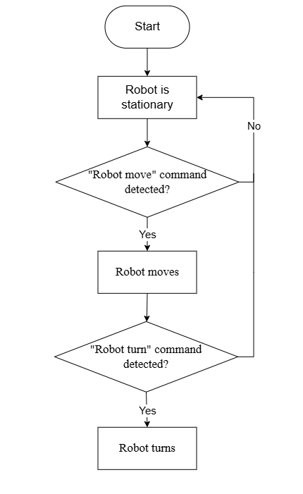
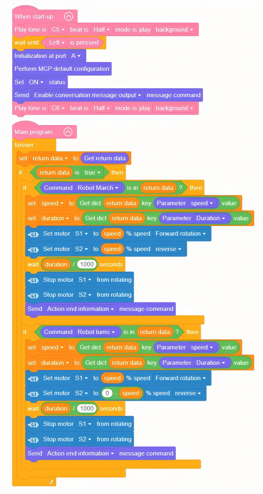

# 3.8 Intelligent Voice Control

## 3.8.1 Lesson Introduction

This lesson combines voice interaction with chassis movement to achieve voice-controlled forward, backward, and turning motions on a tracked robot. Building upon the previous two lessons, the lesson integrates the WonderMind voice module and motor drive systems. The program parses speed and duration parameters from voice commands and maps them to motor control signals. This lesson is the key practice for linking "hearing" and "action," delivering the complete "voice → command → execution" closed-loop experience.

## 3.8.2 Learning Objectives

1. **Knowledge Objectives**: Understand the core logic of voice control, encompassing voice command parsing, parameter extraction, and action mapping. Understand the signal transmission flow from WonderMind to the main controller and then to the motor. 

2. **Skill** **Objectives**: Write programs to control chassis movement using voice commands such as "move forward for 2 seconds." Parse speed and duration parameters from commands.

3. **Thinking Objectives**: Establish "parameterized control" thinking: dynamic adjustment based on command parameters rather than fixed actions.

4. **Application Objectives**: Understand the technical principles behind voice-controlled vehicles, smart wheelchairs, and related applications.

## 3.8.3 Preparation

### (1) Hardware Preparation

- AiBlock controller
- WonderMind large model module
- 360° block motor
- Building block parts
- Module cable
- Type-C data cable

###  (2) Software Preparation

- WonderLab programming software

## 3.8.4 Hands-On Project

###  (1) Project Analysis

The program needs to implement the following: initialize WonderMind, cyclically retrieve returned data, and parse whether "dialogue text" exists. If present, extract parameters such as speed indicated by phrases like "speed 70" and duration indicated by phrases like "last for 3 seconds", then drive the motor to move at the corresponding speed and direction. Default value handling also needs to be set up.

###  (2) Assembly Guide

<pdf src="../../_static/shared/pdf/chapter_3/1.pdf" />

###  (3) Hardware Wiring

- Connect the left wheel 360° block motor to port **S1** of the controller using a 3-pin servo cable.
- Connect the right wheel 360° block motor to port **S2** of the controller using a 3-pin servo cable.
- Connect the WonderMind module to port **A** of the controller using a 4-pin module cable.

###  (4) Adding Extensions

- Select **WonderMind AI** **large model module** under the **Input Module** category.

- Select **360° Motor** under the **Motion module** category.

###  (5) Core Blocks

| Block                                                        | Category                                                     | Function                                                     |
| :----------------------------------------------------------- | :----------------------------------------------------------- | :----------------------------------------------------------- |
|  |  | Drives the buzzer to play notes at specified pitch and beat duration, runs in background mode without blocking subsequent program execution. |
|  |  | Real-time detection of specified button current level state, returns boolean value indicating whether button is pressed. |
|  |  | Initializes the hardware interface of the WonderMind AI large model module. |
|  |  | Loads default MCP protocol parameter configuration to complete basic large model interaction channel setup. |
|  |  | Activates the MCP conversation channel to enable large model interaction functions. |
|  |  | Pushes action completion command to the large model to notify that current robot action execution is finished. |
|  |  | Reads reply commands and text data issued by the large model for subsequent program calls. |
|  |  | Issues motion control commands to the robot, dropdown menu provides multiple robot actions and device control commands. |
|  |  | Reads corresponding parameter values from large model issued commands, dropdown selection provides various parameters for acquiring action speed, running duration, light color, servo angle, ranging distance, and other data for program logic calls. |
|  |  | Controls the specified port 360° block motor with custom running speed, select forward or reverse rotation direction for continuous operation. |
|  |  | Cuts output to the specified port 360° block motor, causing the motor to stop rotating immediately. |

###  (6) Program Description and Upload

- Program Schematic

- Complete Program

  1. After the controller powers on, a startup sound plays. When the WonderMind interface displays MCP configuration, press the left button on the controller. The buzzer then plays a ready sound.

  2. Continuously cycle to retrieve data sent from WonderMind to the controller, store as "return data," then check whether "return data" contains voice action commands.

  3. Extract action direction, running speed, and duration parameters from "return data." Set default parameters as fallback. Drive S1 and S2 motors to complete corresponding movement actions. Delay ends and motors stop. After the complete action set finishes, push action completion information.

> [!NOTE]
>
> **The source files are available for download under [Program Files](https://drive.google.com/drive/folders/1cIZD1yG0hj_lme2SCWtL_KWlalJhd6ib?usp=sharing).**
>

- Program Upload: When uploading the program, **first power on the controller, then power on WonderMind** **switch**.

- **Device restart:** After successful program upload, the large model module requires **restart** before program verification. **The power-on sequence must strictly follow controller first, then WonderMind. First, in the field ①, then in the field ②. Wait for WonderMind to enter the Waiting for MCP extension tool configuration, press Button A to skip interface, then press the left button on the controller to run the program normally**. If the uploaded program is unchanged, the WonderMind restart step is not required.

## 3.8.5 Extended Knowledge

**(1) Segmented Parsing of Continuous Compound Voice Commands**

Perform text segmentation on long-form voice input to extract multiple action and duration parameter sets. Achieve serial execution of continuous action sequences such as "move forward 3 seconds, turn right 2 seconds, move backward 1 second." The underlying implementation relies on MCP parameter multi-segment reading logic. String splitting completes queued execution of multiple commands. Extends to campus patrol robots with single voice command issuance of complete patrol routes.

**(2) Abnormal Command Voice Feedback Mechanism**

Add command validity judgment branches. When voice content lacks valid motion parameters or recognition is ambiguous, WonderMind automatically broadcasts prompt voice. Semantic layered recognition capability filters invalid text to improve human-robot interaction fault tolerance. Applicable to elderly smart personal mobility voice vehicles.

## 3.8.6 Q&A

**Question 1: What advantages do triangular tracks have compared to ordinary tracks?**

Answer: Triangular tracks have a larger ground contact area, providing stronger traction and better passability. They offer higher stability in complex terrain such as sandy ground and staircases, making them less prone to tipping over.

**Question 2:** **What chassis movements correspond to motor forward rotation and reverse rotation?**

Answer: Standard definition: both motors rotating forward moves the chassis forward; reverse rotation moves the chassis backward. When both motors rotate in opposite directions, the chassis rotates in place.

## 3.8.7 Technical Support and Product Discussion

If creative ideas emerge after using the product, sharing in the [Hiwonder community](https://forum.hiwonder.com) is welcome:

