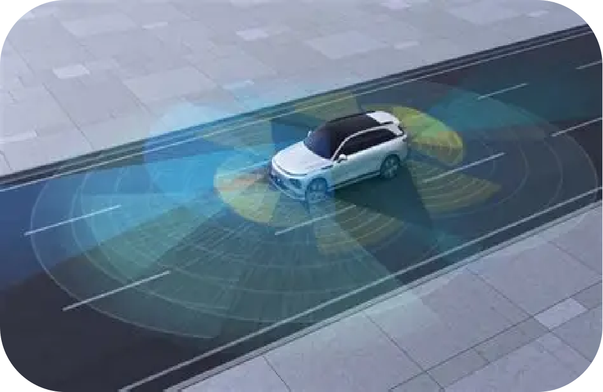
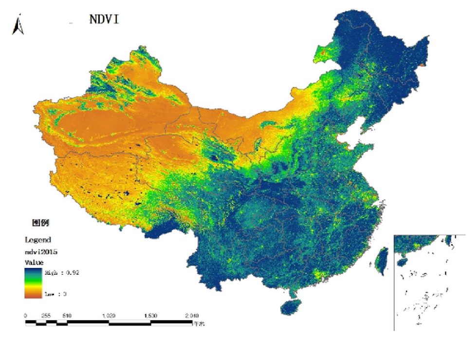
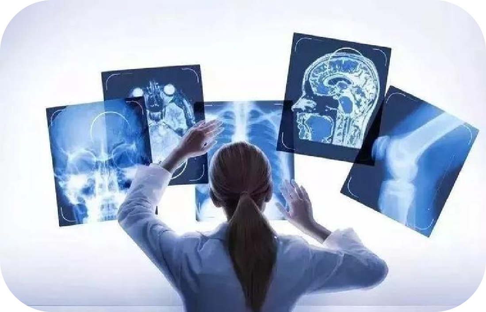
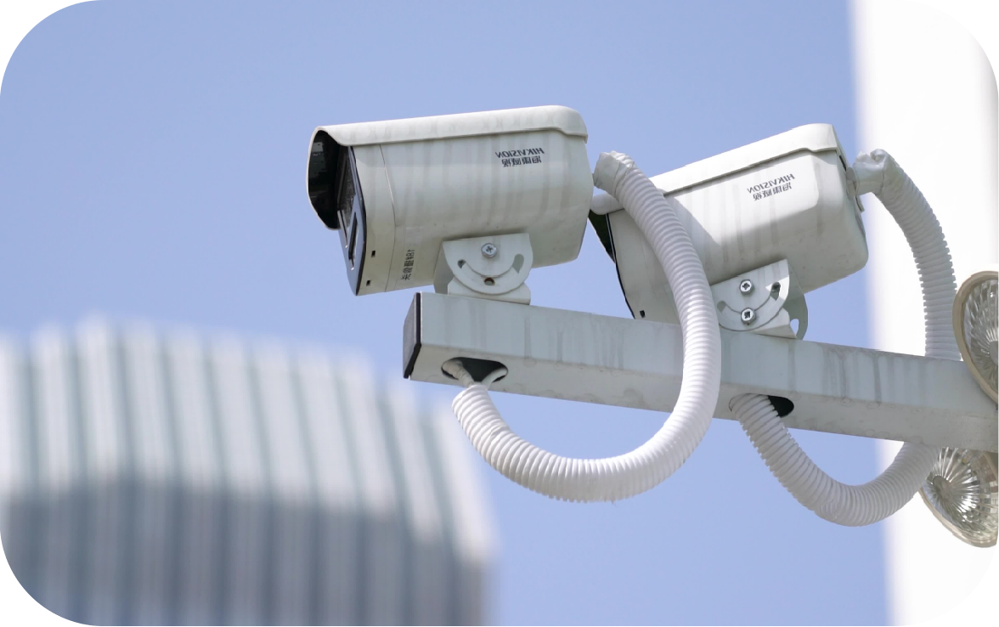
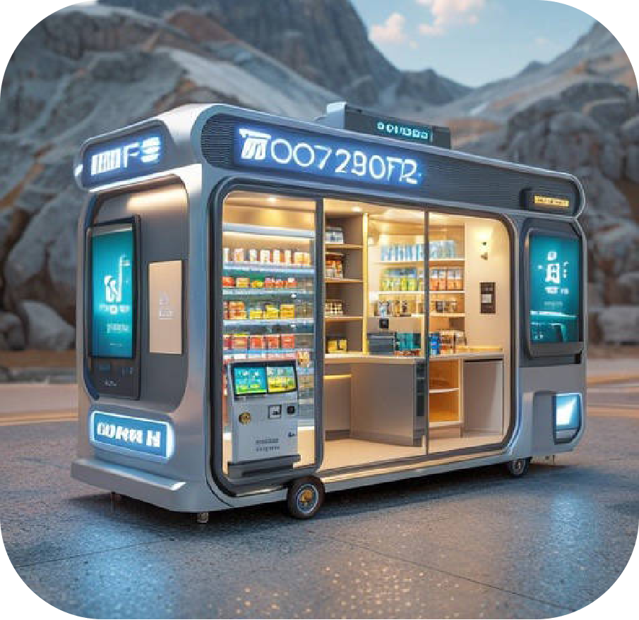
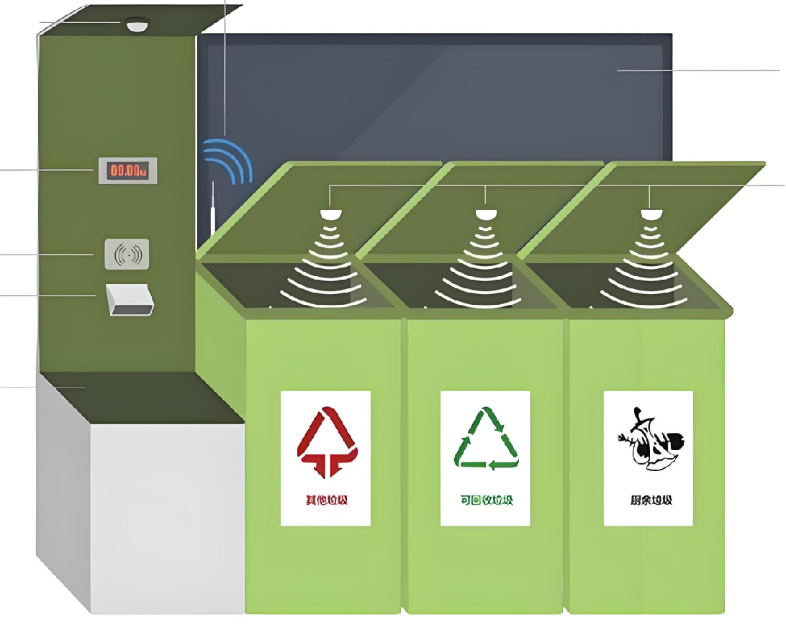

# 3.9 Initial Introduction to Visual Models

## 3.9.1 Lesson Introduction

This lesson shifts from voice to vision, introducing the core capabilities of visual models, seeing and distinguishing. Visual models can not only recognize objects and scenes in images, but also generate image descriptions, functioning like intelligent eyes for humans. Through application scenarios such as smart photo album classification, security monitoring, and industrial quality inspection, this course helps us understand the wide-ranging uses of visual models. Meanwhile, the lesson also introduces the visual module of WonderMind, namely its camera functionality, laying groundwork for subsequent practical lessons on face recognition, color recognition, and more. 

## 3.9.2 Learning Objectives

1. **Knowledge Objectives**: Understand the basic concepts of visual models. Know their capabilities in recognizing and understanding image content. Distinguish differences between vision large models and conventional image processing algorithms.

2. **Skill Objectives**: Identify real-world application scenarios of visual models. Operate the photo capture or image detection functions of WonderMind.

3. **Thinking Objectives**: Establish image recognition thinking based on "feature extraction + matching."

4. **Application Objectives**: Understand the important role of vision AI in security monitoring, medical imaging, and autonomous driving.

## 3.9.3 Understanding Visual Models

### (1) Basic Definition of Visual Models

An AI system that captures images and video, autonomously identifies objects, people, and environments, and comprehends visual content is defined as a Large Vision Model. It functions as the "super eyes" of AI, paired with computing chips to complete image parsing. The system supports real-time camera recognition, static image analysis, and image text description output. It can link with speech modeling to achieve multimodal interaction of "seeing the scene + voice broadcast of recognition results."

Core Characteristics:

- Processes pictures and dynamic video frame information
- Understands objects, distinguishes scenes, and generates image-text descriptions
- Can combine with speech modeling to complete linked interaction of "visual recognition + voice broadcast"

### (2) Life Interaction Scenarios

1. Autonomous driving vehicle vision: Recognizes roads, pedestrians, vehicles, and traffic signs.

2. Satellite remote sensing image analysis: Monitors vegetation, land, and environmental changes.

3. Medical image analysis: Parses CT and X-ray images to assist lesion identification.

4. Security monitoring: Human figure recognition and abnormal behavior capture.

5. Factory assembly line quality inspection: Camera identification of product appearance defects and material differentiation.

6. Unmanned convenience stores: Full-process visual recognition of customers, products, and entry-exit records.

7. Mobile image recognition tools: Automatic species identification from photos of flowers, animals, and objects.

8. AR virtual try-on: Real-time camera overlay of virtual watches and clothing.

9. Smart waste sorting equipment: Camera recognition of waste types with automatic lid opening.

## **3.9.4 Understanding WonderMind Large Model Module Vision Functions**

1. Person Count Recognition: "Hello Hiwonder, take a quick look, how many people are standing in front of you?"

Operation: Multiple people stand before the camera and ask the count. The large model tallies the number and performs voice broadcast.

2. Object Recognition: "Hello Hiwonder, what is that thing in front of you?"

Operation: Place a water cup, fruit, book, or other item before the camera. The device recognizes and voice broadcasts the item name.

3. Interactive Game Recognition: "Hello Hiwonder, do you know rock-paper-scissors?"

Operation: Make a gesture before the camera. The large model recognizes the gesture and interacts.

##  3.9.5 Extended Knowledge

**(1) Core Differences Between Large Language Models and Visual Models**

Large speech models take audio signals as input, with a pipeline of speech-to-text, semantic understanding, and text-to-speech, processing auditory information. Visual models take image or video signals as input, with a pipeline of image acquisition, feature extraction, content parsing, and image-text output, processing visual scenes. Both can fuse into multimodal large models, simultaneously receiving sound and visual information to achieve more intelligent human-robot interaction.

**(2) Differences Between Traditional Image Processing Algorithms and Visual Models**

Traditional algorithms can only complete fixed-rule operations such as cropping, filters, and fixed contour detection. They cannot learn autonomously. Vision large models train on massive image datasets. They can autonomously identify objects never seen before, with stronger generalization capability.

## 3.9.6 Q&A

**Question 1:** **In WonderMind, why must the description text within detection boxes use English?**

Answer: The underlying model training data primarily uses English labels. English usage ensures accurate matching with pretrained categories. Chinese may cause parsing failure.

**Question 2:** **If the captured image is very blurry, can the vision large model still accurately recognize objects?**

Answer: Precise recognition is difficult. Vision large models rely on extracting image color, contour, and texture features to complete matching. Blurry images lose substantial valid features. The model cannot complete accurate comparison and is prone to recognition errors.

## 3.9.7 Technical Support and Product Discussion

If creative ideas emerge after using the product, sharing in the [Hiwonder community](https://forum.hiwonder.com) is welcome:

