# 4. Software and Hardware Guide

## 4.1 AiBlock Controller

### 4.1.1 AiBlock Controller Overview

AiBlock controller is an intelligent powered by ESP32 with MM32 serving as the motor driver, supporting both graphical and Python programming. It features a PC plastic enclosure with 4 onboard PWM servo ports, 4 multi-function motor ports, programmable buttons, buzzer, and reserved sensor ports. The unified 4-pin anti-reverse port ensures expandability and full compatibility with AiBlock series sensors for safe and convenient use.

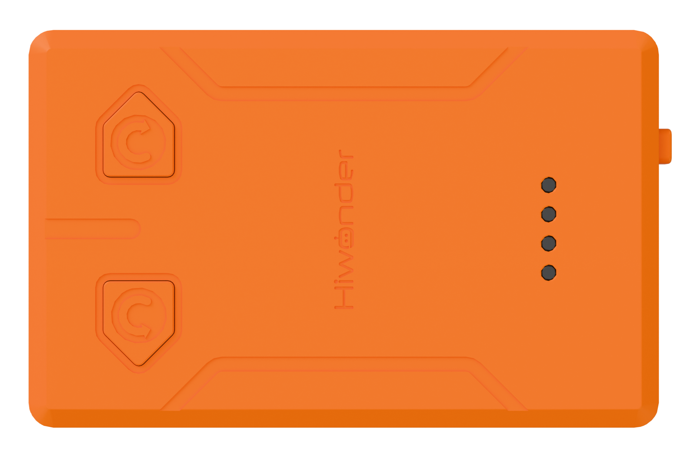

### 4.1.2 AiBlock Controller Function Layout

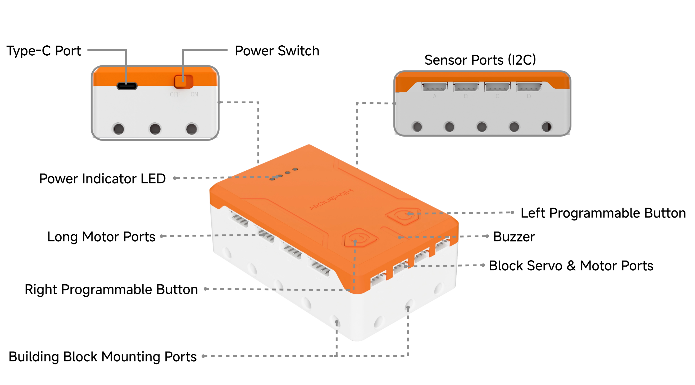

Functions are listed below:

| Port                   | Description                                  |
| :--------------------- | :------------------------------------------- |
| Type-C port            | Program upload and power supply              |
| Power switch           | OFF / ON toggle                              |
| Power indicator        | Displays power status                        |
| A to D, I2C ports      | Sensor ports                                 |
| M1 to M4               | Long motor ports                             |
| S1 to S4               | Block servo ports and block motor ports      |
| 2 programmable buttons | Customizable trigger functions               |
| Buzzer                 | Play tones and prompt sounds                 |
| Building block ports   | Compatible with standard building block pins |

> [!NOTE]
>
> **The three port types are not interchangeable. Ports M1 to M4 connect exclusively to long motors, ports A to D connect to various sensors, and ports S1 to S4 connect to building block servos and standard building block motors. Incorrect connections can damage the controller and accessories.**

### 4.1.3 AiBlock Controller Specifications


|         Product name          |   AiBlock controller    |
| :---------------------------: | :---------------------: |
|    **Product dimensions**     | 88 mm × 56 mm × 31.5 mm |
|     **Charging voltage**      |           5 V           |
|     **Charging current**      |         1500 mA         |
|       **Charging time**       |          3.5 h          |
|     **Battery capacity**      |   3000 mAh / 11.1 Wh    |
| **Maximum operating voltage** |          4.2 V          |
|  **Rated operating voltage**  |          3.7 V          |


### 4.1.4 Power On and Charging Instructions

#### (1) Powering On

Toggle the power switch. The power indicator illuminates, indicating successful startup.


#### (2) Charging

1. Ensure the power switch is set to **OFF**. Connect the Type-C data cable to the controller's charging port and to the charger.


2. The indicator displays charging status. All 4 white lights illuminate when fully charged. Disconnect the power cable promptly after charging to avoid overcharging.


> [!NOTE]
>
> **The power switch must be turned off during charging. Otherwise, the battery may fail to charge fully. Disconnect the charger and power source promptly after charging completes to prevent battery damage caused by overcharging.**

## 4.2 WonderLab Programming Software

### 4.2.1 Programming Platform Overview

WonderLab is Hiwonder's dedicated Scratch-based programming software. It supports automatic conversion between graphical blocks and Python code. Programs are created through drag-and-drop block manipulation, making it ideal for beginners.


### 4.2.2 Downloading the Programming Software

[WonderLab Programming Platform Download for Windows](https://k12.hiwonder.com.cn/download/pcSoftware?get_pc=1&os=windows)

### 4.2.3 Installing WonderLab

1.  Open the **WonderLab setup.exe** installation package.


2.  Select the language, then click **OK**.


3.  Select destination location, then click **Next**.


4.  Click **Next**.


5.  Click **Install**.


6.  After successful installation, click **Finish**.


### 4.2.4 Platform Interface Overview

The figure below shows the "WonderLab" software function areas: ① Menu bar, ② Blocks, ③ Script area, ④ Code display area.

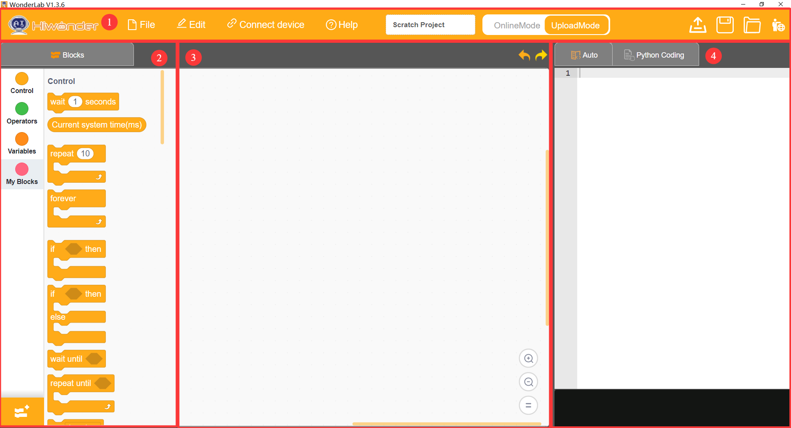

Functions are listed below:

| Icon                                                         | Function                                                     |
| :----------------------------------------------------------- | :----------------------------------------------------------- |
|  | Create, save, and open program files                         |
|  | Online mode only, for reference                              |
|  | Connect device to software and select port                   |
|  | Access help materials, check updates, install drivers        |
|  | Displays program file name. Displays "Scratch Project" when unprogrammed or unsaved. |
|  | Mode switch between Online Mode and Upload Mode              |
|  | Interface language selection: English, Simplified Chinese, Traditional Chinese |
|  | Undo and redo operations during programming                  |
|  | Toggles the editing mode. Selecting "Auto" converts block programs into "Python format". Switching to Python Coding allows direct Python editing. |
|  | Save program as Python code                                  |
|  | Open saved Python file                                       |
|  | Device interaction for program upload to controller          |
|  | Add device extension packages                                |
|  | Zoom in, zoom out, and reset code editor to default size, from top to bottom |


### 4.2.5 Basic Blocks Introduction

| Block                                                        | Category                                                     | Function Description                                         |
| :----------------------------------------------------------- | :----------------------------------------------------------- | :----------------------------------------------------------- |
|  |  | Pauses program for 1 second before continuing execution. Commonly used for action intervals and delay buffering. |
|  |  | Reads total milliseconds since device power-on. Used for timing and time difference calculation. |
| 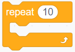 |  | Runs nested code for specified iterations, then exits loop.  |
|  |  | Infinitely loops nested instructions. Program continuously repeats loop logic. |
|  |  | Basic conditional judgment. Executes internal code when condition is true, otherwise skips. |
|  |  | Dual-branch conditional judgment. Executes "then" branch when true, "else" branch when false. |
|  |  | Custom delay input. Controls program pause duration.         |
|  |  | Loops internal code until specified condition is met, then exits. |
|  |  | Terminates current loop structure early. Jumps to subsequent program. |
|  |  | Used inside custom functions. Returns specified data to function call position. |
| 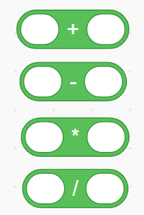 |  | Basic arithmetic operations. Inputs two numbers, outputs result. |
|  |  | Modulo operation. Calculates remainder after division.       |
|  |  | Generates random integer within specified range.             |
| 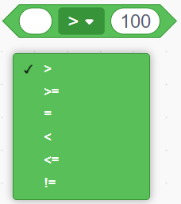 |  | Numeric comparison. Compares two numbers, returns boolean value. |
|  |  | Logical AND. Result is true only when all conditions are met. |
|  |  | Logical OR. Result is true when any condition is met.        |
|  |  | Boolean NOT. Reverses original true/false result.            |
|  |  | Boolean constants. Provides true and false values for conditional judgment. |
|  |  | Custom text input. Generates string data for concatenation, display, or judgment. |
|  |  | String concatenation. Merges two text segments into one.     |
|  |  | Extracts single character at specified index from string.    |
|  |  | Gets total character count in string.                        |
|  |  | Checks if string contains specified character/text. Returns boolean. |
|  |  | Converts text-formatted number to integer type.              |
|  |  | Converts numeric value to text string format.                |
|  |  | Decodes UTF-8 byte data to normal text characters.           |
|  |  | Encodes normal text to UTF-8 byte data.                      |
|  |  | Converts character to corresponding Unicode code point.      |
|  |  | Extracts substring from specified start position and length. |
|  |  | Finds first index position of target text in string.         |
|  |  | Splits string into multiple segments using specified delimiter, generating list. |
|  |  | Rounds decimal to nearest integer.                           |
| 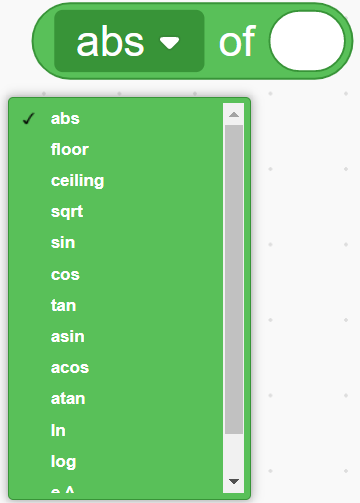 |  | Common mathematical functions. Completes rounding, trigonometry, square root, logarithm, etc. |
|  |  | Reads data at corresponding position from list or tuple by index. |
|  |  | Checks if list or tuple contains specified content. Returns boolean. |
|  |  | Creates single key-value pair for dictionary data construction. |
|  |  | Reads stored data from dictionary by key name.               |
|  |  | Reads dictionary key data, returns preset default if key does not exist. |
|  |  | Boolean constants. Provides logical true and false values.   |
|  |  | Null constant. Represents absence of valid data.             |
|  |  | Maps input value from original range to target range linearly. |
|  |  | Creates custom-named variable for storing single data item such as number or text. |
|  |  | Assigns value to specified variable, overwriting existing data. |
|  |  | Performs increment operation on numeric variable, adding specified number to current value. |
|  |  | Displays variable current data in visual interface.          |
|  |  | Hides variable display in visual interface.                  |
|  |  | Reads data stored in variable. Can participate in operations, conditions, and output. |
|  |  | Creates custom-named empty list for batch storage of multiple data items. |
|  |  | Generates empty list container. Can store numbers, text, and other data types for subsequent operations. |
|  |  | Appends new element at list end, expanding list content.     |
|  |  | Removes element at corresponding position from list by index. |
|  |  | Clears all stored elements in target list, resetting to empty. |
|  |  | Inserts custom content before element at specified list index. |
|  |  | Modifies element at specified list position, overwriting original content. |
|  |  | Reads element stored at corresponding list position by index. |
|  |  | Finds first index of target content in list.                 |
|  |  | Gets total count of currently stored elements in list.       |
|  |  | Checks if list contains specified element. Returns boolean.  |
|  |  | Displays all list content in visual interface.               |
|  |  | Hides list display in visual interface.                      |
|  |  | Creates custom function block. Defines function name, parameters, and internal execution logic. |
|  |  | Creates parameterless custom function. Encapsulates reusable program logic. |
|  |  | Calls defined parameterless function. Executes all encapsulated program logic. |
|  |  | Creates parameterized custom function. Sets function name. Parameters support number or text types for internal program use. |
|  |  | Parameter container inside custom function. Receives externally passed number or text data. |
|  |  | Provides number or text type argument for parameterized custom function during call. |


### 4.2.6 AiBlock Controller Extension Library

| Block                                                        | Category                                                     | Function Description                                         |
| :----------------------------------------------------------- | :----------------------------------------------------------- | :----------------------------------------------------------- |
|  |  | Program main loop container. Continuously executes internal code after power-on initialization completes. |
|  |  | Executes once after device power-on. Used for hardware initialization and parameter configuration. |
|  |  | Drives buzzer to play notes at specified pitch and beat. Runs in background mode without blocking subsequent program execution. |
|  |  | Drives buzzer with numeric pitch and custom duration. Background playback does not block program. |
|  |  | Adjusts buzzer output volume. Value range 0 to 100. Higher values produce greater volume. |
| 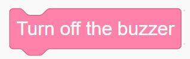 |  | Immediately stops buzzer sound. Terminates current playing tone. |
|  |  | Reads controller battery current voltage in millivolts. Used for power monitoring. |
|  |  | Prints custom text string to computer via serial port. Used for debugging and information display. |
| 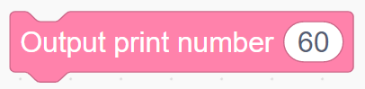 |  | Prints specified numeric value to computer via serial port. Used for data debugging. |
|  |  | Event-triggered block. Executes internally nested code when corresponding button short-press is detected. |
|  |  | Real-time detection of specified button current level state. Returns boolean indicating pressed state. |
| 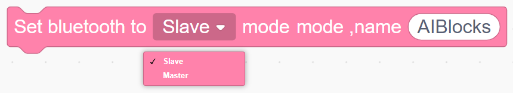 |  | Configures Bluetooth working mode as host or slave. Customizes Bluetooth device name. Initializes Bluetooth function. |
|  |  | Detects Bluetooth link connection status. Returns boolean indicating successful connection. |
|  |  | Reads local Bluetooth hardware MAC address string.           |
|  |  | Checks if received Bluetooth buffer data contains specified identifier character. |
|  |  | Reads complete raw data content received by Bluetooth module. |
|  |  | Parses Bluetooth data packet by communication protocol. Extracts command field. |
|  |  | Parses Bluetooth data packet by communication protocol. Extracts specified index parameter content. |
| 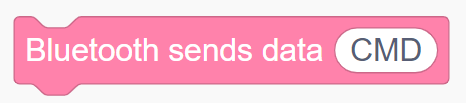 |  | Sends custom text or command data externally via Bluetooth.  |


<a id ="sectiom-4-3"></a>

## 4.3 Electronic Modules Guide

### 4.3.1 360° Block Motor

#### (1) Overview

This is a PWM motor. Control is achieved by setting the motor port number, rotation speed, and direction for forward or reverse rotation at a specified speed. 

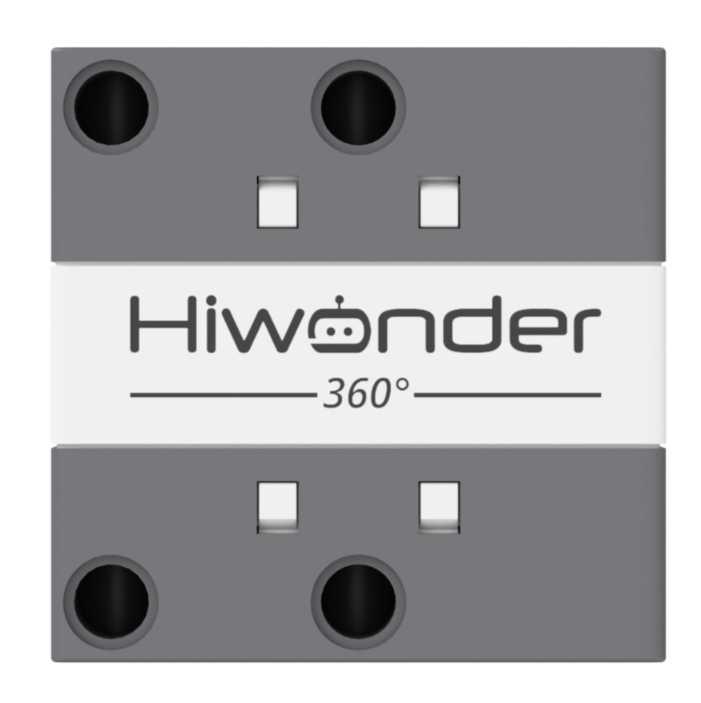

#### (2) Technical Specifications

| Operating voltage  | 5 V                   |
| :----------------- | :-------------------- |
| Stall torque       | 1.5 kg·cm             |
| Angle range        | 0°-360°               |
| Product dimensions | 54.0 × 54.0 × 40.0 mm |


#### (3) Hardware Wiring

Connect the 360° block motor to any port from **S1 to S4** of the controller using a 3-pin servo cable, as shown below:

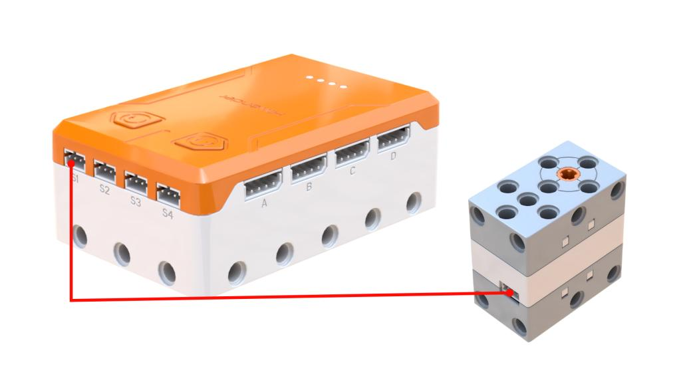

#### (4) Example Project

Example 1: Motor Forward and Reverse Delayed Start and Stop

Adding Extensions: Select **360° Motor** under the **Motion module** category.


Program Logic: Control the motor to rotate forward at 30% speed for 3 seconds, then reverse at 60% speed for 3 seconds.

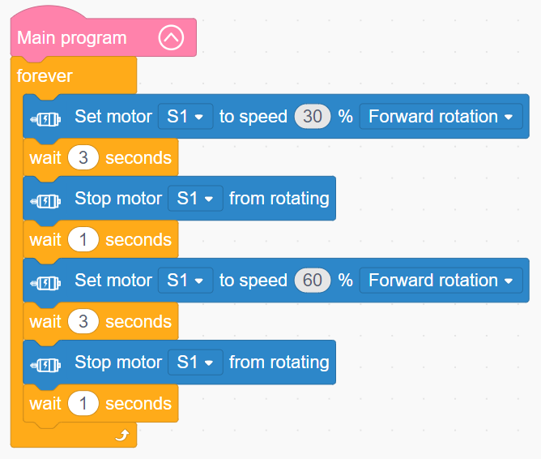

Program Upload: Click **Connect device**, select the serial port, then click the upload button to complete the program transfer and test the execution results.


> [!NOTE]
>
> **The source files are available for download under [Program Files](https://drive.google.com/drive/folders/1IwdDhoH3O3trxqMtk-FYqoNnL3NvJzF2?usp=sharing).**

### 4.3.2 180° Block Servo

#### (1) Overview

This is a PWM servo. Control is achieved by setting the servo port number, rotation speed, and target angle. The angle range is 0° to 180°.

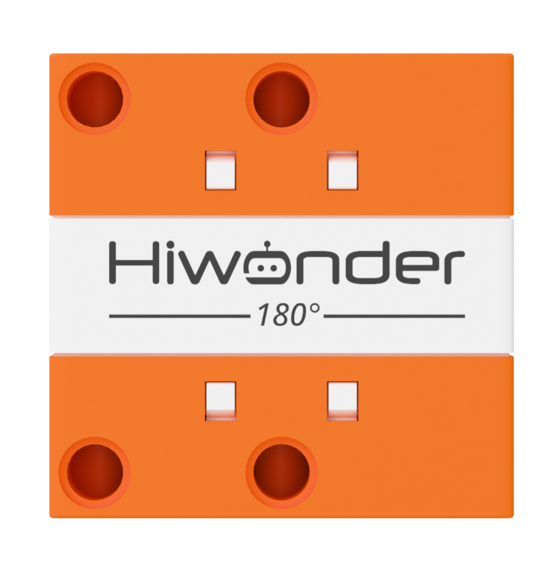

#### (2) Technical Specifications

| Operating voltage  | 5 V                   |
| :----------------- | :-------------------- |
| Stall torque       | 1.5 kg·cm             |
| Angle range        | 0°-180°               |
| Product dimensions | 54.0 × 54.0 × 40.0 mm |


#### (3) Hardware Wiring

Connect the 180° block servo to any port from **S1** to **S4** of the controller using a 3-pin servo cable, as shown below:

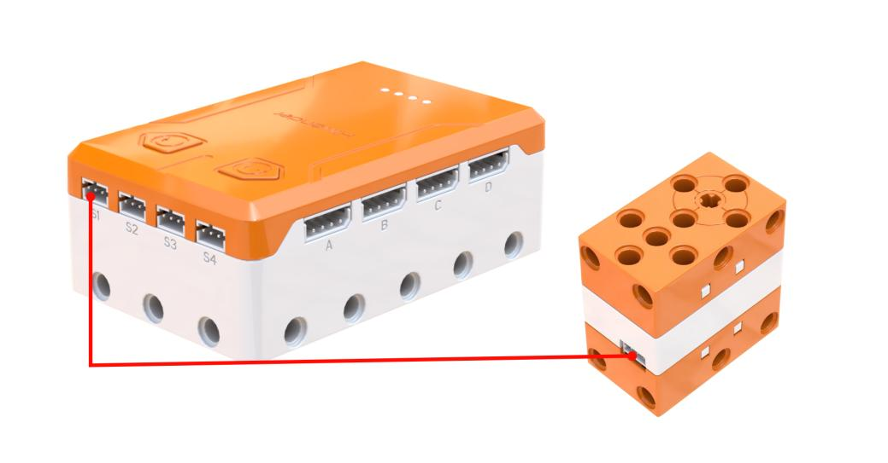

#### (4) Example Project

Example 1: Servo Dual-Speed Reciprocating Swing

Adding Extensions: Select **180° servo** under the **Motion module** category.

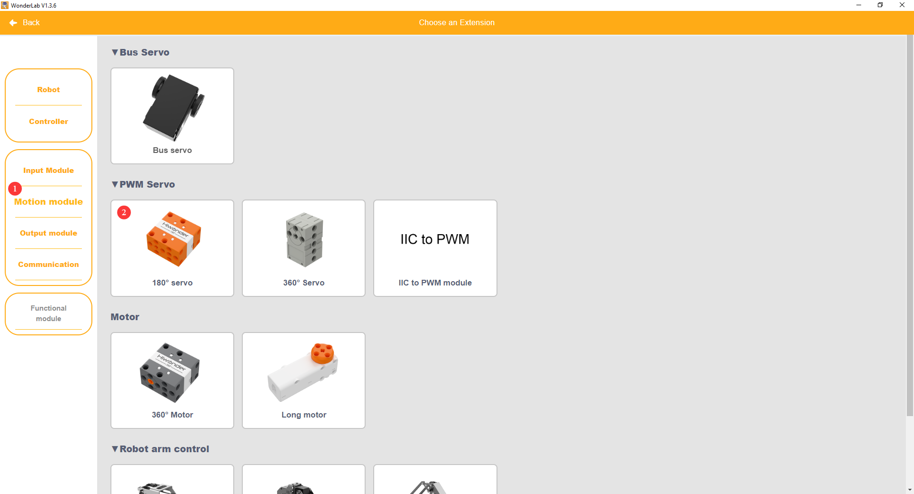

Program Logic: Control servo to rotate to 180° then 0° at 30% speed, then to 180° then 0° at 60% speed.

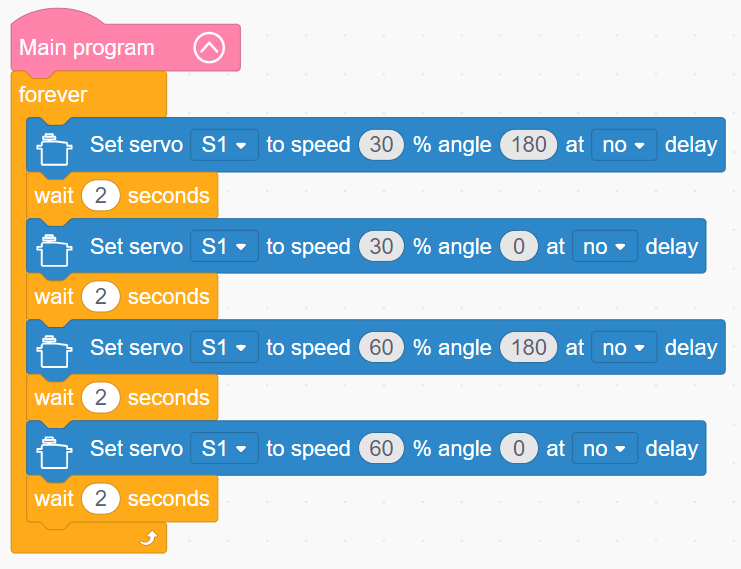

Program Upload: Click **Connect device**, select the serial port, then click the upload button to complete the program transfer and test the execution results.


> [!NOTE]
>
> **The source files are available for download under [Program Files](https://drive.google.com/drive/folders/1IwdDhoH3O3trxqMtk-FYqoNnL3NvJzF2?usp=sharing).**

### 4.3.3 Ultrasonic Sensor

#### (1) Overview

This is a glow-capable ultrasonic ranging module. It adopts an industrial-grade ultrasonic ranging chip with integrated ultrasonic transmitting circuit, receiving circuit, and digital processing circuit. The module uses I2C communication port for reading measured distance.

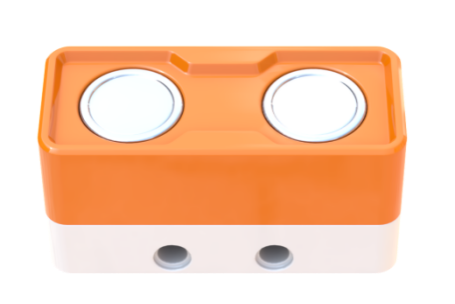

#### (2) Technical Specifications

| Port model           | 5264-4AW              |
| :------------------- | :-------------------- |
| Communication method | I2C                   |
| Operating voltage    | 5 V                   |
| Product dimensions   | 55.4 × 23.4 × 27.2 mm |


#### (3) Hardware Wiring

Connect the ultrasonic sensor to any port from **A to D** of the controller using a 4-pin module cable, as shown below:

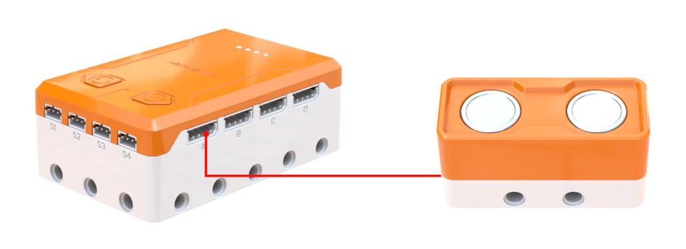

#### (4) Example Projects

Adding Extensions: Select **Ultrasonic sensor** under the **Input Module**.


Example 1: Serial Real-Time Ranging Display

Program Logic: Display obstacle distance detected by ultrasonic sensor through AiBlock serial port.

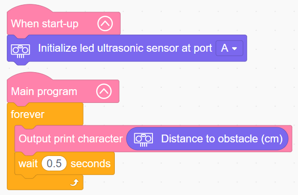

Example 2: Close-Range Obstacle Buzzer Alarm

Program Logic: Ultrasonic ranging buzzer alarm. When obstacle distance exceeds 20 cm, buzzer is silent. When obstacle distance is below 20 cm, buzzer alarms.

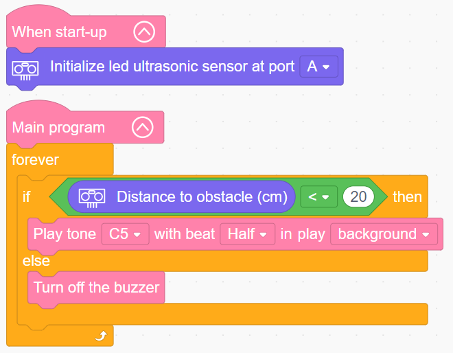

Example 3: Ultrasonic Color Light Effects

Program Logic: Control ultrasonic color light switching and breathing light mode.

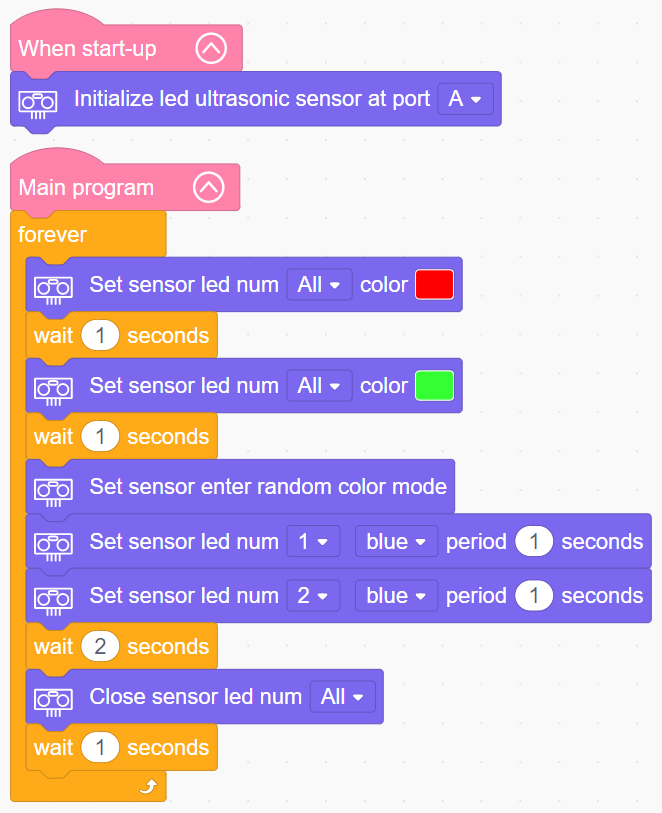

Program Upload: Click **Connect device**, select the serial port, then click the upload button to complete the program transfer and test the execution results.


> [!NOTE]
>
> **The source files are available for download under [Program Files](https://drive.google.com/drive/folders/1IwdDhoH3O3trxqMtk-FYqoNnL3NvJzF2?usp=sharing).**

### 4.3.4 Temperature and Humidity Sensor

#### (1) Overview

This is a high-precision, high-reliability temperature-humidity sensor. It detects ambient temperature and humidity with accurate feedback. This sensor enables the creation of simple dehumidifiers or automated fan control systems when combined with a fan module.

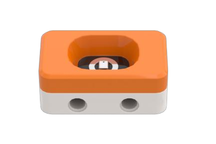

#### (2) Technical Specifications

| Port model           | 5264-4AW              |
| :------------------- | :-------------------- |
| Communication method | I2C                   |
| Operating voltage    | 5 V                   |
| Product dimensions   | 39.5 × 23.4 × 15.4 mm |


#### (3) Hardware Wiring

Connect the temperature-humidity sensor to any port from **A to D** of the controller using a 4-pin module cable, as shown below:

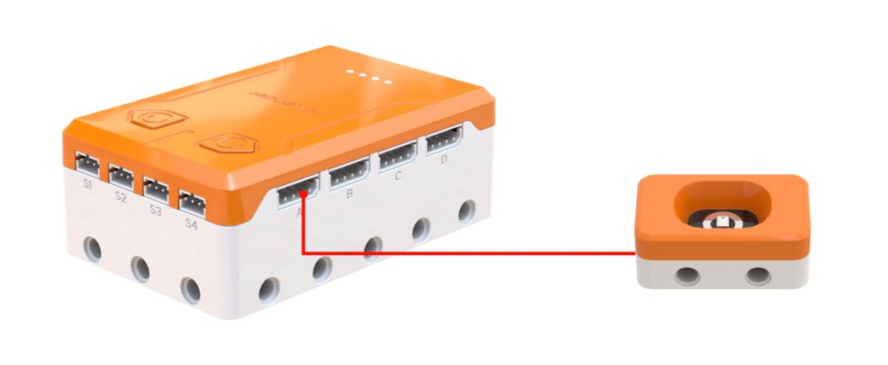

#### (4) Example Project

Example 1: Environmental Temperature-Humidity Real-Time Serial Display

Adding Extensions: Select **Temperature humidity sensor** under the **Input Module**.

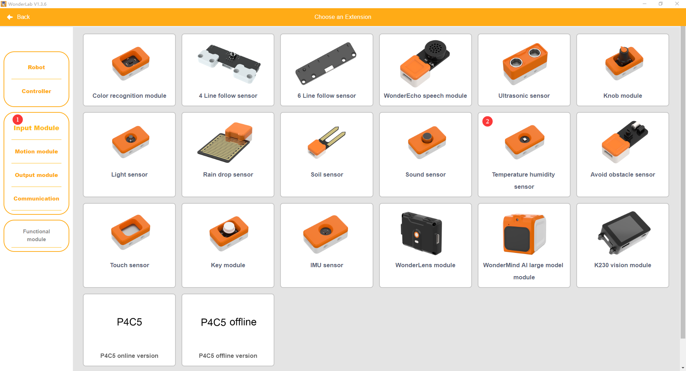

Program Logic: Display temperature and humidity values through AiBlock serial port.

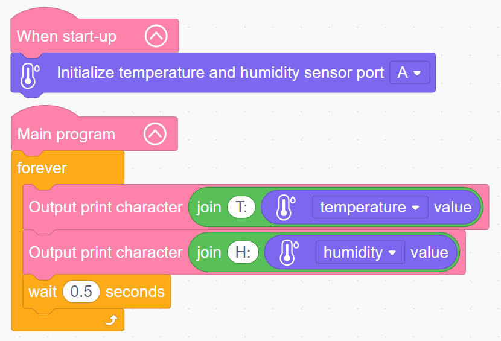

Program Upload: Click **Connect device**, select the serial port, then click the upload button to complete the program transfer and test the execution results.


> [!NOTE]
>
> **The source files are available for download under [Program Files](https://drive.google.com/drive/folders/1IwdDhoH3O3trxqMtk-FYqoNnL3NvJzF2?usp=sharing).**

### 4.3.5 Light Sensor

#### (1) Overview

This is an ambient light intensity sensor. It is commonly used for interactive projects with effects that vary with light intensity, such as automatic street lighting control systems and environmental monitoring systems.


#### (2) Technical Specifications

| Port model           | 5264-4AW              |
| :------------------- | :-------------------- |
| Communication method | I2C                   |
| Operating voltage    | 5 V                   |
| Product dimensions   | 39.5 × 23.4 × 17.2 mm |


#### **(3) Hardware Wiring**

Connect the light sensor to any port from **A to D** of the controller using a 4-pin module cable, as shown below:

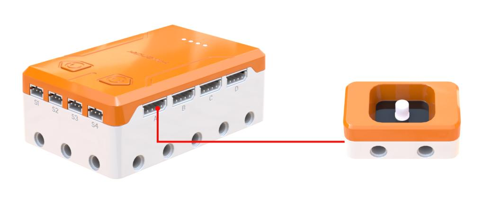

#### (4) Example Project

Example 1: Serial Light Intensity Acquisition and Display

Adding Extensions: Select **Light sensor** under the **Input Module**.

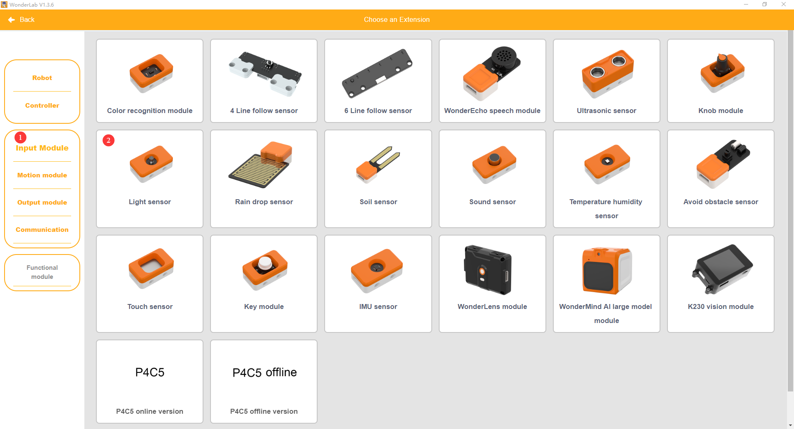

Program Logic: Display light intensity value detected by light sensor through AiBlock serial port.

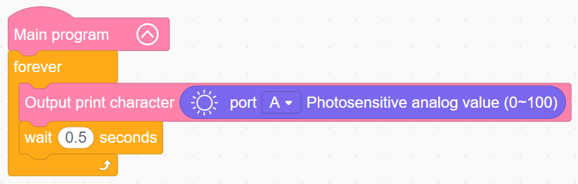

Program Upload: Click **Connect device**, select the serial port, then click the upload button to complete the program transfer and test the execution results. 


> [!NOTE]
>
>  **The source files are available for download under [Program Files](https://drive.google.com/drive/folders/1IwdDhoH3O3trxqMtk-FYqoNnL3NvJzF2?usp=sharing).**

### 4.3.6 Dot Matrix **Module**

#### (1) Overview

This is an LED dot matrix display module. It features high brightness, flicker-free display, and convenient wiring. It can display numbers, text, and patterns.

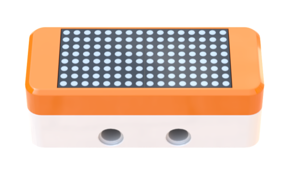

#### (2) Technical Specifications

| Port model           | 5264-4AW              |
| :------------------- | :-------------------- |
| Communication method | I2C                   |
| Operating voltage    | 5 V                   |
| Product dimensions   | 55.4 × 23.4 × 19.0 mm |


#### (3) Hardware Wiring

Connect the dot matrix module to any port from **A** **to** **D** of the controller using a 4-pin module cable, as shown in the figure below:

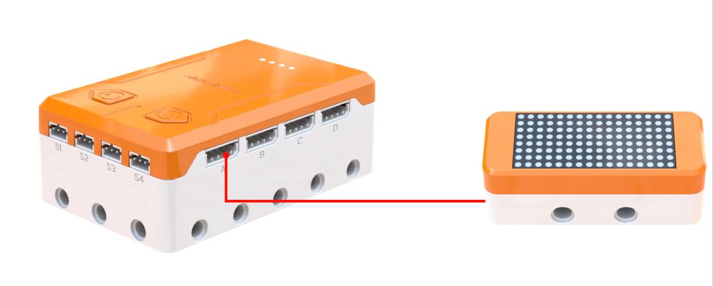

#### (4) Example Project

Example 1: Dot Matrix Graphic and Text Alternating Display

Adding Extensions: Select **Dot matrix module** under the **Output module**.

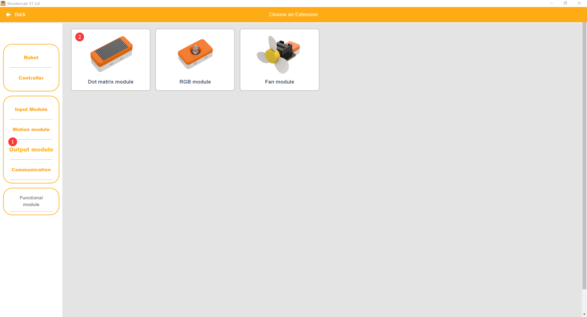

Program Logic: Control dot matrix to switch display between "Hi", "123", and "❤".

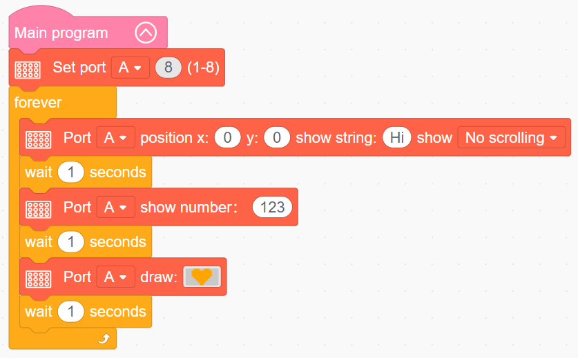

Program Upload: Click **Connect device**, select the serial port, then click the upload button to complete the program transfer and test the execution results.


> [!NOTE]
>
> **The source files are available for download under [Program Files](https://drive.google.com/drive/folders/1IwdDhoH3O3trxqMtk-FYqoNnL3NvJzF2?usp=sharing).**

### 4.3.7 RGB Light Module

#### (1) Overview

This is a common RGB light module. Through control programs, the RGB light can achieve illumination, flashing, rainbow, and other effects.

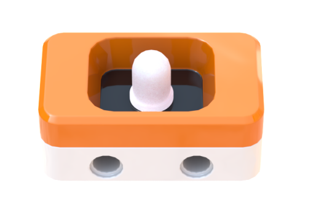

#### (2) Technical Specifications

| Port model           | 5264-4AW              |
| :------------------- | :-------------------- |
| Communication method | I2C                   |
| Operating voltage    | 5 V                   |
| Product dimensions   | 39.5 × 23.4 × 23.0 mm |


#### (3) Hardware Wiring

Connect the RGB light module to any port from **A to D** of the controller using a 4-pin module cable, as shown below:

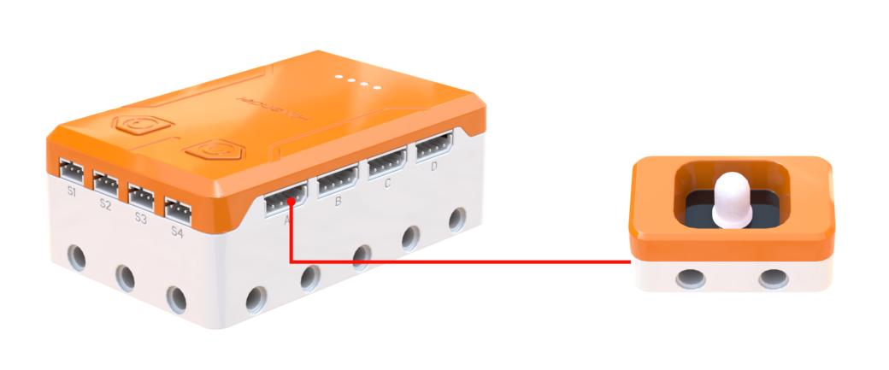

#### (4) Example Project

Example 1: RGB Color Light Timed Color Change

Adding Extensions: Select **RGB module** under the **Output module**.

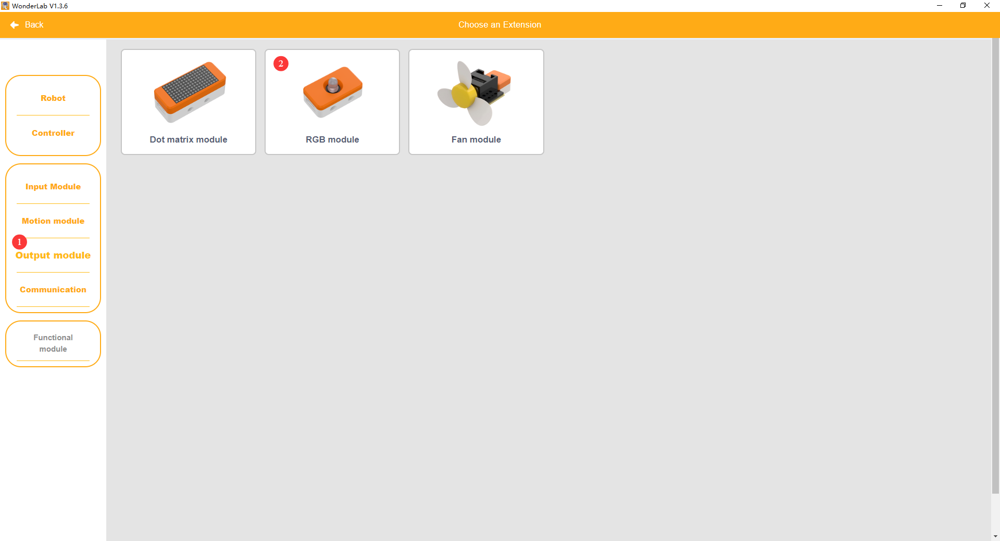

Program Logic: Control RGB light to illuminate and switch color every 1 s.

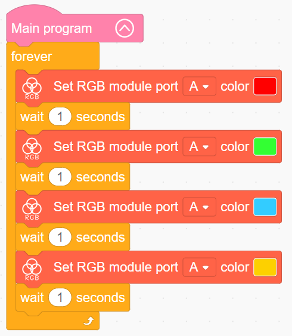

Program Upload: Click **Connect device**, select the serial port, then click the upload button to complete the program transfer and test the execution results.


> [!NOTE]
>
> **The source files are available for download under [Program Files](https://drive.google.com/drive/folders/1IwdDhoH3O3trxqMtk-FYqoNnL3NvJzF2?usp=sharing).**

<a id="section-4-4"></a>

## 4.4 WonderMind Module

### 4.4.1 Module Overview

#### (1) Module Introduction

This is an AI large model module. It features an ESP32-S3 high-performance chip, integrated 2-megapixel HD camera, microphone, HD display, speaker, and CI1302 voice recognition chip. It deeply fuses text, voice, vision, and other models.

The module is easy to operate and is commonly paired with robots, giving the robot a "super brain" that deeply understands voice commands. It endows robots with exceptional perception, reasoning, and action capabilities, creating flexible and natural human-robot interaction experiences.


#### (2) Technical Specifications

| Port model           | 5264-4AW              |
| :------------------- | :-------------------- |
| Communication method | I2C                   |
| Operating voltage    | 5 V                   |
| Product dimensions   | 41.7 × 48.7 × 46.4 mm |


#### (3) Hardware Interface Description


| Part | Function |
|:--:|:--:|
| Screen | Displays large model dialogue and camera feedback images |
| Microphone | Large model voice acquisition |
| Camera | Large model image acquisition |
| Button A | Activates large model dialogue function |
| Button B | Switches between dialogue, expression, and feedback modes |
| Speaker | Plays large model voice dialogue |
| I2C communication port | Communication port with controller |
| Switch | Device power switch |
| Charging port | Device charging |
| Building block port | Mounting building block pin parts |

### 4.4.2 Device Power On

1. Toggle the rear power switch. The screen illuminates, indicating successful startup.


2.  Upon power-up, check the **device hotspot name** and **browser configuration URL** displayed on the screen accompanied by voice prompts. Follow [4.4.3.1 Module Network Setup](#section-4-4-3-1) to complete network connection first.


3.  After completing network configuration, bind the module to the platform agent. Check the **device ID** and **platform binding URL** displayed on the screen accompanied by the voice-broadcasted verification code. Follow [4.4.3.2 Device Binding](#section-4-4-3-2) to complete binding.

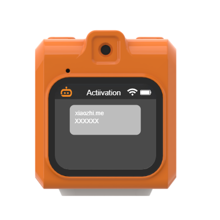

4. After binding, the module enters MCP setup waiting interface. The current mode waits for an external controller to configure MCP for the large model. When operating without an external controller, **short-press** **Button A** to enter expression mode directly.


5. Upon entering the large model expression mode, the module displays expressions. Network configuration and binding are now complete!


### 4.4.3 Module Configuration

<a id="section-4-4-3-1"></a>

#### (1) Module Network Setup

- **Operation Description**

The module enters network configuration mode under three conditions: ① The module is used for the first time or reflashed with new firmware, leaving no saved Wi-Fi connection credentials. ② The current environment contains no hotspot matching saved Wi-Fi credentials. ③ Configuration mode is triggered manually by long-pressing Button A.

- **Operation Steps**

1. Upon power-up, network setup begins automatically. The **device hotspot** **name** and **browser configuration URL** are displayed, with accompanying voice prompts. The WonderMind Module activates its built-in hotspot for connection and configuration. Hotspot names vary by device, following the unified format **WonderMind-xxxx**. WonderMind-7885 serves as the example.


2. Locate and connect to the corresponding hotspot via computer or mobile device. No password is required.


3. Click [Network Configuration](http://192.168.4.1/) to access the device network configuration URL directly. Alternatively, copy the URL and open it in a browser.

```py
http://192.168.4.1
```


4. Enter the hotspot name for automatic connection on power-up in field ① SSID. Enter the hotspot password in field ② Password. Finally, click **Connect** ③. The module attempts to locate and connect to the matching hotspot using the configured credentials.


5. Available hotspots detected by the module are listed in the interface. Click an entry to auto-populate the corresponding hotspot name in field ①.


6. If the following prompt appears on the interface, the hotspot is not detected or the password is incorrect. Re-enter the credentials.


7. If the following prompt appears on the interface, the module has located and connected to the hotspot. The module restarts and reconnects.


> [!NOTE]
>
> * **Do not enter hotspots that are undetected, weak, or lack internet access.**
>
> * **If a previous hotspot was saved, new credentials are stored alongside existing entries. On the next power-up, the module sequentially attempts each saved entry until a match is found.**
>
> * **If the message Error: New version check failed. Retrying in xx seconds appears after network configuration, the hotspot has no internet access or unstable connectivity. Switch to another hotspot.**

**Manual Network Configuration Entry**

1. WonderMind Module supports manual entry into network configuration mode to select a hotspot connection.

2. When the module is powered on, long-press Button A to send manual configuration instruction. The module enters configuration mode directly upon receipt. Release the button.


3. Existing hotspot configuration is not lost after entering configuration mode.

**Managing Saved Connection Configurations**

1. When the module is in network configuration mode, connect to the module hotspot to enter the network configuration interface. A list of all saved hotspot connection configurations is displayed, provided that hotspot connection details have been configured previously, as shown in the figure below:

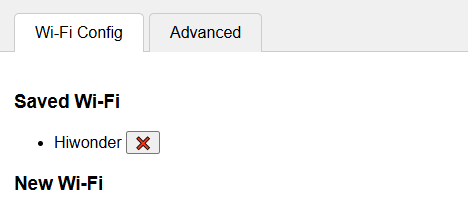

2. Click the corresponding icon of any saved hotspot connection to delete it. Alternatively, click the icon to raise its matching priority during network configuration. The priority decreases from top to bottom in the list.

<a id="section-4-4-3-2"></a>

#### (2) Device Binding

- **Operation Description**

After powering on and completing network configuration, the screen displays a **6-digit device** **ID** and **the platform binding URL** if the module is used for the first time. A voice prompt plays at the same time. Bind the module to the platform agent by following the tutorial below.

- **Operation Steps**

1. Click [XiaoZhi AI Chatbot](https://xiaozhi.me/) to access the device binding URL directly. Alternatively, copy the URL and open it in a browser.

```py
https://xiaozhi.me
```


2. Click **Console** to access the XiaoZhi AI Agent Management Platform.


3. Log in with an existing XiaoZhi AI account and password. For first-time access, register an account first.


4. Enter the required information, then click **Send Code** to obtain the verification code.


5. Select the agreement and privacy policy checkbox, then click **Login**.


6. Complete the required profile information, then click **Confirm** to finalize registration and login.


7. After completing login, the following interface is displayed.


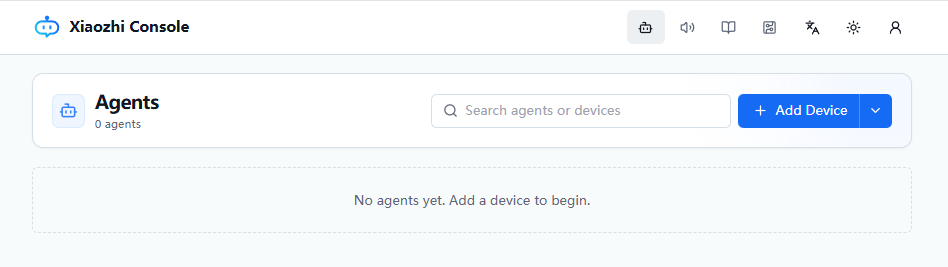

8. Click the dropdown arrow next to the Add Device button, then click **Create Agent**.


9. Enter the agent name, then click **Confirm** to complete agent creation.


10. Click **Configure** to access agent function settings.


11. Click **Role** to configure the agent role. Select the desired conversation language in ①, the desired voice in ②, and configure voice settings in ③.


12. Click **Model & Memory**. Select **Xiaozhi Lite** for the language model. Disable the memory function. Keep other settings as default.

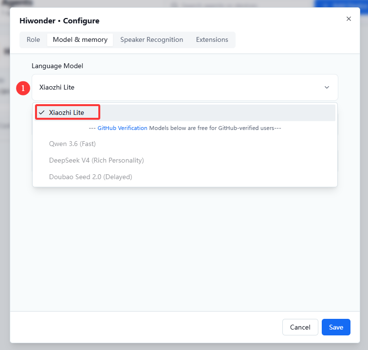


* **If the account has not completed developer authentication on XiaoZhi AI Platform, only XiaoZhi Lite with reduced performance is available by default. For stronger models such as Qwen 3.6 or DeepSeek V4, complete [4.4.3.3 Platform Developer Authentication](#section-4-4-3-3) first, then reselect here.**


13. Click **Extensions**. Official service functions can be freely enabled or disabled. New agents have all functions enabled by default. Click **Save** after selection.

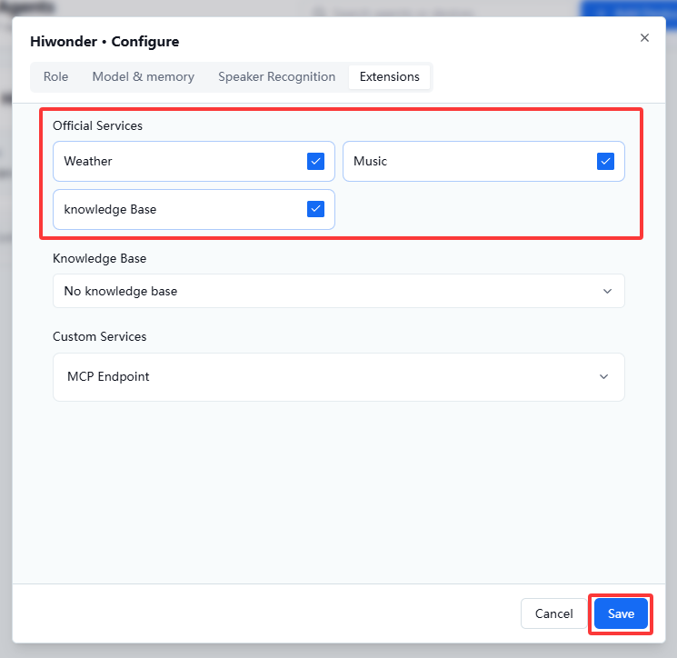

14. Click **Devices** to access device management.


15. Click **Link new device**. Enter **the 6-digit device ID** in the pop-up window, then click **Link**.


16. If binding is successful, **Device added successfully** is displayed. Select **Open Source**, then click **Start Using**.


<a id ="section-4-4-3-3"></a>

#### (3) Platform Developer Authentication

> [!NOTE]
>
> * **Authenticated and unauthenticated GitHub accounts have different permission levels, as shown below:**
>
> 
>
> * **If the permission differences are already understood, skip GitHub authentication and proceed to [4.4.3.4 Device Unbinding](#section-4-4-3-4). To proceed with GitHub authentication, follow the steps below.**

- **GitHub Platform Login**

1. On the XiaoZhi AI Platform, click **GitHub Authentication** below the icon. After the authentication interface loads, click **Link GitHub**.


2.  Wait for the interface to redirect to the GitHub account login page.


3. Log in with an existing GitHub account and password, then proceed to [4.4.3.3.3 Binding XiaoZhi AI Platform and GitHub](#section-4-4-3-3-3). If no account exists, click **Create an account**.


4. Enter email address, password, username, and location in the pop-up interface. Click **Create account** to submit registration information.


5. Click **Visual puzzle** in the page to start image verification.


6. After image verification is completed, GitHub platform sends a verification email to the previously entered registration email address. Open the email, copy the verification code, and enter it on the webpage.


7. Wait for the webpage to redirect to the login page after registration completes. A registration success prompt is displayed.


<a id ="section-4-4-3-3-3"></a>

- **Binding XiaoZhi AI Platform and GitHub Platform**

1. Click **Authorize tenclass** to complete binding the XiaoZhi AI Platform and GitHub.


2. After binding is completed, XiaoZhi AI Platform authentication is fully completed. The page automatically returns to the previous authentication screen, and the following notification is displayed.


3. Click **Agents** to return to the XiaoZhi AI agent console. Create a new agent. The previously restricted settings are now unlocked.

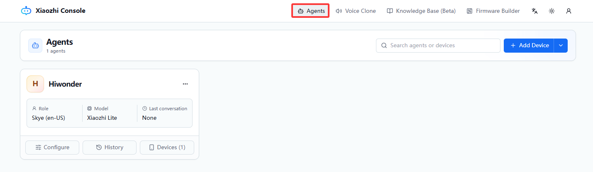

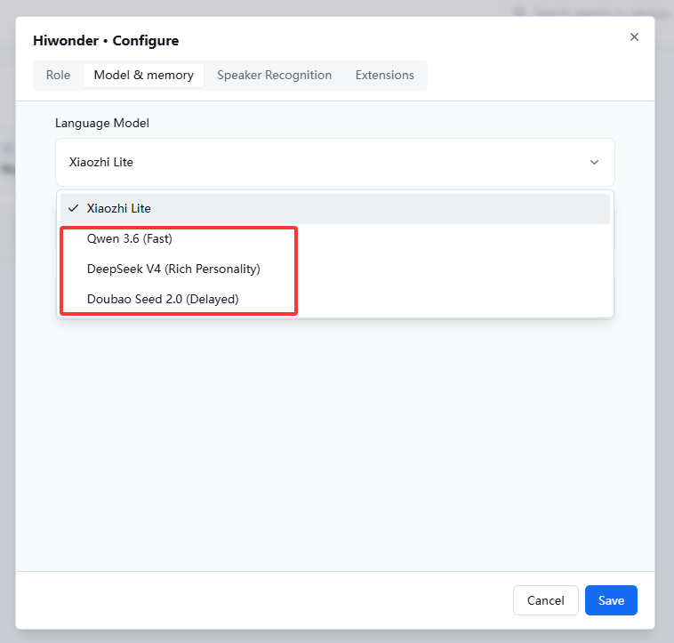

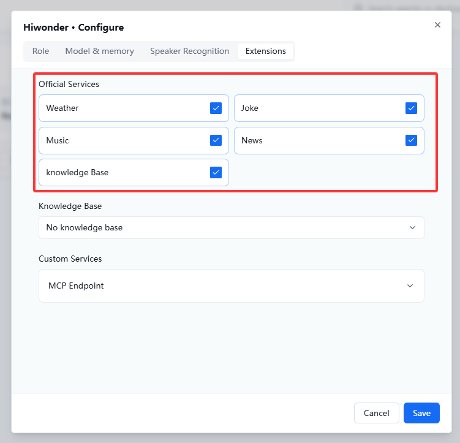

<a id ="section-4-4-3-4"></a>

#### (4) Device Unbinding

- **Operation Description**

&emsp;To unbind a device, follow the operations below.

- **Operation Steps**

1. Click [XiaoZhi AI Chatbot](https://xiaozhi.me/) to access the device binding URL directly. Alternatively, copy the URL and open it in a browser.


```py
https://xiaozhi.me
```


2. Click **Console** to access the XiaoZhi AI Agent Management Platform.


3. Click **Devices** to access device management.


4. Find the device to unbind, click the corresponding  icon, then click **Unbind** in the pop-up.

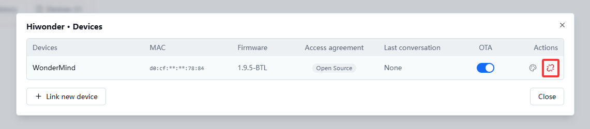

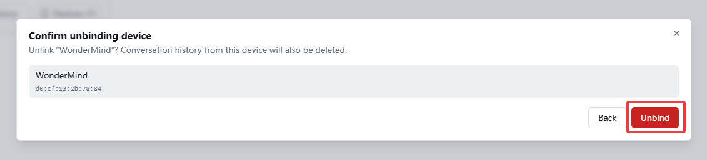

5. If unbinding is successful, **Device unbound successfully** is displayed.

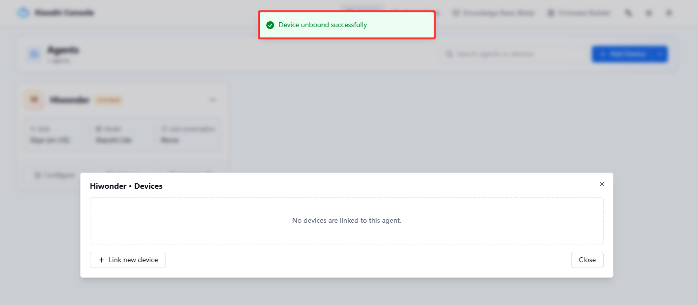

<a id ="section-4-4-3-5"></a>

### 4.4.4 Volume Control

1. During interaction with the WonderMind Module, issue volume adjustment commands to control the module volume.

2. The specific operation method: **Short-press** **Button B twice** to enter the **chat interface**. Then wake up the module by saying the **wake word** or **short-pressing Button A**. Refer to the following phrases: **① Set volume to xx**. **The valid range is 0 to 100. Integers only. Percentages are also supported.** **② Increase volume**. **This approximate command lets the module adjust the volume automatically.**

3. After recognition, the dialog box displays the volume adjustment function to be called. This information can be disregarded. The dialog box then shows the response from the large model and broadcasts it simultaneously. The response is generated randomly by the module to provide an appropriate context.


### 4.4.5 Expression Mode

#### (1) Mode Overview

The device automatically enters expression mode on startup. In this mode, the module simulates human facial expressions and can also engage in dialogue.


####  (2) Regular Operation Instructions

1. After power-on and network configuration, the module automatically enters expression mode.

2. In image transmission mode, **short-press** **Button B** **twice** to switch to expression mode.

3. In chat mode, **short-press** **Button B** **once ** to switch to expression mode.

4. In expression mode, activate the module by saying the **wake word** or **short-pressing** **Button A**. After activation, dialogue is possible but content is not displayed.


#### (3)  Special Function Activation

After module preparation is complete, say **show xx expression** to make the module simulate the expression.


### 4.4.6 Chat Mode

#### (1) Mode Overview

In chat mode, the module listens to and understands voice input, makes appropriate replies, and simultaneously displays chat content in the chat box interface. Image recognition is also supported in this mode.


#### (2) Regular Operation Instructions

1. In expression mode, **short-press Button B** **twice** to switch to chat mode.

2. In image transmission mode, **short-press** **Button B** **once** to switch to chat mode.

3. In chat mode, activate the module by saying the **wake word** **Hello Hiwonder** or **short-pressing Button A**.

4. Speak freely. The module understands through cloud large model linkage and makes text and voice replies. The module has memory function and supports multi-round continuous dialogue.

5. After each round of human-robot interaction, including after waking WonderMind, the module continues listening. If no voice input is detected for 1 minute continuously, the module automatically ends listening. The large model replies with an appropriate farewell message displayed in the chat box. To continue interaction, reactivate the module by **saying the specified wake word** or **short-pressing Button A**.

6. During human-robot dialogue, the conversation can also be actively ended. Refer to the following phrases to instruct the WonderMind Module: **① Goodbye, ② Okay, that's all for now.** The module replies with an appropriate farewell message and ends listening.

7. The WonderMind module supports voice interruption functionality. During the module's voice speech, including ① module voice reply, ② module voice greeting, ③ module voice farewell, **short-press Button A ** to end the current voice output immediately.

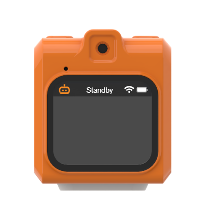

8. WonderMind module supports English recognition and speech. The operating language can be switched directly by using commands such as: **Please speak English.**

#### (3) Special Function Activation

After module preparation is complete, **press** **Button B** **twice** to switch to chat mode. In chat mode, activate the module by saying the wake word **Hello Hiwonder** or **short-pressing** **Button A**.

The module has built-in special functions that can be activated by voice commands during human-robot interaction. Refer to the following phrases to query all currently supported special functions: **① List all supported functions. ② Give an overview of the available functions.**

Refer to the following phrases to activate corresponding special functions:

&emsp;&emsp;1. Weather query: **Check the weather in [location]**.


&emsp;&emsp;2. News broadcast: **① Broadcast today's news. ② Introduce today's hot events.**


&emsp;&emsp;3. Outfit recommendation: **Give an outfit recommendation for today.**


&emsp;&emsp;4. Joke telling: **① Tell a joke. ② Tell a joke to lighten the mood.**


&emsp;&emsp;5. Horoscope query: **Check today's horoscope for [zodiac sign]**.


&emsp;&emsp;6. Music playback: **Play a random song**.

> [!NOTE]
>
> **Lower the module volume before using the music playback function.**

​        


### 4.4.7 Image Transmission Mode

#### (1) Mode Overview

In this mode, the module screen displays real-time camera feed. However, normal dialogue is not supported and dialogue messages are not displayed.


#### (2) Regular Operation Instructions

1. In expression mode, **press** **Button B** **once briefly** to switch to image transmission mode.

2. In chat mode, **press** **Button B** **twice briefly** to switch to image transmission mode.

### 4.4.8 Scene Understanding

1.  After power-on, the module enters the expression interface. Activate the module by saying the **wake word** or **short-pressing** **Button A**. Then instruct the WonderMind Module with one of the following phrases: **① Describe the scene in front of the camera. ② Please take a photo.**

2. After interpreting the command, the module camera activates, captures a real-time image, and briefly displays it on the screen for confirmation. The dialog box then returns the image capture function to be called. This function information can be disregarded. After that, the dialog box displays the analysis statement generated by the large model and broadcasts it simultaneously. The response is generated randomly by the module to ensure appropriate meaning.


